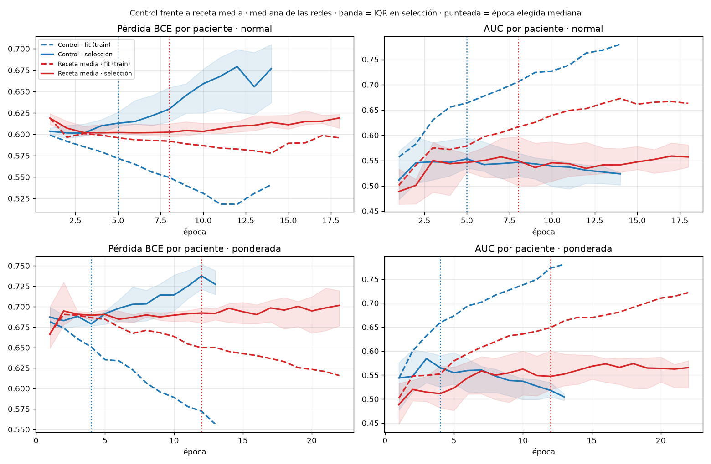

# Lecciones de todo el proyecto y diseño de PartyNet

26/10/2026. Síntesis de los ~30 informes de `main` (resultados 01–31,
`docs/EXPERIMENTOS_DESCARTADOS.md`, auditorías) y de la literatura. Los
informes originales siguen en `main`:
`git show main:docs/EXPERIMENTOS_DESCARTADOS.md`.

## 1. Datos

- Train: **1.097 pacientes, 10.945 cortes** (≈10 por paciente, mín. 5), 322 pCR
  (29,4 %). Test público: 176 pacientes, 53 pCR. Validación privada: 177, solo profesorado.
- Tres cohortes con prevalencias distintas: Duke 21 % (209), I-SPY1 25 % (104),
  I-SPY2 32 % (784). **Solo saber la cohorte da AUC media ≈ 0,549.**
- El subtipo es un predictor fuerte de pCR: HR+/HER2− 14 % (453), triple
  negativo 38 % (354), HER2+ 43 % (287). HR/HER2/volumen están en
  `patients.csv` para casi todas las pacientes de train.
- La auditoría de los 32.835 PNG de train no encontró archivos corruptos ni
  duplicados entre pacientes. Incidencias: ISPY1_1139 tiene EARLY = LATE en
  los diez cortes; ISPY1_1193 tiene un LATE anormalmente brillante; 15 pacientes
  tienen posibles traslaciones entre fases. Se dejan tal cual: son 2/1.097
  y cualquier exclusión debería decidirse sin mirar resultados.

## 2. Qué se probó y qué dio

AUC por paciente con la media de probabilidades de los cortes. «Media» es la
media de AUC de los cinco folds exteriores; los protocolos varían, así que la
tabla es descriptiva.

| Familia (fecha) | Media AUC CV | Nota |
|---|---:|---|
| V001 CNN histórica (30/09) | 0,5945 agrupada | Selección con el propio fold; test 0,546 |
| Cuatro mejoras (05/10): control / Dropout2d / afines / EMA / WD | 0,550 / 0,573 / 0,567 / 0,556 / 0,554 | Todas positivas e inconcluyentes por separado |
| BCE por paciente; lotes mezclados; GroupNorm | 0,540; 0,521; 0,480 | Peores |
| V005/V006 CNN por fases (14/10) | 0,533 / 0,549 | Normal / ponderada |
| **V007 cinética multiescala (21/10)** | **0,577 ± 0,030** | La mejor solo imagen; test 0,608 (ya visto) |
| Híbrida de rasgos (25/10) | 0,567 | Test 0,504 |
| Control 27 (selección por pérdida) | 0,556 ± 0,035 | Referencia de las últimas familias |
| Espacial compacta (25/10) | 0,546 | 105 k parámetros |
| Campo de adquisición (25/10, 2 folds) | 0,550 frente a 0,560 | |
| MixStyle (26/10) | 0,558 | |
| Nativa 256 uniforme / atención (26/10) | 0,535 / 0,540 | |
| Multimodal V002 con clínica (07/10) | 0,7246 agrupada | **No admisible como solución**: usa clínica como entrada |

## 3. Patrones que se repiten

1. **Techo de ≈0,55–0,58**, apenas por encima de la referencia de cohorte
   (0,549). Ni la capacidad (105 k–594 k parámetros), ni la resolución, ni la
   atención, ni la normalización de estilo lo han movido.
2. **Sobreajuste temprano**: la época elegida tiene mediana 2–8 y la brecha AUC
   fit−selección es de 0,2–0,27 al final. La red memoriza cortes correlacionados.
3. **Protocolo con poca potencia**: con unas 220 pacientes exteriores por fold,
   la DE entre folds es 0,03–0,05 y el IC95 % pareado de un Δ mide unos ±0,04.
   Para que el IC excluya el 0, un Δ real tiene que rondar 0,04–0,05. Cada familia
   de 20–40 entrenamientos salía «inconcluyente» casi por construcción.
4. **Selección con 132 pacientes, ruidosa**: el pico de AUC interno (0,71) cayó
   a 0,577 en exterior. Dedicar el 15 % a parar quita datos de fit.
5. **Umbrales**: las políticas de especificidad ≥ 95 % producen sensibilidad
   ≈ 0–7 %. En la demo en directo eso equivale a decir siempre «no pCR».
6. La clínica (subtipo y volumen) contiene la señal que las imágenes no han
   sabido extraer: el multimodal llega a 0,72 y el subtipo por sí solo explica
   gran parte.
7. Los ensembles de semillas y la media de cortes ayudan poco pero de forma
   consistente. Las técnicas «inconcluyentes positivas» (Dropout2d, afines, EMA)
   nunca se combinaron.

## 4. Literatura

- **BreastDCEDL** ([Fridman et al., arXiv 2506.12190](https://arxiv.org/html/2506.12190v3)):
  ViT con las tres fases como RGB, probablemente preentrenado (no admisible aquí).
  Test **0,72** global; I-SPY2 0,78, I-SPY1 0,68, **Duke 0,54**. Sensibilidad 0,27 con
  especificidad 0,95. El volumen tumoral es la variable más importante en sus
  modelos con clínica. Un modelo grande preentrenado sigue sin funcionar en Duke.
- El subtipo molecular se puede predecir desde DCE-MRI: en la literatura, AUC
  ≈ 0,7–0,9 según la cohorte, y más bajas en validación externa
  ([multitarea ER/PR/HER2, arXiv 2601.07001](https://arxiv.org/abs/2601.07001v1)).
  Aprender varias tareas a la vez mejoró la predicción de pCR temprana en
  [arXiv 2502.00051](https://arxiv.org/pdf/2502.00051).
- Las CNN desde cero con pocos datos sobreajustan; ayudan la parametrización
  compartida y los objetivos que regularizan la representación
  ([MIMS, arXiv 1907.02413](https://arxiv.org/pdf/1907.02413)).

## 5. Hipótesis de PartyNet

**Resultado: rechazada** (§6). El modelo final usa el mismo tronco sin tareas
auxiliares y con la receta media.

> Si la representación por corte se obliga a predecir también **HR, HER2 y
> log-volumen tumoral** (objetivos de entrenamiento, nunca entradas), aprende
> rasgos de biología tumoral asociados a pCR en lugar de memorizar cortes o
> cohorte. La AUC exterior debería subir y la brecha de sobreajuste bajar.

Cumple el PDF: CNN 2D propia desde cero, sin preentrenados, un único logit en
inferencia, BCEWithLogitsLoss normal y ponderada (`pos_weight = N0/N1`). Las
variables clínicas solo aparecen como etiquetas auxiliares en train; la
aplicación solo recibe PNG.

### Qué se conserva y qué cambia

| Componente | Decisión | Motivo |
|---|---|---|
| Tronco | Igual que V007: 6 canales (fases + realces firmados), vistas 256/128/64 → 128, 4 bloques 24/48/96/160, avg+max | La mejor media CV; no se vuelve a buscar arquitectura |
| **Cabezas auxiliares** | HR, HER2 (BCE) y log-volumen (Smooth L1), λ = 1 | **Novedad** (§5) |
| Aumentos | Rot90 × flip + afín suave (±5 % escala, ±3 % traslación), idénticos en las tres fases | Los afines dieron +0,016 aislados |
| EMA de pesos | 0,995, con calentamiento | +0,006 aislado; suaviza el óptimo temprano |
| Dropout espacial | 0,10 | +0,022 aislado |
| Optimización | AdamW, LR 3·10⁻⁴, WD 0,01, lote 64, coseno de 40 épocas, warmup 1, bf16 | Receta modal de V007/27 |
| Parada | AUC de paciente en selección (15 %) con media móvil de 3 épocas, paciencia 8, mínimo 6 | En la prueba previa (fold 0, solo selección), la BCE ponderada era mínima en la época 3, con AUC de selección 0,49, mientras la AUC subía a 0,57 en la época 10: con `pos_weight` la BCE mide sobre todo la descalibración |
| Ensemble y TTA | 3 semillas por fold y 4 reflexiones en inferencia | Reduce varianza a coste cero de datos |
| Modelo final | **100 % de train**, épocas = mediana de las elegidas en CV, 5 semillas | Usa las 132 pacientes de selección |
| Umbral | Youden sobre las OOF calibradas de la CV | Sensibilidad útil en la demo; nunca test |

### Comparaciones que hace la CV

- **λ = 1 frente a λ = 0** con la misma pérdida, semillas, roles, inicialización,
  orden de lotes y aumentos. Es la prueba de la hipótesis.
- **Ponderada frente a normal**: requisito del PDF.
- Cada brazo frente a la **referencia de cohorte**. Además se informa de la AUC
  **dentro de cada cohorte**, para separar biología de cohorte, y por subtipo.
- Diagnóstico: AUC de HR/HER2 predichos desde la imagen en exterior. Si salen
  ≈ 0,5, las cabezas no aprendieron y la hipótesis no se ha probado.

### Límites conocidos

- El train ya se ha usado muchas veces: la CV es desarrollo adaptativo. El test
  público (0,608 para V007) ya está visto. La confirmación honesta es la
  validación privada del profesorado.
- La calibración y el umbral salen de las OOF de 3 redes por fold, entrenadas
  con ~746 pacientes. El paquete final tiene 5 redes con 1.097. Es monótono, así
  que la AUC no cambia, pero el punto operativo puede desplazarse.
- El subtipo en el mundo real no se conoce al leer la imagen. Aquí solo se usa
  para entrenar; en inferencia no hace falta.

## 6. Resultados de la rama (26/10/2026)

Tres CV de 5 folds por paciente con los mismos roles y semillas (42, 2026, 7).
Por eso las comparaciones entre recetas son pareadas. AUC exterior por
paciente: media de cortes, de semillas y de 4 reflexiones (TTA). Todo es
desarrollo dentro de train; test y validación privada siguen cerrados.

| Receta y pérdida | Media AUC ± DE | Δ frente al control [IC95 %] | Época elegida | Pico selección | Brecha AUC elegida / final | Tendencia 1–14 |
|---|---:|---|---:|---:|---:|---:|
| Control normal | 0,5802 ± 0,025 | — | 5 | 3 | 0,099 / 0,263 | no medida |
| Control ponderada | 0,5814 ± 0,029 | — | 4 | 2 | 0,083 / 0,264 | no medida |
| Control + aux, normal | 0,5622 ± 0,058 | −0,018 [−0,042; +0,005] | 10 | — | — | — |
| Control + aux, ponderada | 0,5671 ± 0,038 | −0,014 [−0,036; +0,008] | 8 | — | — | — |
| Lenta normal | 0,5494 ± 0,021 | −0,031 [−0,060; −0,002] | 12 | 7 | 0,001 / 0,079 | 14/15 |
| Lenta ponderada | 0,5505 ± 0,038 | −0,031 [−0,060; +0,000] | 12 | 10 | 0,015 / 0,071 | 14/15 |
| **Media normal** | **0,5842 ± 0,036** | **+0,004 [−0,015; +0,022]** | **8** | 6 | 0,064 / 0,144 | 7/15 |
| Media ponderada | 0,5734 ± 0,027 | −0,008 [−0,025; +0,009] | 12 | 11 | 0,067 / 0,162 | 4/15 |

Referencia solo cohorte: 0,549 ± 0,027. La media normal la supera en +0,035
[−0,002; +0,071], con P(Δ ≤ 0) = 0,03. Es lo más cerca que ha estado el
proyecto de demostrar señal por encima de la cohorte, aunque el IC todavía
toca el 0.

### Qué se aprendió

1. **Multitarea (HR, HER2, volumen): rechazada.** La red aprende el volumen
   (ρ ≈ 0,7) pero no el subtipo (AUC HR ≈ 0,53, HER2 ≈ 0,49). El volumen se
   lleva capacidad y la AUC baja, sobre todo dentro de Duke.
2. **El pico temprano venía de cómo se define una época.** Con los ~10 cortes
   casi idénticos de cada paciente, la época 3 equivale a ~30 pasadas por
   paciente. El control memorizaba: la BCE de selección sube desde la época 3
   y la brecha final es 0,26.
3. **Regularizar fuerte estira las curvas, pero quita señal.** La receta lenta
   (LR 2e-4, WD 0,05, dropout 0,5, giro ±15°, cutout, label smoothing) cumple
   la tendencia 1–14 en 14/15 redes, pero su AUC cae al nivel de la cohorte:
   infraajuste.
4. **Basta con cambiar el muestreo.** La receta media conserva la
   regularización del control y solo ve 3 cortes al azar por paciente y época
   (más un giro de ±10° y EMA 0,98). Elige el doble de tarde (8 frente a 4),
   reduce la brecha final de 0,26 a 0,14 y discrimina igual o algo mejor. La
   BCE de selección deja de divergir, aunque sigue sin bajar: lo que aprende
   generaliza poco.
5. **Normal frente a ponderada:** sin diferencia relevante en ninguna receta
   (|Δ| ≤ 0,014, todos los IC incluyen 0). Cumple la comparación del PDF.
6. **Criterios fijados antes de la CV media:** pico entre 10 y 15, tendencia en
   ≥ 50 % de las redes y Δ ≥ −0,01. Ningún brazo cumple los tres. Se toman como
   orientativos y se elige el de mejor AUC media, la regla prefijada desde el
   inicio.

## 7. Modelo final: `modelos/party_final/`

- **Receta media, pérdida normal, sin tareas auxiliares.** 8 épocas (mediana
  de las elegidas en la CV), 5 semillas (42, 2026, 7, 1234, 31415), todas las
  1.097 pacientes de train. 593.716 parámetros por red; unos 25 s por red en
  la RTX 3090, con 7,3 GB de memoria máxima.
- **Inferencia:** PNG/255, TTA con 4 reflexiones, media de las 5 redes; para
  cada paciente, media de sus cortes. GPU y CPU coinciden con una diferencia
  de unas 6 millonésimas.
- **Política, ajustada solo con las OOF de la CV:** Platt a = 0,849,
  b = −0,100. Umbral Youden 0,297 sobre la probabilidad calibrada. En OOF:
  sensibilidad 55,9 %, especificidad 55,4 %, F1 pCR 0,425 y macro-F1 0,531
  (frente a 0,414 de decir siempre «no pCR»).
- El paquete completo (5 pesos, `paquete.json` con SHA-256, historias y
  registro; ≈12 MB) está versionado en Git.
- **Test aún no evaluado.** `evaluar-test` se ejecuta una sola vez y escribe la
  marca en el paquete.
