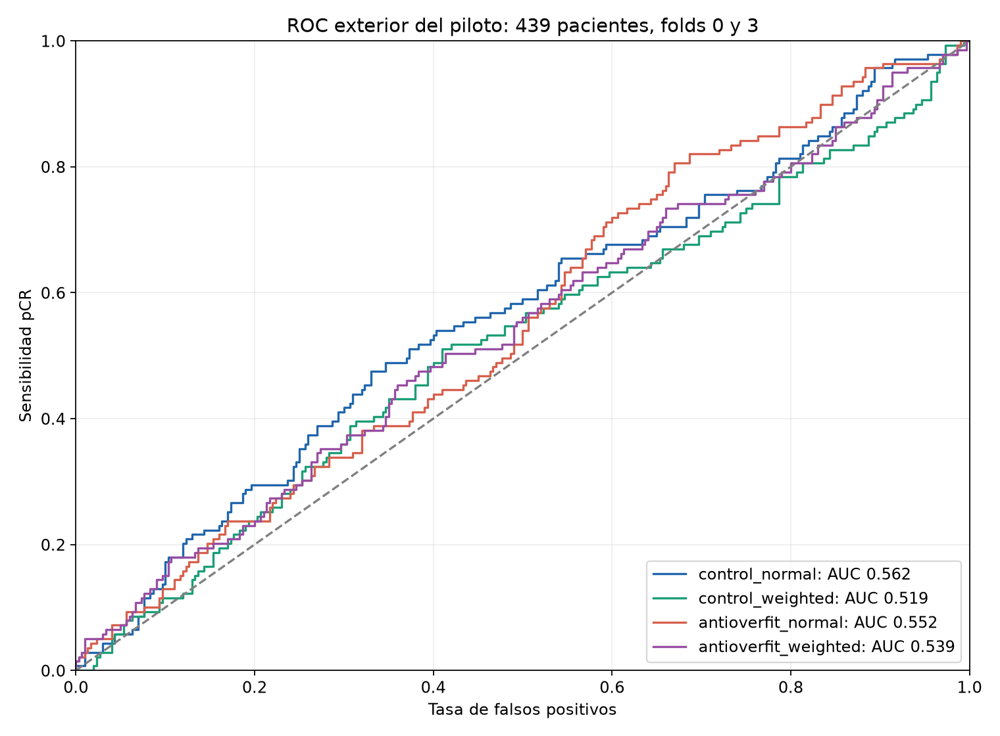
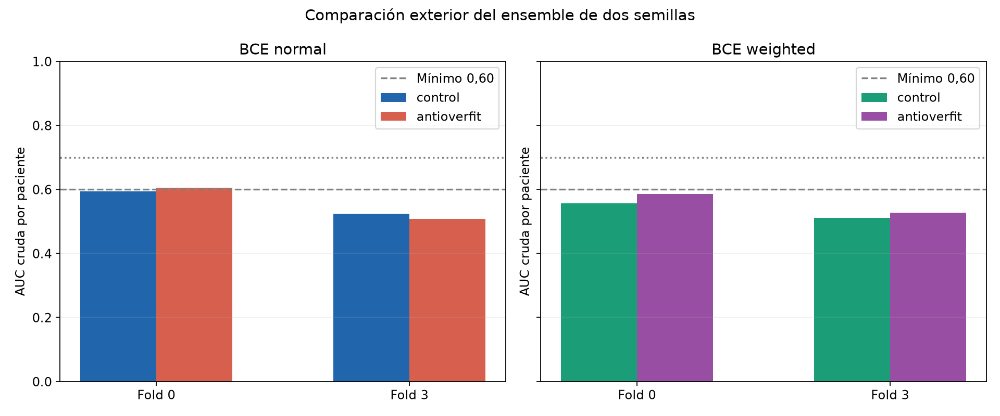
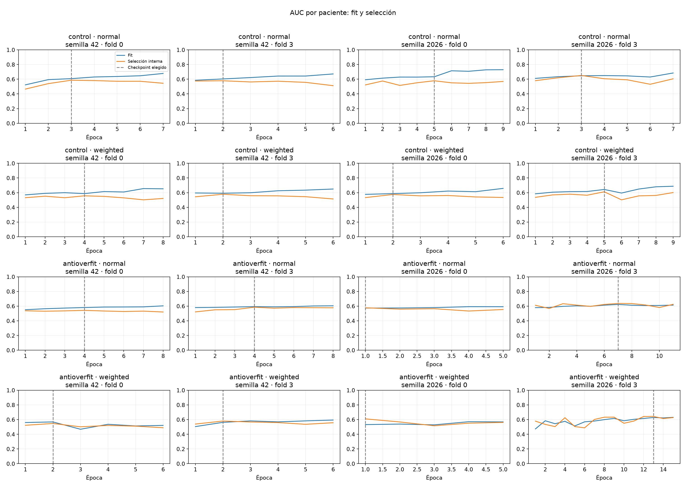
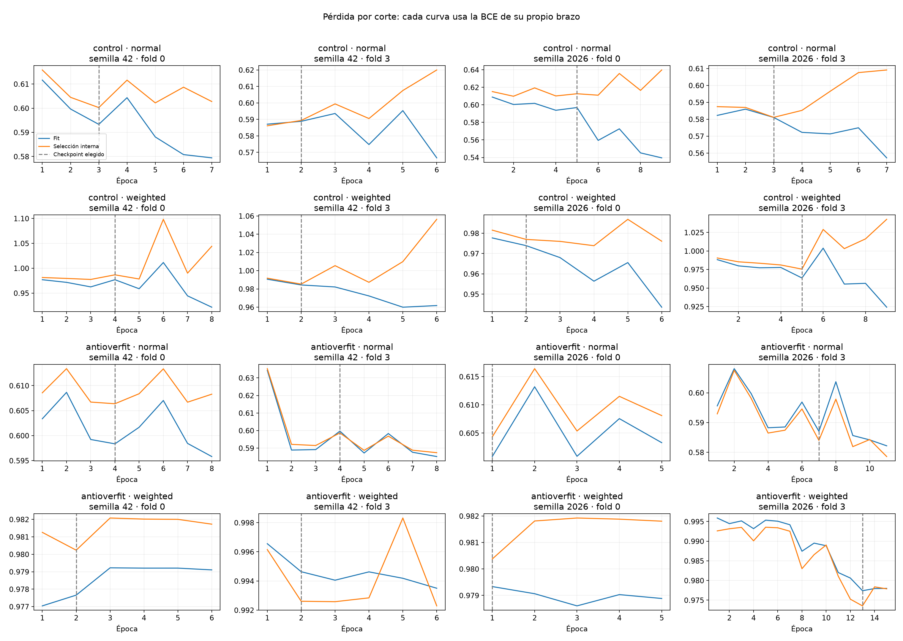

# Piloto anti-sobreajuste: resultados y preparación de entrega

21/10/2026. Entrega local preparada; no se realiza commit ni push.

Se completaron 16 entrenamientos y 122 épocas en 26.34 minutos. La evaluación exterior del piloto reúne 439 pacientes (139 pCR), de los folds 0 y 3. Cada paciente se evalúa con las dos semillas de su fold, sin entrar en el entrenamiento ni en la selección de esos modelos. Test y validación privada siguen cerrados.

**Conclusión:** el paquete reduce la brecha fit−selección, pero no alcanza AUC media 0,60. La BCE ponderada cumple el filtro exploratorio (+0,0232 de AUC media); su intervalo de diferencia incluye cero. La BCE normal no mejora. El candidato ponderado tampoco supera la estimación puntual del control normal (0,5571 frente a 0,5593). V002 permanece activo; no se inicia otra matriz.

## Resultado principal

| BCE | Control: AUC media | Anti-overfit: AUC media | Diferencia | IC95 % diferencia media | Gate prefijado |
|---|---:|---:|---:|---|---|
| normal | 0.559266 | 0.556672 | -0.002594 | [-0.029726; +0.024499] | False |
| weighted | 0.533843 | 0.557058 | +0.023215 | [-0.029557; +0.072034] | True |

El gate exige +0,01 de AUC media, ningún fold peor en más de 0,02 y mediana de brecha fit−selección del checkpoint no mayor. Es un filtro exploratorio: incluso si se supera, solo justificaría completar cinco folds con protocolo nuevo. No equivale a generalización independiente ni a autorización para abrir test.

## Discriminación, pérdidas y errores

Probabilidades crudas, sin calibración posterior. Todos los recuentos siguientes usan umbral fijo 0,5; no se optimiza ese umbral con estas pacientes. Positivo significa pCR, no presencia de cáncer. La AUC agrupada mezcla salidas de modelos de folds diferentes; la métrica principal prefijada es la media de AUC por fold.

| Brazo / BCE | AUC agrupada | IC95 % | AP | Log-loss | Brier | FP | FN | Sensibilidad | Especificidad |
|---|---:|---|---:|---:|---:|---:|---:|---:|---:|
| control_normal | 0.561894 | [0.502391; 0.618662] | 0.373135 | 0.620581 | 0.214669 | 0 | 139 | 0.00% | 100.00% |
| control_weighted | 0.518849 | [0.471341; 0.569329] | 0.335039 | 0.709951 | 0.258416 | 232 | 36 | 74.10% | 22.67% |
| antioverfit_normal | 0.552134 | [0.511893; 0.591727] | 0.368557 | 0.620594 | 0.214816 | 0 | 139 | 0.00% | 100.00% |
| antioverfit_weighted | 0.538609 | [0.484260; 0.596406] | 0.373575 | 0.687336 | 0.247096 | 52 | 110 | 20.86% | 82.67% |

A umbral 0,5, ambas BCE normales predicen todas las pacientes como no pCR. En la ponderada, anti-overfit reduce FP de 232 a 52, pero aumenta FN de 36 a 110 y baja TP de 103 a 29. Es un cambio de compromiso entre sensibilidad y especificidad, no una mejora simultánea de ambos errores. No se reajusta el umbral con estas OOF.

## Sobreajuste

| Brazo / BCE | Brecha mediana en checkpoint | Brecha mediana al final | Mediana AUC fit elegida | Mediana AUC selección elegida |
|---|---:|---:|---:|---:|
| control_normal | 0.022973 | 0.146538 | 0.620506 | 0.582713 |
| control_weighted | 0.021679 | 0.127340 | 0.589616 | 0.577035 |
| antioverfit_normal | 0.001833 | 0.032580 | 0.586782 | 0.581414 |
| antioverfit_weighted | -0.016119 | 0.019223 | 0.565378 | 0.594978 |

Una brecha menor también puede reflejar menor aprendizaje en fit. Se requiere mejora exterior para considerar útil la regularización; no basta con acercar curvas.

## Reproducibilidad y límites

- CNN temporal simple desde cero, una sola escala, 551.913 parámetros; PRE/EARLY/LATE, sin clínica.
- Control frente a un paquete conjunto: lotes de seis pacientes, igual peso por paciente, Dropout2d 0,10 y aumentos suaves comunes a las fases. No identifica cuál de sus componentes produce el efecto.
- AdamW, LR 0,0008, WD 0,001, máximo 15 épocas, mínimo 4 y paciencia 4. Semillas 42/2026.
- El arreglo local del informe corrige un desfase de una época: `best_epoch` ya está numerado desde uno. No altera pesos, arquitectura, selección ni entrenamiento. Prueba de regresión incluida.
- 62 pruebas y cuatro pruebas cortas GPU pasadas; estas últimas no entran en selección ni métricas.
- Bootstrap pareado de 2.000 remuestreos por fold y clase, semilla 20261021. Los intervalos condicionan a estos modelos y no recogen la variación de nuevos entrenamientos ni toda la búsqueda histórica.
- Solo dos folds y antecedentes de exploración en train: desarrollo adaptativo, no evaluación independiente.
- No se modifican V002 ni las siete versiones publicadas. No se inicia otro entrenamiento.

## Entrega local

Los dieciséis pesos de inferencia se conservan en un paquete específico de piloto bajo `modelos/pilotos/`, con código congelado y manifiesto. Contiene cuatro modelos por brazo/BCE (dos semillas × dos folds). No es una versión final de diez modelos ni se integra en la aplicación. Su inferencia conjunta usa cuatro modelos para entradas futuras; las métricas anteriores usan solo las dos semillas del fold que excluye a cada paciente.

Se excluyen datasets, checkpoints con optimizador/RNG y pruebas cortas. Los artefactos quedan preparados para revisar y publicar únicamente cuando el usuario lo indique.

- [Métricas completas](evaluacion_recalculada.json).
- [Protocolo real y hashes de código](protocolo_ejecutado.json).
- [Configuraciones, resúmenes y entornos](configuraciones_y_resumenes.json).
- [Historias completas](historias.csv).
- [Auditoría final de los 16 entrenamientos](verificacion_final.json).

- [Verificación de carga e inferencia del paquete aislado](verificacion_paquete.json).

