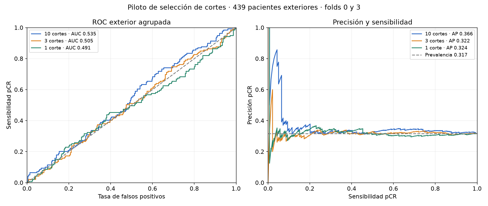
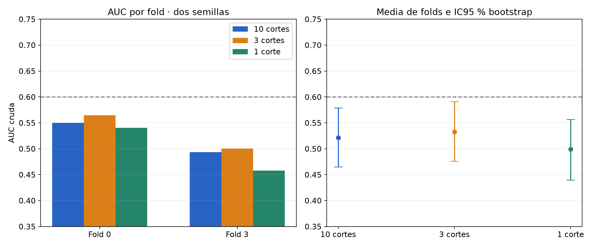
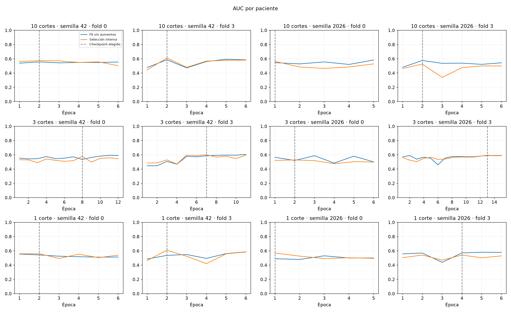
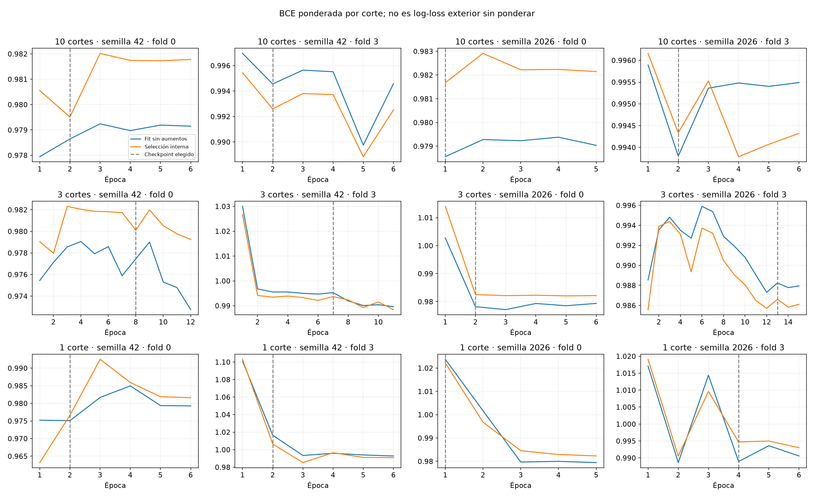
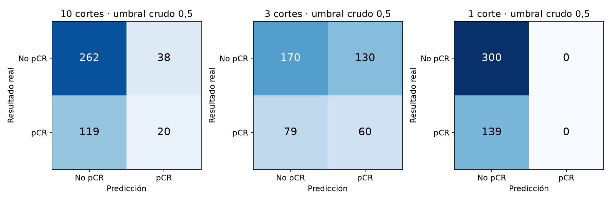
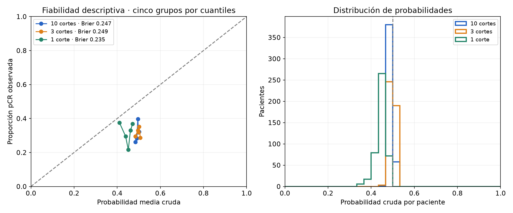

# Piloto de selección de cortes: resultados

22/10/2026. Informe local; no se realiza commit ni push.

Se completaron 12 entrenamientos y 90 épocas en 11.53 minutos, incluyendo preparación y auditoría. Evaluación exterior: 439 pacientes, 139 con pCR y 300 sin pCR. Dos semillas por fold y dos folds exteriores (0/3). Test y validación privada cerrados.

**Resultado:** la mayor AUC media puntual es 0.5328, con 3 cortes. Ningún brazo alcanza la AUC media 0,60; tampoco se alcanza 0,70. V002 permanece activo. No se inicia otro entrenamiento.

## Comparación principal

| Cortes en fit | AUC fold 0 | AUC fold 3 | Media AUC (principal) | IC95 % media | Delta frente a 10 | IC95 % delta pareada | Filtro |
|---|---:|---:|---:|---|---:|---|---|
| 10 | 0.5498 | 0.4932 | 0.5215 | [0.4646; 0.5786] | Referencia | — | — |
| 3 | 0.5649 | 0.5007 | 0.5328 | [0.4755; 0.5907] | +0.0113 | [-0.0304; +0.0525] | False |
| 1 | 0.5402 | 0.4581 | 0.4992 | [0.4396; 0.5564] | -0.0224 | [-0.0683; +0.0262] | False |

El filtro prefijado exige +0,01 de AUC media, ningún fold peor en más de 0,02 y mediana de brecha fit−selección del checkpoint no mayor. Es exploratorio: dos comparaciones y antecedentes de búsqueda en train impiden tratarlo como confirmación. Incluso un filtro superado no autoriza abrir test, promocionar modelo ni iniciar otra tanda.

Tres cortes mejora la media puntual en 0,0113 y mejora ligeramente ambos folds, pero no pasa la regla de brecha prefijada: −0,0109 frente a −0,0174 con diez. Ambas brechas son negativas; este incumplimiento no demuestra por sí solo mayor sobreajuste. Un corte empeora la media en 0,0224. La reducción de cortes no aporta una mejora suficiente y confirmada en este piloto.

Los IC usan 2.000 remuestreos pareados por fold y clase, semilla 20261022. Condicionan a los modelos ya entrenados; no recogen la variación de nuevas semillas, folds o todo el desarrollo adaptativo. No se corrigen por comparaciones múltiples.

## Métricas y errores

AUC agrupada y AP usan probabilidades crudas. La métrica principal es la media por fold; agrupar mezcla escalas de modelos distintos. Log-loss y Brier se calculan sin ponderar por paciente. No se calibra ni se elige umbral con las pacientes exteriores.

| Cortes | AUC agrupada | IC95 % | AP | Log-loss | Brier | Sensibilidad | Especificidad | Precisión pCR | F1 pCR |
|---|---:|---|---:|---:|---:|---:|---:|---:|---:|
| 10 | 0.5355 | [0.5030; 0.5698] | 0.3660 | 0.6878 | 0.2473 | 14.39% | 87.33% | 34.48% | 0.2030 |
| 3 | 0.5051 | [0.4535; 0.5583] | 0.3217 | 0.6914 | 0.2491 | 43.17% | 56.67% | 31.58% | 0.3647 |
| 1 | 0.4908 | [0.4305; 0.5498] | 0.3239 | 0.6622 | 0.2346 | 0.00% | 100.00% | 0.00% | 0.0000 |

Los errores usan el umbral fijo 0,5 crudo. Positivo significa respuesta patológica completa (pCR), no presencia de cáncer. FP: predice pCR sin alcanzarla; FN: predice no pCR aunque se alcanza. Cambiar de FP a FN no constituye una mejora simultánea.

| Cortes | TN | FP | FN | TP |
|---|---:|---:|---:|---:|
| 10 | 262 | 38 | 119 | 20 |
| 3 | 170 | 130 | 79 | 60 |
| 1 | 300 | 0 | 139 | 0 |

## Sobreajuste y aprendizaje

| Cortes | Brecha elegida mediana | Brecha final mediana | AUC fit elegida mediana | AUC selección elegida mediana | Épocas elegidas (42f0,42f3,2026f0,2026f3) |
|---|---:|---:|---:|---:|---|
| 10 | -0.0174 | +0.0474 | 0.5668 | 0.5691 | [2, 2, 1, 2] |
| 3 | -0.0109 | +0.0059 | 0.5611 | 0.5864 | [8, 7, 2, 13] |
| 1 | -0.0444 | +0.0038 | 0.5398 | 0.5648 | [2, 2, 1, 4] |

La brecha se calcula en los checkpoints elegidos exclusivamente por AUC interna. Esa selección favorece métricas internas optimistas; una brecha pequeña o negativa no demuestra generalización. Hay que considerar también la AUC de fit, la evolución de ambas curvas y las AUC exteriores. No se interrumpieron ejecuciones por ruido de pocas épocas: se respetaron parada temprana y máximo prefijados. No se ajustan parámetros después de ver estas OOF.

El problema observado no se explica solo por una brecha grande: las medianas de AUC de fit elegidas son 0,5668, 0,5611 y 0,5398. El modelo también discrimina poco en los datos de ajuste evaluados sin aumentos. Esto apunta a aprendizaje predictivo limitado en esta receta, sin identificar por sí solo si la causa es la representación de las imágenes, la optimización o la señal disponible. Con tres cortes se reduce la brecha final mediana de 0,0474 a 0,0059, pero esa reducción no se traduce en AUC exterior suficiente.

Las probabilidades de diez y tres cortes están muy agrupadas alrededor de 0,5; con uno ninguna llega a 0,5 y se predice no pCR en las 439 pacientes. La BCE ponderada no garantiza probabilidades calibradas. Las curvas de fiabilidad son descriptivas; no se reajustan con estas pacientes. La especificidad del 100 % del brazo de un corte debe leerse junto a sensibilidad del 0 % y AUC media 0,4992.

## Qué se ha probado

- Misma CNNTemporalSimple de 551.913 parámetros, desde cero, tres fases PRE/EARLY/LATE, una escala 256×256, sin clínica.
- Tres brazos nuevos y comparables: hasta 10, 3 o 1 corte por paciente solo en fit. Selección interna y exterior usan todos.
- BCE ponderada por pacientes, con idéntico pos_weight y pacientes en los tres brazos de cada fold. No se reutiliza el piloto anterior como control, porque calculaba el peso de clase por corte.
- AdamW LR 0,0008, WD 0,001, máximo 15 épocas, mínimo 4, paciencia 4; lotes de seis pacientes, mismo peso total por paciente. Semillas 42/2026, separación por paciente/cohorte/clase. Sin cambio de arquitectura ni protocolo durante la ejecución.
- El selector fijo utiliza un medoide de las tres fases reducidas a 32×32; para tres cortes añade diversidad y separación axial. No usa pCR, máscaras ni una regla de área tumoral. Se prepara por paciente, sin aprender parámetros entre pacientes.
- Correlación mediana de descriptores en desarrollo: 10 cortes 0.9312; 3 cortes 0.8868. Con uno no se define correlación por pares. La reducción de correlación de píxeles no garantiza más información predictiva.
- Reducir cortes cambia imágenes por lote, BatchNorm y variabilidad del gradiente. El estudio no aísla solo redundancia.
- 66 tests y tres pruebas técnicas GPU pasados. Las pruebas técnicas y cualquier piloto CPU se excluyen de esta comparación.
- Finitud, pasos AdamW/AMP, hashes y modelos previos auditados. No se modifica V002 ni ninguna versión o piloto anterior.

## Entrega y límites

Se conservan doce pesos exclusivos de inferencia como piloto p002 en modelos/pilotos/, con configuraciones reales, fuentes congeladas y hashes. No es una versión productiva ni un ensemble de cinco folds. Para entradas futuras hay cuatro modelos por k; estas métricas usan solo las dos semillas del fold que excluye cada paciente. No se utilizan datos del test para métricas, calibración o umbrales. No se incluyen imágenes ni checkpoints con optimizador/RNG.

Las cifras históricas de V002 o de otros experimentos con clínica, arquitectura, entrenamiento o folds distintos no constituyen controles equivalentes. La comparación válida de esta tanda es entre sus tres brazos nuevos.

- [Métricas completas e intervalos](evaluacion_recalculada.json).
- [Configuraciones, resúmenes y entornos](configuraciones_y_resumenes.json).
- [Protocolo congelado y hashes](protocolo_ejecutado.json).
- [Preparación del selector](preparacion.json).
- [Auditoría de pacientes y pesos](verificacion_particiones.json).
- [Auditoría final](verificacion_final.json).
- [Verificación del paquete aislado](verificacion_paquete.json).

