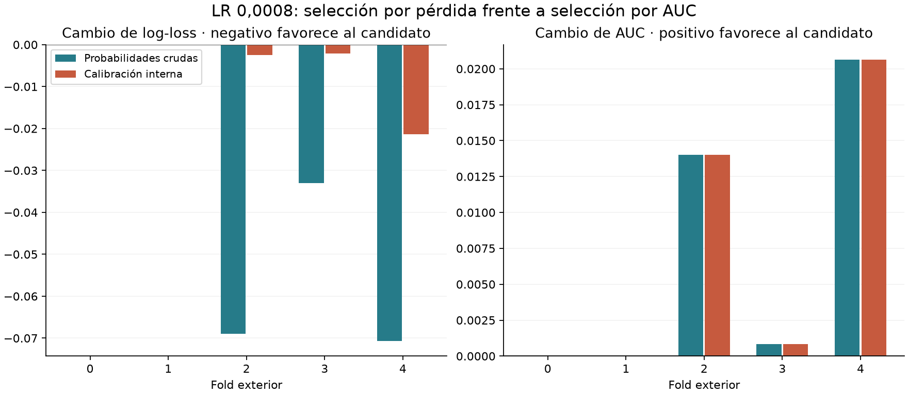
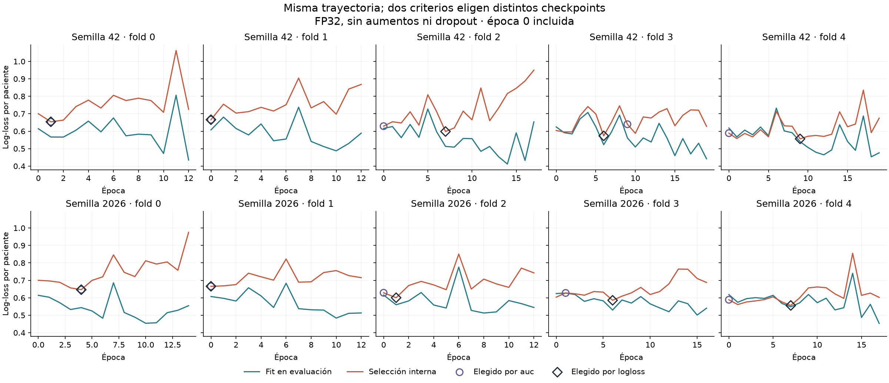

# Candidato multimodal: LR actual y selección por pérdida

Se reutilizaron los diez checkpoints ya entrenados con LR 0,0008 y selección interna por log-loss.
El candidato queda preparado y versionable; v002 continúa como base activa.

## Comparación equiparada

El control y el candidato comparten datos, inicialización y trayectoria. Solo cambia el checkpoint elegido.
Las métricas corresponden a 1.097 pacientes de folds exteriores que no eligieron épocas ni calibración.

| Escala | Selector | AUC media folds | AUC OOF | AP | Log-loss | Brier |
|---|---|---:|---:|---:|---:|---:|
| raw | auc | 0.704684 | 0.701968 | 0.494831 | 0.617650 | 0.213613 |
| raw | logloss | 0.711780 | 0.706067 | 0.514256 | 0.583075 | 0.197349 |
| calibrated_inner | auc | 0.704684 | 0.694037 | 0.485814 | 0.561517 | 0.187723 |
| calibrated_inner | logloss | 0.711780 | 0.698974 | 0.509181 | 0.556335 | 0.185745 |

Delta log-loss cruda: -0.034575. Tras calibración interna: -0.005183; IC98,33% condicionado [-0.014431, +0.003966].

Después de calibrar, el intervalo incluye cero: no se demuestra una ventaja adicional en log-loss.

## Qué aportó seleccionar por pérdida

La pérdida cruda mejora en tres folds y coincide en dos, donde se eligen los mismos pesos. Seis de los diez checkpoints cambian: el selector AUC conserva seis épocas 0 y el de pérdida conserva dos.
La AUC media cruda aumenta en estimación puntual, pero su intervalo de diferencia incluye cero.

Las curvas de ambos selectores son la misma trayectoria. Elegir otra época mejora el modelo conservado, pero no elimina el sobreajuste que aparece al prolongar el aprendizaje.

## Calibración y preparación de la versión

Para evaluar calibración, se promedian las dos semillas por corte de selección interna y se agrega por mediana. Platt y Youden se ajustan con esas pacientes y se aplican al fold exterior. Las etiquetas exteriores no ajustan el calibrador ni el umbral. El calibrador utiliza el mismo subconjunto interno que eligió el checkpoint; la evaluación exterior mantiene esa selección separada.

El manifiesto operativo tiene una calibración distinta: Platt y Youden ajustados con todas las OOF. Sus métricas son aparentes y están separadas en resumen.json. No se presentan como evaluación independiente.

Umbral operativo candidato: 0.3063397710. La inferencia usa diez modelos; cada predicción OOF se calculó con los dos modelos de su fold. La transferencia de calibración al ensemble completo necesita confirmación externa.

## Decisión

Conservar LR 0,0008 y selección por pérdida como candidato reproducible. No sustituir v002 por comparar su AUC histórica de 0,724568 con esta AUC: el protocolo y la fracción de aprendizaje son diferentes. La evidencia disponible no demuestra superioridad sobre v002 en pacientes nuevas.

Análisis secundario después de elegir candidato sobre desarrollo observado. Calibradores de evaluación ajustados solo con selección interna; los intervalos condicionan a predicciones fijas. No es confirmación externa.
No se abrieron imágenes de test ni validación privada.

## Reproducción y evidencia

`.venv/bin/python -B -m cancer_mama.informe_loss` reconstruye el análisis desde la evidencia local.
`--solo-presentacion` regenera únicamente el informe y las figuras. Los archivos entradas_sha256.json, epocas.csv, metricas_folds.csv, calibradores_internos.json y las OOF conservan la trazabilidad del diagnóstico.
