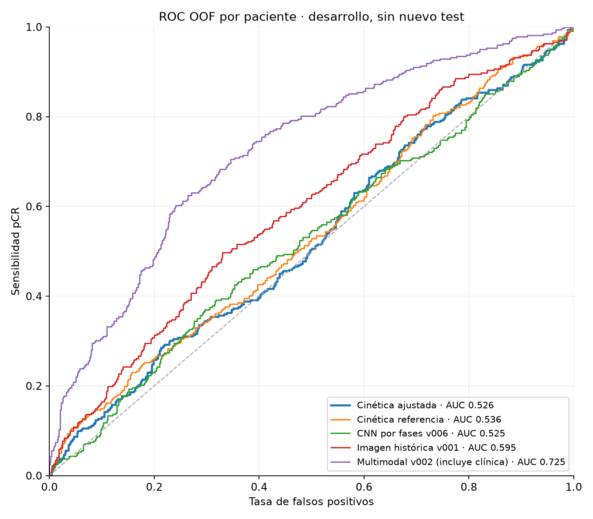
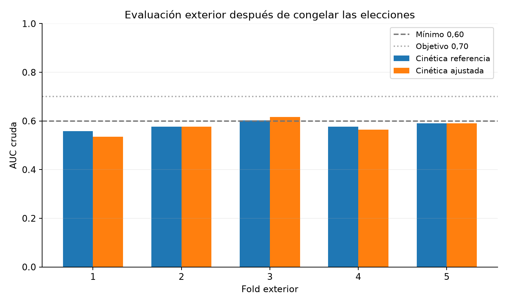
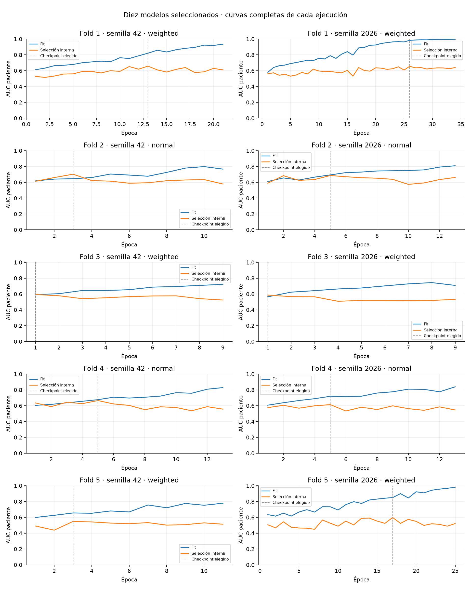
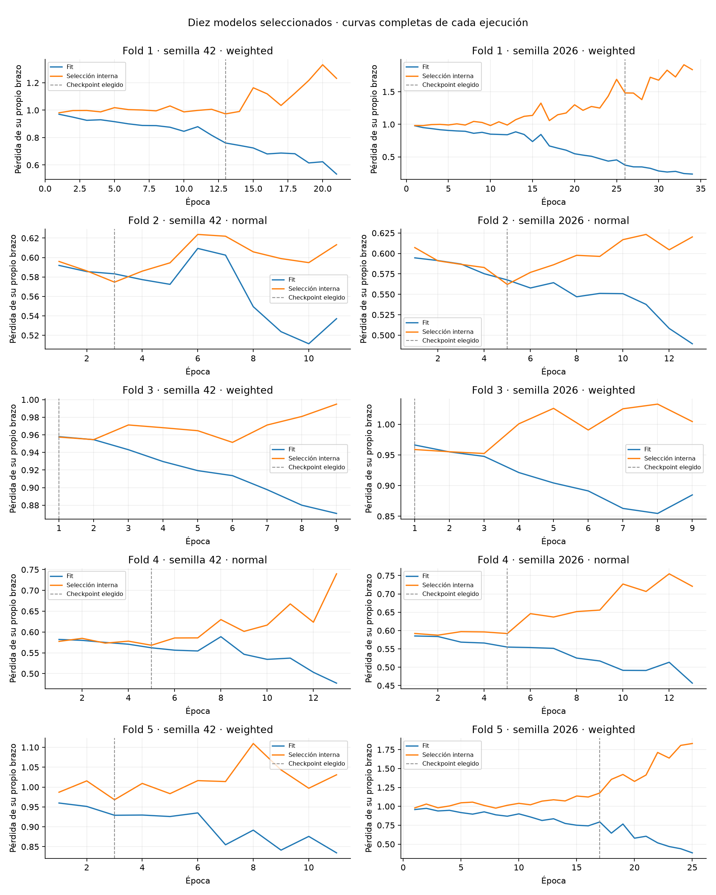

# CNN cinética multiescala: resultado del ajuste de entrenamiento

21/10/2026. **Ensayo cerrado: no alcanza el mínimo AUC 0,60 ni el objetivo 0,70.**
La arquitectura se conserva exactamente como en `39bd951`: 593.521 parámetros.
Se guardan los diez pesos seleccionados como **v007_cnn_cinetica_multiescala_20261021**,
con estado `ensayo_insuficiente_conservado`. V002 continúa activo y no se inicia
otro entrenamiento tras este ensayo.

## Resultado exterior

Evaluación OOF de 1.097 pacientes: 322 pCR y 775 no pCR. Cada paciente se evalúa
con modelos cuyo entrenamiento y selección interna no incluyen a esa paciente.
La selección de hiperparámetros, pérdida, checkpoint, calibración y umbral se
realiza dentro del fold. Las cinco elecciones se congelan antes de cargar las
imágenes exteriores. No se han cargado imágenes del test reservado.

| Métrica | Cinética de referencia | Cinética ajustada |
|---|---:|---:|
| AUC OOF global cruda | 0,535981 | **0,526404** |
| IC95 % de AUC global cruda | [0,511751; 0,560777] | [0,498565; 0,552856] |
| Media de AUC cruda por fold ± desviación | 0,581014 ± 0,016781 | **0,576593 ± 0,030063** |
| AUC global con calibración interna por fold | 0,578982 | **0,561803** |
| Average precision sin calibrar | 0,341442 | 0,325114 |
| Log-loss con calibración interna | 0,604072 | 0,613787 |
| Brier con calibración interna | 0,205838 | 0,209418 |

El ajuste cambia la AUC global en **−0,009577**, IC95 % pareado
**[−0,028690; +0,008952]**, frente a la misma red de referencia. No hay evidencia
de mejora. Tampoco mejora las estimaciones puntuales de media por fold, AP,
pérdida ni Brier. El intervalo de AUC global del candidato incluye 0,50.

Las tres AUC anteriores responden a agregaciones distintas. La media por fold
evalúa la ordenación dentro de cada partición. La AUC global cruda mezcla
salidas de modelos diferentes, incluidas BCE normal y ponderada, cuyas escalas
no son necesariamente comparables. La calibración interna permite informar
también una AUC global de probabilidades calibradas. **Ninguna alcanza 0,60**;
no se escoge retrospectivamente una agregación para presentar éxito.

## Sensibilidad, especificidad y errores

La calibración y el umbral de cada fold se ajustan con sus pacientes de selección
interna. El objetivo operativo era máxima sensibilidad con especificidad interna
de al menos el 90 %. La tabla reúne las decisiones exteriores de esos umbrales;
no aplica el umbral global del paquete archivado a las mismas OOF.

| Métrica exterior con umbrales internos | Referencia | Ajustada |
|---|---:|---:|
| Verdaderos negativos (TN) | 720 | 701 |
| Falsos positivos (FP) | 55 | **74** |
| Falsos negativos (FN) | 281 | **281** |
| Verdaderos positivos (TP) | 41 | **41** |
| Sensibilidad pCR | 12,73 % | **12,73 %** |
| Especificidad | 92,90 % | **90,45 %** |
| Balanced accuracy | 0,528181 | 0,515923 |
| Macro-F1 | 0,503492 | 0,492797 |

El ajuste añade **19 FP sin evitar ningún FN** frente al control. «Positivo»
significa respuesta patológica completa, no presencia de cáncer. Estos recuentos
son de desarrollo y no se extrapolan a pacientes nuevas.

## Selección interna y resultado de cada fold

La referencia utiliza LR 0,0008 y weight decay 0,001; elige BCE normal o ponderada
solo con validación interna. El candidato puede elegir además LR 0,0003 y
weight decay 0,001 o 0,01. En cada alternativa se promedian las probabilidades
de las semillas 42 y 2026 y los cortes de cada paciente.

| Fold | Opción elegida | BCE | AUC interna elegida | AUC exterior ajustada | AUC exterior referencia |
|---|---|---|---:|---:|---:|
| 1 | LR 0,0003 / WD 0,01 | Ponderada | 0,683209 | 0,534879 | 0,558216 |
| 2 | Referencia | Normal | 0,709953 | 0,576741 | 0,576741 |
| 3 | LR 0,0003 / WD 0,01 | Ponderada | 0,601323 | 0,615749 | 0,602748 |
| 4 | LR 0,0003 / WD 0,01 | Normal | 0,658037 | 0,564782 | 0,576552 |
| 5 | Referencia | Ponderada | 0,593604 | 0,590816 | 0,590816 |

El AUC interno 0,710 del segundo fold no se sostiene en su evaluación exterior:
queda en 0,577. Los informes de seguimiento se referían a selección interna,
no al rendimiento final. Elegir entre más opciones mejora el máximo interno,
pero en este ensayo no proporciona una mejora exterior.

## Sobreajuste y funcionamiento técnico

Las 60 ejecuciones completan **948 épocas** y **220.884 pasos de AdamW**, todos
aplicados, sin pasos omitidos por AMP. Los pesos e historiales son finitos y
los hashes de los artefactos coinciden. Entrenamiento y evaluación terminaron
el 21/10/2026 entre las **13:43:27 y las 17:00:37**, Europe/Madrid:
**3 h 17 min 10 s**. Las pruebas cortas se excluyen de la selección.

La búsqueda conserva lote 32, aumentos geométricos conjuntos, AdamW, coseno,
FP16/AMP, clipping 5, máximo 40 épocas, mínimo 8 y paciencia 8. La tasa mínima
es 0,00001. La arquitectura, recortes, filtros, inicialización y dropout no
cambian entre alternativas. Se usan solo PNG PRE/EARLY/LATE; ninguna variable
clínica ni preentrenamiento.

En los diez modelos elegidos, la mediana de la época seleccionada es **5**.
La mediana de las brechas AUC fit − selección por modelo pasa de **0,058252**
en el checkpoint elegido a **0,268942** en la última época. Los diez terminan
con pérdida interna mayor que en su checkpoint elegido; esto ocurre en 59 de
las 60 ejecuciones. La parada temprana evita conservar muchos finales peores,
pero **no elimina el sobreajuste ni produce discriminación exterior suficiente**.
No se interpreta una menor brecha inicial como demostración de utilidad.

## Referencias históricas

| Modelo | AUC global OOF cruda | AP sin calibrar |
|---|---:|---:|
| CNN cinética ajustada, v007 | **0,526404** | 0,325114 |
| CNN cinética referencia de este ensayo | 0,535981 | 0,341442 |
| CNN por fases ponderada, v006 | 0,524572 | 0,317948 |
| CNN solo imagen histórica, v001 | 0,594510 | 0,377397 |
| Multimodal original con clínica, v002 | 0,724568 | 0,531646 |

Respecto a v006, la diferencia es **+0,001831**, IC95 % pareado
**[−0,037750; +0,040400]**: no demuestra mejora. Respecto a la imagen histórica,
es **−0,068107**, IC95 % **[−0,102752; −0,034152]**. La comparación con v002
es descriptiva: usa información clínica y un procedimiento histórico de selección
distinto. No constituye una comparación controlada de arquitecturas visuales.

Se emplean 2.000 remuestreos pareados por paciente, estratificados por fold,
cohorte y clase, con semilla 20261021. Los intervalos condicionan a los modelos
ya entrenados: no repiten entrenamiento/selección ni corrigen toda la búsqueda
histórica. Las OOF siguen siendo evidencia de desarrollo, no test independiente.

## Paquete conservado y decisión

V007 guarda los **diez pesos elegidos por selección interna**, aunque la
referencia tenga mejores métricas exteriores. Se conserva el procedimiento
prefijado y no se sustituye después el candidato por el ganador de las OOF.
Los checkpoints completos de las 60 ejecuciones y los pesos de control siguen
localmente; el paquete público contiene únicamente pesos de inferencia.

La política global archivada se ajusta con todas las OOF de desarrollo para
una posible prueba independiente futura: Platt con pendiente **0,0982743656**,
intercepto **−0,8330288655** y umbral **0,3087942921**. No es constante, pero
comprime la escala de probabilidades. **No es la calibración por fold ni el
umbral usado en la tabla de FP/FN**. No se presentan sus métricas aparentes como
test ni como evaluación exterior.

Nota de procedencia: algunas calibraciones por fold conservan en `informe.json`
la etiqueta genérica `fit_data: train_oof` de la función común. El código
`evaluate_choice` las ajusta realmente con `selection_patients.csv` interno;
no usa el fold exterior. Se conserva el resultado original y se aclara aquí
la procedencia. La política global del paquete sí identifica explícitamente
su ajuste sobre todas las OOF para uso futuro.

**Decisión:** registrar el ensayo como insuficiente, conservar v007 con sus
fuentes y evidencia, mantener V002 activo y revisar con el usuario los siguientes
pasos. No se inicia otra búsqueda ni se reabre test para decidir.

## Evidencia

- [Métricas recalculadas, intervalos y política futura](evaluacion.json).
- [Selecciones congeladas antes de evaluar exterior](seleccion_congelada.json).
- [Configuración y protocolo de las 60 ejecuciones](protocolo.json).
- [Configuraciones, resúmenes y entornos completos](ejecuciones.json).
- [Historiales completos](historias.csv) y [diagnóstico por ejecución](diagnostico_ejecuciones.csv).
- [OOF ajustada](oof_pacientes_selected.csv) y [OOF referencia](oof_pacientes_reference.csv).
- [Predicciones de selección interna](predicciones_seleccion.csv).
- [Auditoría de los 60 entrenamientos](verificacion_entrenamiento.json).
- [Verificación de publicación y paquete](verificacion_publicacion.json).
- [Recopilador reproducible](recopilar.py).
- [Versión v007 con pesos y código](../../modelos/versiones/v007_cnn_cinetica_multiescala_20261021/).

