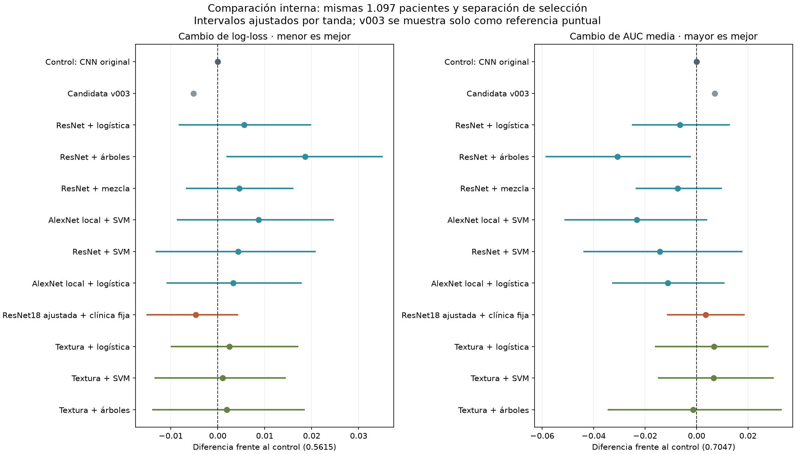
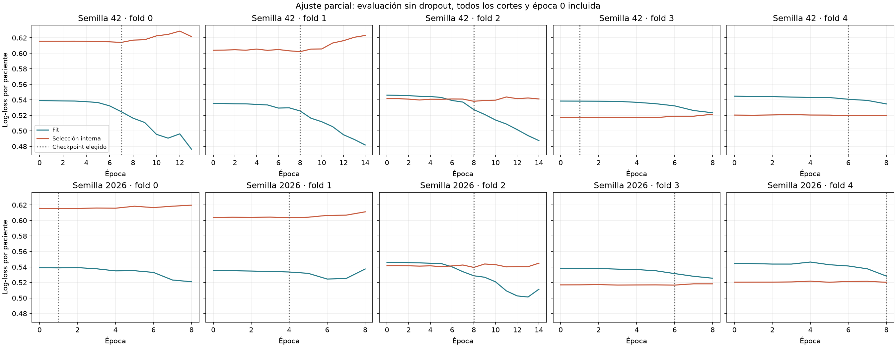

> **Cierre del 11/10/2026:** ensayo descartado como intento de superar al v002 original. La versión activa vuelve a ser v002; v003/v004 se conservan como experimentos. Los resultados frente al control reentrenado no prueban superioridad sobre el original. Las decisiones de promoción que aparecen más abajo son históricas y quedan revocadas. Véase el [registro de cierre](../../docs/EXPERIMENTOS_DESCARTADOS.md).

# Investigación y entrenamiento de mejoras del multimodal

Se buscaron estrategias documentadas, se fijaron cuatro protocolos y se entrenaron diez familias. Todas usan exclusivamente desarrollo y selección interna separada del fold exterior. La versión activa continúa siendo v002.

## Compatibilidad con el enunciado

Estas cuatro tandas se conservan como investigación descartada, no como candidatas para la entrega. La página 6, sección 7, exige CNN 2D desde cero y prohíbe expresamente modelos preentrenados y transfer learning. ResNet/AlexNet incumplen esa condición; los clasificadores de textura tampoco sustituyen la CNN obligatoria. La aplicación y v002 no fueron reemplazadas. Las siguientes pruebas se restringen al contrato docente.

## Resultado

Ninguna de las diez familias cumple el criterio de mejora interna fijado. No se ha demostrado una mejora del multimodal original.

| Modelo | AUC media folds | AUC OOF calibrada | AP | Log-loss calibrada | Brier |
|---|---:|---:|---:|---:|---:|
| Control: CNN original | 0.7047 | 0.6940 | 0.4858 | 0.5615 | 0.1877 |
| Candidata v003 | 0.7118 | 0.6990 | 0.5092 | 0.5563 | 0.1857 |
| ResNet + logística | 0.6983 | 0.6799 | 0.4674 | 0.5672 | 0.1901 |
| ResNet + árboles | 0.6740 | 0.6614 | 0.4184 | 0.5801 | 0.1960 |
| ResNet + mezcla | 0.6973 | 0.6849 | 0.4698 | 0.5661 | 0.1898 |
| AlexNet local + SVM | 0.6814 | 0.6696 | 0.4412 | 0.5702 | 0.1929 |
| ResNet + SVM | 0.6905 | 0.6727 | 0.4530 | 0.5659 | 0.1913 |
| AlexNet local + logística | 0.6936 | 0.6799 | 0.4699 | 0.5648 | 0.1904 |
| ResNet18 ajustada + clínica fija | 0.7082 | 0.6965 | 0.4837 | 0.5568 | 0.1870 |
| Textura + logística | 0.7114 | 0.6942 | 0.4755 | 0.5640 | 0.1887 |
| Textura + SVM | 0.7113 | 0.6894 | 0.4754 | 0.5626 | 0.1894 |
| Textura + árboles | 0.7034 | 0.6831 | 0.4816 | 0.5634 | 0.1893 |

El control es la arquitectura original reentrenada con selección interna y LR 0,0008. La AUC histórica de v002 (0,724568) utilizaba otro protocolo y no es directamente comparable. La AUC agrupada puede variar por la calibración distinta entre folds; la AUC media de folds también se informa.

## Qué se probó y por qué

1. ResNet50 ImageNet congelada, dos escalas, PCA y fusión lineal, árboles o mezcla de probabilidades. La representación preentrenada reduce parámetros que deben aprenderse con estas pacientes.
2. AlexNet pool2 con posiciones espaciales y selección supervisada dentro de fit; SVM/logística. También se probó selección supervisada y SVM sobre ResNet50.
3. ResNet18 parcialmente ajustada, L2-SP, entrenamiento por paciente y corrección visual limitada de una clínica fija. Dos semillas y cinco folds; selección por log-loss interna.
4. Descriptores de textura y diferencias entre fases a tres escalas, media/desviación entre cortes, selección supervisada y logística/SVM/árboles. Se usan las mismas cuatro variables clínicas. Los descriptores de PNG no son medidas físicas de perfusión.

## Evidencia que orientó los ensayos

- [Scientific Reports, I-SPY1, 2021](https://www.nature.com/articles/s41598-021-93592-z): características locales de AlexNet y SVM. Sus mejores resultados combinan exploraciones previas y durante tratamiento; aquí solo hay exploraciones previas.
- [AACR/Clinical Cancer Research, 2026](https://aacrjournals.org/clincancerres/article/32/4_Supplement/PS2-09-01/773092/Abstract-PS2-09-01-Optimizing-Transfer-Learning): transferencia parcial con ResNet en RM previa al tratamiento y combinación clínica. Es un resumen de congreso, no garantía de replicación.
- [Cancers, 2025](https://www.mdpi.com/2072-6694/17/20/3394): extracción de características preentrenadas y clínica con clasificadores regularizados; incluye RM y TC.
- [ICML 2018, L2-SP](https://proceedings.mlr.press/v80/li18a.html): regularización hacia los pesos preentrenados. Evidencia metodológica general, no validación específica de nuestro modelo.

- [Radiómica de RM previa, PMID 35636571](https://pubmed.ncbi.nlm.nih.gov/35636571/): texturas con clínica y hallazgos radiológicos; orientó la cuarta tanda, sin reproducir sus segmentaciones ni sus medidas físicas.

## Límites y reproducción

Los intervalos pareados están en resumen.json: primera tanda 98,33 %, segunda 99,17 %, tercera 99,29 % y cuarta 99,5 %. Se ajusta por las familias de cada tanda acumulada, pero no por toda la investigación histórica. Los intervalos condicionan a predicciones fijas y no representan validación externa.
Los datos exteriores ya han sido observados durante investigación adaptativa. Probar más modelos hasta obtener un valor favorable no convierte ese valor en una confirmación. No se han leído imágenes del test ni de validación privada.
Las OOF de SVM denominadas raw son sigmoid(margen), no probabilidades calibradas. La tabla principal usa Platt ajustado solo con selección interna.
Las cuatro tandas tienen módulos, protocolos y artefactos locales separados. Los pesos de trabajo y las características son locales; este informe conserva métricas, predicciones, hashes, curvas y selección de checkpoints. Se regenera con `.venv/bin/python -B -m cancer_mama.informe_transferencia` cuando se dispone de los runs completos.
