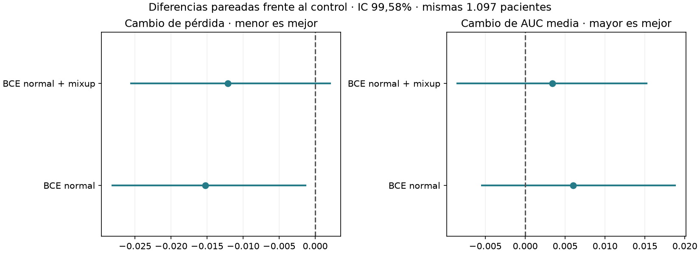
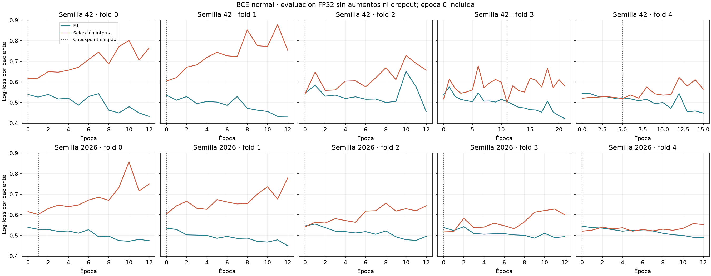
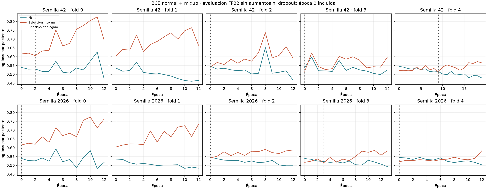

> **Cierre del 11/10/2026:** ensayo descartado como intento de superar al v002 original. La versión activa vuelve a ser v002; v003/v004 se conservan como experimentos. Los resultados frente al control reentrenado no prueban superioridad sobre el original. Las decisiones de promoción que aparecen más abajo son históricas y quedan revocadas. Véase el [registro de cierre](../../docs/EXPERIMENTOS_DESCARTADOS.md).

# CNN desde cero: BCE normal y mixup

La tanda conserva la arquitectura, las cuatro variables clínicas y el contrato PNG de v002. Entrena veinte modelos con BCE normal y BCE normal + mixup, comparados con los controles ponderados ya entrenados. No se cargaron imágenes del test. La versión activa no se modifica.

Señal interna favorable según el criterio predefinido: BCE normal. Requiere comprobar estabilidad antes de promoverla.

| Variante | AUC media folds | AUC OOF | AP | Log-loss | Brier |
|---|---:|---:|---:|---:|---:|
| BCE ponderada · selección AUC | 0.7047 | 0.6940 | 0.4858 | 0.5615 | 0.1877 |
| BCE ponderada · selección pérdida | 0.7118 | 0.6990 | 0.5092 | 0.5563 | 0.1857 |
| BCE normal | 0.7107 | 0.7109 | 0.5087 | 0.5463 | 0.1826 |
| BCE normal + Platt (secundario) | 0.7107 | 0.7022 | 0.4968 | 0.5552 | 0.1859 |
| BCE normal + mixup | 0.7081 | 0.7049 | 0.5010 | 0.5494 | 0.1840 |
| Mixup + Platt (secundario) | 0.7081 | 0.6967 | 0.4893 | 0.5577 | 0.1871 |

La comparación principal usa las probabilidades crudas de BCE normal/mixup y el control ponderado con Platt interno. Se informa también el control elegido por pérdida; las calibraciones nuevas son diagnósticos secundarios, no alternativas seleccionadas después de observar su resultado.

## Curvas y contribución visual

BCE normal: 3/10 checkpoints conservan una contribución visual distinta de cero; 7/10 seleccionan época 0. Una época 0 equivale al inicializador clínico y no demuestra aprendizaje visual.

BCE normal + mixup: 3/10 checkpoints conservan una contribución visual distinta de cero; 7/10 seleccionan época 0. Una época 0 equivale al inicializador clínico y no demuestra aprendizaje visual.

## Reproducción y límites

La sección 7 del PDF exige CNN 2D desde cero, un logit y BCEWithLogitsLoss. Esta tanda cumple esas restricciones. Mixup interpola imágenes, clínica imputada/estandarizada y etiquetas conjuntamente; no altera el formato de inferencia.

Las decisiones de checkpoint, umbral y calibración se ajustan solo con selección interna por paciente. No se usan etiquetas exteriores para esas decisiones. El bootstrap pareado condiciona a OOF fijas; la corrección por doce familias no elimina el sesgo de toda la búsqueda adaptativa previa. Una señal favorable sería evidencia interna, no confirmación clínica ni externa.

Se conservan configuración, entorno, hashes, curvas, métricas por semilla y checkpoints seleccionados. Los pesos y estados completos permanecen en el directorio local de entrenamiento. El informe se regenera con `.venv/bin/python -B -m cancer_mama.informe_bce_mixup`.

[Mixup, ICLR 2018](https://arxiv.org/abs/1710.09412) · [Calibración, ICML 2022](https://proceedings.mlr.press/v162/zhang22f.html) · [Límites con calibración posterior, CVPR 2023](https://openaccess.thecvf.com/content/CVPR2023/html/Wang_On_the_Pitfall_of_Mixup_for_Uncertainty_Calibration_CVPR_2023_paper.html)

## Comprobación de precisión del bootstrap

Con 10.000 réplicas y el mismo alpha=0,05/12, el intervalo de delta log-loss es [-0.028051; -0.002503]. Se mantiene por debajo de cero. Es una comprobación numérica adicional; no añade pacientes ni corrige toda la búsqueda adaptativa.

## Diagnóstico de la contribución visual

El inicializador clínico solo obtiene log-loss 0.548954 y AUC media 0.706179; la CNN seleccionada obtiene 0,546255 y 0,710686. Es una comparación descriptiva posterior, que no cambió las decisiones ni el protocolo de repetición. No constituye por sí sola una demostración del valor adicional de la imagen.

## Reproducción y formato de un corte

Se comprobaron las diez particiones y una predicción guardada por checkpoint con inferencia CPU. El error absoluto máximo respecto a la OOF GPU fue 8.14e-08; los pesos cargados con la clase original y la del ensayo dan exactamente la misma salida en esas entradas.

Tomando un corte por paciente con una regla hash fija e independiente de las etiquetas, la pérdida es 0.546177 con BCE normal y 0.561313 con el control. La AUC media es 0.710497 y 0.703847, respectivamente. Es un diagnóstico posterior sobre desarrollo; no prueba el comportamiento con cualquier corte o paciente nuevo.
