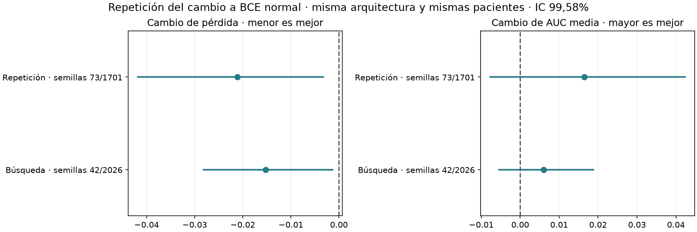

> **Cierre del 11/10/2026:** ensayo descartado como intento de superar al v002 original. La versión activa vuelve a ser v002; v003/v004 se conservan como experimentos. Los resultados frente al control reentrenado no prueban superioridad sobre el original. Las decisiones de promoción que aparecen más abajo son históricas y quedan revocadas. Véase el [registro de cierre](../../docs/EXPERIMENTOS_DESCARTADOS.md).

# Repetición de la mejora con BCE normal

La reducción de pérdida se reproduce según el criterio predefinido.

Se volvieron a entrenar candidata y control con semillas 73 y 1701 en los cinco folds. No se modificaron hiperparámetros, particiones ni decisiones de calibración. Es repetición sobre el mismo desarrollo, no validación externa.

| Semillas | Modelo | AUC media folds | AUC OOF | Log-loss | Brier |
|---|---|---:|---:|---:|---:|
| 73 | normal | 0.7109 | 0.7111 | 0.5467 | 0.1826 |
| 73 | weighted_auc | 0.6856 | 0.6799 | 0.5643 | 0.1894 |
| 73 | weighted_logloss | 0.6973 | 0.6823 | 0.5681 | 0.1905 |
| 1701 | normal | 0.7062 | 0.7065 | 0.5490 | 0.1840 |
| 1701 | weighted_auc | 0.6859 | 0.6736 | 0.5750 | 0.1919 |
| 1701 | weighted_logloss | 0.7003 | 0.6819 | 0.5679 | 0.1905 |
| 73/1701 | normal | 0.7102 | 0.7101 | 0.5467 | 0.1829 |
| 73/1701 | weighted_auc | 0.6936 | 0.6807 | 0.5678 | 0.1900 |
| 73/1701 | weighted_logloss | 0.7046 | 0.6856 | 0.5659 | 0.1896 |

El control principal es BCE ponderada con selección por AUC y Platt interno. El control seleccionado por pérdida se incluye como diagnóstico. La candidata usa BCE normal, inicialización clínica no ponderada, selección por pérdida y probabilidades sin calibración posterior.

## Qué demuestra y qué queda abierto

La búsqueda original obtuvo log-loss 0,5463 frente a 0,5615 y AUC media 0,7107 frente a 0,7047. La mejora principal es probabilística; no se afirma un aumento concluyente de AUC. La AUC histórica 0,7246 de v002 procede de otro protocolo y no debe compararse directamente con estas cifras.

La comprobación adicional con 10.000 remuestreos mantiene el intervalo de delta log-loss [-0.028051; -0.002503] en la búsqueda original. No cambia el modelo ni aporta datos independientes.

Siete de los diez checkpoints originales seleccionan época 0, equivalente al inicializador clínico. Por tanto, las curvas aún muestran sobreajuste y no se ha probado que la rama visual aporte una mejora independiente. Se conserva el mejor checkpoint, no el último.

Las pacientes exteriores de cada fold no se usan para elegir épocas ni ajustar calibración/umbral. Sin embargo, la investigación previa es adaptativa y se observa el mismo desarrollo repetidamente. Cambiar semillas comprueba estabilidad de entrenamiento, no generalización a otras pacientes o centros. El test reservado y la validación privada siguen sin abrirse.

## Paquete candidato

Se conservan los diez pesos originales de las semillas 42/2026, como se fijó antes de repetir. No se elige el par de semillas con mejor resultado. La calibración es identidad: no añade un Platt posterior.

El umbral operativo Youden es 0.3489952150, ajustado sobre las OOF originales. Es una decisión para inferencia; no se usa para afirmar una mejora independiente de sensibilidad/especificidad. La evaluación interna agrega varios cortes; usar un solo corte, como en la aplicación docente, puede cambiar el rendimiento.

## Integración verificada

La versión `v004_multimodal_bce_normal_20261011` queda archivada y seleccionada
por defecto en la aplicación y en la CLI. Conserva los diez pesos originales
42/2026, la arquitectura CNN 2D propia y las tres fases PNG exigidas por el PDF.
El umbral operativo es 0,348995215. Las versiones v001, v002 y v003 siguen intactas.

Pasaron 66 pruebas unitarias y la verificación de hashes y carga de pesos de las
cuatro versiones. Una prueba de integración con un ejemplo de train comprobó
la aplicación, la CLI y el paquete archivado: coincidencia CPU/CLI exacta y
diferencia CPU/GUI menor de 0,000001. También comprobó que cambiar una entrada
oculta la predicción anterior. No se evaluó el test reservado.

La comprobación se puede repetir desde la raíz con
`.venv/bin/python -B scripts/verifica_v004_app.py`. El JSON de integración y la
verificación de versiones acompañan este informe. Para regenerar el informe de
la repetición con sus fuentes originales debe usarse el commit `41428a2`;
los cambios posteriores de interfaz y versión activa son deliberados.
