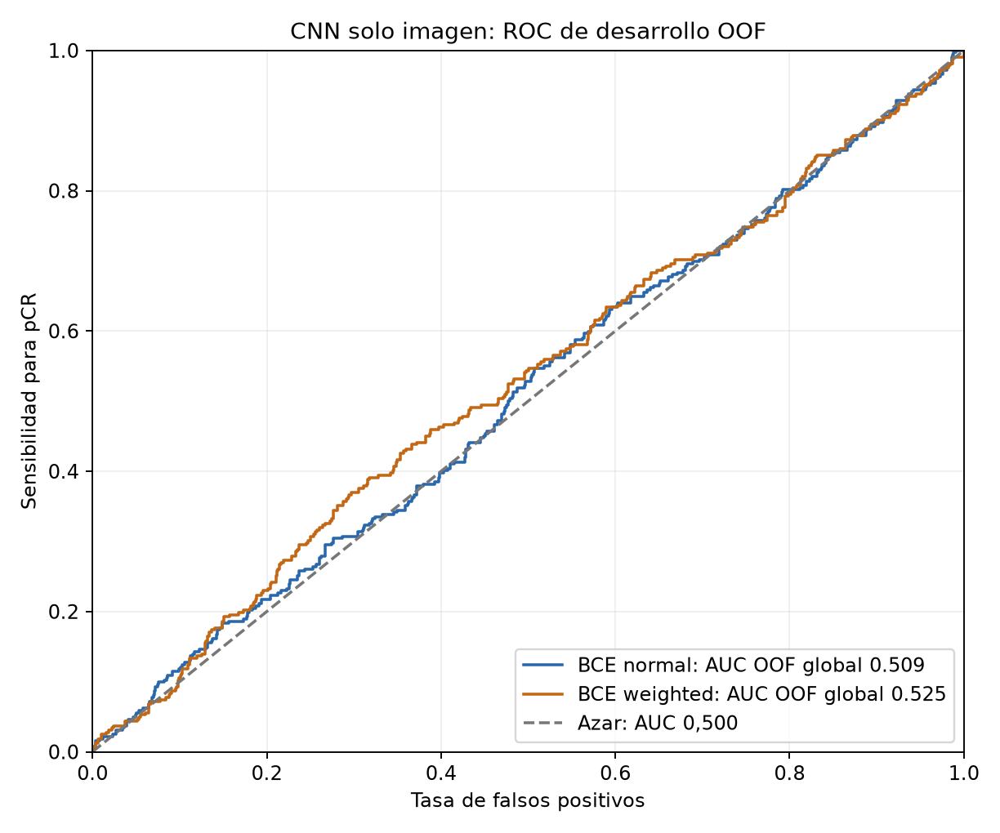
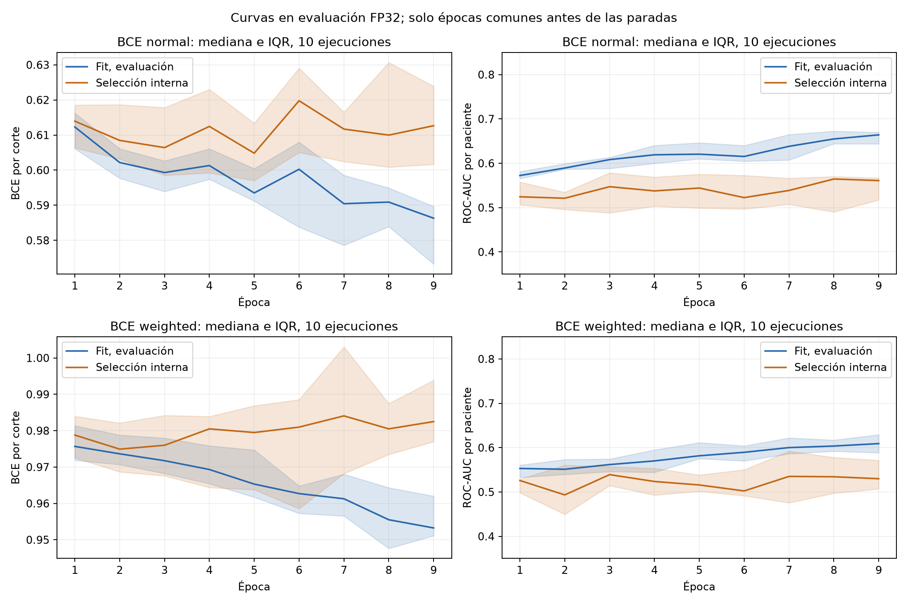

# CNN solo imagen por fases: resultado del 14/10/2026

Las 20 ejecuciones terminaron correctamente, pero esta configuración no consigue
una discriminación útil en desarrollo. BCE ponderada gana la comparación
prefijada por media de AUC de los folds, con **0,548571 ± 0,050435**. Su AUC OOF
global es **0,524572**. Las versiones se conservan para reproducibilidad, sin
activar ninguna como sustituta del multimodal v002.

## Ejecución y protocolo

- Inicio: 14/10/2026, 17:38:09; fin de entrenamiento y comparación: 19:36:07,
  Europe/Madrid. Duración: 1 h 57 min 58 s.
- Código de entrenamiento: commit `3eec1f0`; SHA-256 y entornos completos en
  [procedencia](procedencia.json) y [ejecuciones](ejecuciones.json).
- CNN propia de 442.577 parámetros, desde cero; encoder monocanal compartido
  PRE/EARLY/LATE y fusión de características temporales ordenadas. Sin clínica
  ni pesos preentrenados. Mismo protocolo para ambas pérdidas.
- Dos semillas, 42 y 2026, y cinco folds exteriores por pérdida: 20 runs,
  326 épocas (146 normal y 180 ponderada).
- AdamW, LR inicial 0,0008, weight decay 0,001, lote 32, máximo 40 épocas,
  calendario coseno, mínimo 8 épocas y paciencia 8. Geometría compartida entre
  fases, AMP FP16 en ajuste y evaluación FP32 sin aumentos.
- Fit y selección interna del 15 % separados por paciente, estratificados por
  cohorte × pCR. Checkpoint por AUC de paciente en selección interna. El fold
  exterior no elige checkpoint, calibración ni umbral.
- Se promedian probabilidades de las dos semillas y los cortes por paciente.
  La comparación de pérdidas usa la media de AUC cruda de los cinco folds.
- Umbral principal: máxima sensibilidad con especificidad interna mínima del
  90 %. Se guarda también macro-F1 como política secundaria.

El [protocolo prefijado](../../docs/mejoras_cnn/PROTOCOLO_CNN_IMAGEN_FASES.md)
explica todas las decisiones. Son resultados de validación cruzada de desarrollo;
no representan una nueva cohorte independiente. No se ha abierto el test para
escoger modelo, calibración o umbral.

## Resultados por paciente

1.097 pacientes: 322 pCR y 775 no pCR. Las métricas de decisión usan
calibración y umbral elegidos en selección interna por fold, aplicados después
al fold exterior. Positivo significa **respuesta patológica completa**, no
presencia de cáncer. Media ± desviación entre cinco folds, no intervalo de confianza.

| Métrica | BCE normal | BCE ponderada |
|---|---:|---:|
| Media de AUC cruda por fold, principal | 0,533002 ± 0,025339 | 0,548571 ± 0,050435 |
| AUC cruda OOF global, descriptiva | 0,508660 | 0,524572 |
| AUC OOF con calibraciones internas por fold | 0,519539 | 0,518513 |
| Average precision con calibraciones internas | 0,313602 | 0,314215 |
| Log-loss con calibraciones internas | 0,610778 | 0,612615 |
| Brier con calibraciones internas | 0,209128 | 0,208523 |
| Exactitud | 67,00 % | 67,27 % |
| Balanced accuracy | 49,33 % | 50,88 % |
| Sensibilidad pCR | 6,52 % | 11,18 % |
| Especificidad no pCR | 92,13 % | 90,58 % |
| Precision pCR | 25,61 % | 33,03 % |
| F1 pCR | 0,103960 | 0,167053 |
| Macro-F1 | 0,450863 | 0,481712 |
| TN / FP / FN / TP | 714 / 61 / 301 / 21 | 702 / 73 / 286 / 36 |

El baseline que siempre predice no pCR tiene exactitud 70,65 % y balanced
accuracy 50 %. El umbral conservador limita los falsos positivos, a costa de
sensibilidad muy baja. La diferencia de AUC entre pérdidas es pequeña y no se
ha realizado un contraste que demuestre superioridad estadística.

Las escalas y calibraciones cambian entre folds. Por eso AUC global, media de
AUC por fold y AUC global después de calibrar son cantidades diferentes.
La pendiente no negativa conserva el orden dentro de cada fold cuando es
positiva; no garantiza conservar el orden entre pacientes de folds distintos.

## Sobreajuste

Las curvas de fit y selección muestran una brecha creciente. Medianas de la
última época de las diez ejecuciones de cada pérdida:

| Diagnóstico | Normal | Ponderada |
|---|---:|---:|
| AUC fit final | 0,740857 | 0,639291 |
| AUC selección interna final | 0,514286 | 0,552714 |
| Mediana de brecha emparejada final | 0,220632 | 0,132839 |
| Mediana de brecha en checkpoint seleccionado | 0,050111 | 0,006671 |
| Mediana de época seleccionada | 8 | 9,5 |
| Mediana de épocas completadas | 14,5 | 17,5 |

Los valores finales describen sobreajuste y no sustituyen las métricas exteriores
de los checkpoints seleccionados. La parada temprana reduce la brecha en el
checkpoint retenido, pero no logra una buena generalización exterior. No basta
con aumentar épocas ni con seleccionar una curva de entrenamiento atractiva.

La figura agregada usa solo épocas comunes a las diez ejecuciones de cada brazo,
para no cambiar la composición de la muestra cuando aparecen paradas. Las
[20 curvas completas](curvas_por_ejecucion/) muestran cada ejecución. Los
[diagnósticos](diagnostico_por_ejecucion.csv) contienen checkpoint seleccionado
y última época separados.

## Calibración final y conservación de pesos

La ponderada gana el selector de desarrollo, pero la calibración final ajustada
sobre sus OOF cae en la solución de frontera: pendiente 0, intercepto
−0,8783114838, probabilidad constante **0,2935278031** y umbral **1,0**. Esa política
predice no pCR para todas las pacientes. Se conserva exactamente como salió,
porque corregirla tras ver estos resultados sería otro cambio experimental.
No son las probabilidades ni los umbrales internos por fold de la tabla anterior.

No se había seleccionado una política final para BCE normal. Su versión
archivada conserva probabilidades crudas, calibración identidad y umbral 0,5
solo como diagnóstico; no se ajusta ahora otra calibración ni se presenta ese
umbral como el de la tabla.

- [v005, diez pesos BCE normal](../../modelos/versiones/v005_cnn_imagen_fases_normal_20261014/).
- [v006, diez pesos BCE ponderada](../../modelos/versiones/v006_cnn_imagen_fases_ponderada_20261014/).

Cada paquete contiene pesos de inferencia, código compatible congelado, entorno,
configuraciones, historias, resúmenes, manifiesto y hashes. Se conserva el código
de entrenamiento nuevo del commit `3eec1f0`; publicar pesos no cambia su arquitectura
ni activa un nuevo entrenamiento. Los estados de optimizador, RNG y `last.pt`
permanecen en la ejecución local y no forman parte de estos paquetes.

V002 sigue siendo el modelo que carga la aplicación/CLI multimodal, con sus diez
pesos, calibración y umbral intactos. Su AUC histórica OOF es 0,724568. Compararla
con este ensayo es descriptivo: utiliza clínica, otra arquitectura y otro
protocolo histórico de selección. El resultado de esta CNN no prueba que todas
las arquitecturas de imagen o las imágenes en general carezcan de señal.

## Verificación y evidencia

Se han comprobado los 20 checkpoints finales: pesos finitos, hashes de pesos y
predicciones correctos y todos los pasos AdamW esperados aplicados, sin saltos
por AMP. Las cuatro versiones anteriores permanecen intactas. Se recalcularon
AUC, pérdida, Brier y matrices desde las OOF publicadas.

- [Selección, calibraciones y métricas completas](seleccion.json).
- [Comparación CSV](comparacion_perdidas.csv), [OOF normal](oof_pacientes_normal.csv)
  y [OOF ponderada](oof_pacientes_weighted.csv).
- [Historias completas](historias.csv), [configuraciones, entornos y resúmenes](ejecuciones.json).
- [Predicciones por paciente de cada ejecución](predicciones_pacientes_por_ejecucion.csv)
  y [predicciones por corte exterior](predicciones_cortes_outer.csv).
- [Verificación del entrenamiento](verificacion_entrenamiento.json),
  [verificación de publicación y carga aislada](verificacion_publicacion.json) y
  [procedencia y hashes](procedencia.json).

`recopilar.py` reconstruye este conjunto de resultados desde el run local sin
entrenar ni abrir el dataset. `archivar.py` conserva las dos versiones sin
sobrescribir números ya publicados. El test reservado permanece sin evaluar
en este ensayo. La decisión es conservar el resultado insuficiente y no
promocionar estos pesos a la aplicación.
