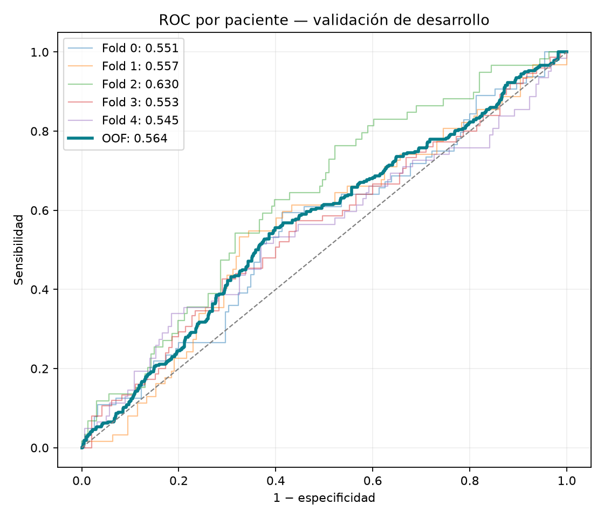
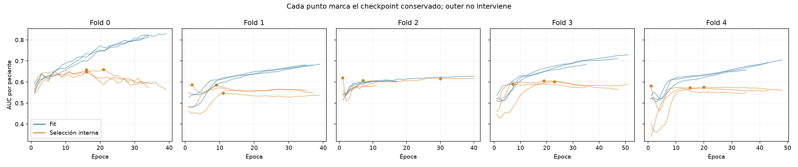
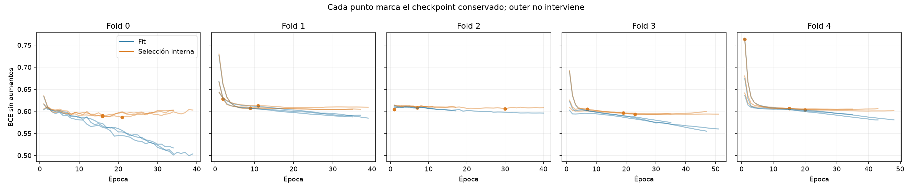

# Red neuronal exclusivamente de imágenes — resultados

25/10/2026. **No se ha alcanzado el objetivo ideal de AUC 0,70.**

Se completaron **75 entrenamientos y 3007 épocas**, con
23.5 minutos acumulados de entrenamiento medido. Son pilotos,
repeticiones internas y búsqueda anidada; no se suman como muestras independientes.
Se conservan quince pesos seleccionados y un paquete de inferencia independiente.

## Resultado exterior de desarrollo

- **AUC OOF calibrada: 0.5638**, IC95 % [0.5261, 0.6014].
- **Media de AUC por fold: 0.5673 ± 0.0352**, IC95 % condicional [0.5295, 0.6053].
- AUC OOF cruda: **0.5245**. La calibración no mejora el ranking dentro de cada fold; alinea escalas entre modelos.
- BCE calibrada: **0.6033**; Brier: **0.2064**; AP: **0.3428**.
- 1.097 pacientes, 322 pCR, una predicción exterior por paciente. **Cero imágenes de test cargadas**.

| Fold | Receta elegida internamente | AUC exterior | BCE exterior | Brecha AUC fit−outer |
|---|---|---:|---:|---:|
| 0 | hybrid_rank_v2 | 0.5514 | 0.6080 | +0.1783 |
| 1 | hybrid_mlp_stable_v4 | 0.5569 | 0.5988 | +0.0501 |
| 2 | hybrid_v1 | 0.6298 | 0.5631 | -0.0198 |
| 3 | hybrid_mlp_stable_v4 | 0.5532 | 0.6477 | +0.1140 |
| 4 | hybrid_mlp_stable_v4 | 0.5451 | 0.5989 | +0.0762 |

## Sobreajuste y elección de pesos

Las CNN son propias y parten de pesos aleatorios. Cada paciente contribuye una
observación a la pérdida. Los aumentos se comparten entre fases y cortes, se
utiliza dropout, AdamW, mixup o ranking auxiliar según la receta y parada interna.
Los descriptores de intensidad, realce y textura se calculan solo de píxeles;
no se usan variables clínicas, cohorte, IDs ni adquisición como predictores.

La mediana de brecha AUC fit−selección de los quince checkpoints es
**0.0433** (rango -0.0767 a 0.0897).
La restricción final se aplica a cada ensemble interno de tres semillas (<=0,12),
no a cada semilla aislada. Los puntos en las gráficas señalan los pesos guardados.
Se conservan también las épocas posteriores para mostrar si aparece divergencia.
Una brecha pequeña no demuestra por sí sola ausencia de sobreajuste: también
puede indicar poco aprendizaje, y la búsqueda puede sobreajustar la validación.
La mediana de brecha entre el ensemble fit y su fold exterior es
**0.0762**. No prueba ausencia de sobreajuste en otra población.

Se descartó la promoción del pico 0,66 de una red lineal muy penalizada: oscilaba
con el optimizador y elegía máximos de validación poco estables. El control
convergido y los pesos promediados revelaron ese problema. La agregación axial
Conv1d y las BCE ponderadas tampoco justificaron ampliar esos ensayos.

## Protocolo y límites

Se fijaron tres recetas antes de outer. En cada fold se compararon internamente
sus tres semillas; se eligió AUC con brecha fit−selección <=0,12 y desempate por
BCE. **Las cinco decisiones y los hashes se guardaron antes de calcular cualquier
predicción exterior.** Calibración Platt únicamente interna, sin invertir signos.
El test entregado y la validación privada siguen cerrados.

Estas cifras son **validación de desarrollo adaptativo**, no confirmación externa:
el historial del proyecto y la búsqueda de arquitecturas han explorado train.
Cada paciente queda fuera de fit, checkpoint, selección de receta y calibración
de su grupo exterior, pero eso no borra el historial global de decisiones.
Los IC usan 2.000 bootstrap por paciente, estratificados por fold y etiqueta;
condicionan a estos pesos y no recogen toda la búsqueda ni futuros reentrenamientos.

| Cohorte (solo auditoría) | Pacientes | AUC |
|---|---:|---:|
| duke | 209 | 0.4712 |
| spy1 | 104 | 0.5873 |
| spy2 | 784 | 0.5634 |

A umbral fijo 0,5: TN=773, FP=2, FN=321, TP=1.
No se ha reajustado el umbral mirando outer. ROC-AUC mide ordenación, no garantiza
buenas decisiones a ese umbral ni calibración en otra población.

## Artefactos y reproducción

- [Registro completo de experimentos](../../docs/mejoras_cnn/EXPERIMENTOS_IMAGEN_20261025.md).
- [Plan previo a outer](final_plan_locked.json) y [elecciones bloqueadas](final_choices_locked.json).
- [OOF por paciente](final_oof_patients.csv), [métricas](final_metrics.json) e [intervalos](bootstrap.json).
- [Candidatos internos de cada fold](final_inner_candidates.csv), [historias](final_selected_histories.csv) y [épocas conservadas](final_selected_epochs.csv).
- [Auditoría de datos](data_audit.json): sin tripletas idénticas entre pacientes distintas de train a 128 px.
- [Verificación CPU/GPU de inferencia](inference_verification_internal.json).
- [Paquete de quince pesos, código congelado y uso](../../modelos/imagen_sola_20261025/README.md).

Preparación y pilotos: `scripts/experimentar_imagen_mil.py`,
`pilotos_imagen_roi.py`, `pilotos_imagen_regularizada.py`, `confirmar_imagen_mil.py`,
`pilotos_imagen_estable.py` y `pilotos_imagen_axial.py`.
Validación final: `scripts/validar_imagen_anidada.py`.
Informe y paquete: `scripts/informar_imagen_mil.py`.
Las configuraciones exactas, particiones, hashes de código y entornos están en
cada ejecución. La caché local de píxeles se excluye de Git y puede regenerarse.

Fuentes metodológicas: [MIL de Ilse et al.](https://proceedings.mlr.press/v80/ilse18a.html),
[Group Normalization](https://www.ecva.net/papers/eccv_2018/papers_ECCV/html/Yuxin_Wu_Group_Normalization_ECCV_2018_paper.php),
[mixup](https://arxiv.org/abs/1710.09412) y
[repositorio original BreastDCEDL](https://github.com/naomifridman/BreastDCEDL).
Sus pesos preentrenados no se han utilizado. Uso educativo.
