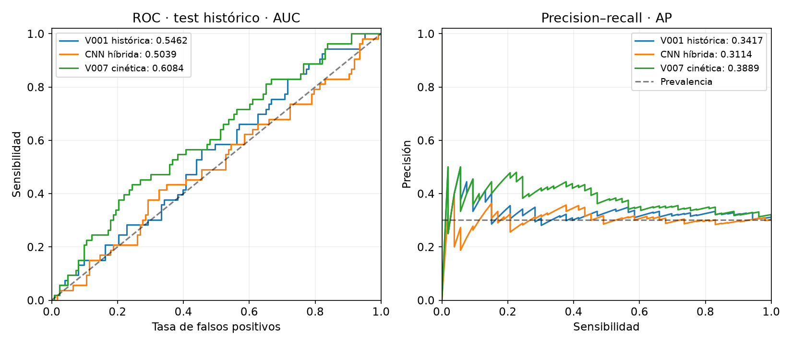
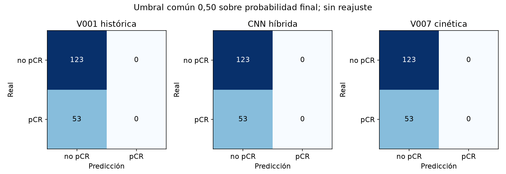
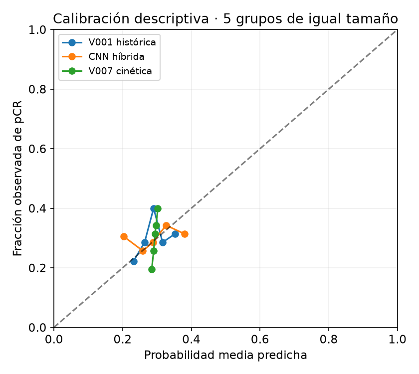

# Evaluación final pareada de modelos de solo imagen

25/10/2026. Comparación de paquetes congelados, sin entrenamiento ni ajuste con test.

**176 pacientes, 53 pCR y 1758 cortes.** Una predicción por paciente; mismos PNG en los tres paquetes.

## Resultado sobre test

| Modelo | AUC final | IC95 % | AUC cruda | AP final | Logloss final | Brier final |
|---|---:|---|---:|---:|---:|---:|
| V001 histórica | **0.5462** | [0.4632, 0.6268] | 0.5462 | 0.3417 | 0.6090 | 0.2094 |
| CNN híbrida | **0.5039** | [0.4152, 0.5900] | 0.5338 | 0.3114 | 0.6226 | 0.2146 |
| V007 cinética | **0.6084** | [0.5222, 0.6935] | 0.6084 | 0.3889 | 0.6095 | 0.2095 |

La métrica principal es la AUC de la probabilidad final de cada paquete. No se escoge entre AUC cruda, calibrada o media por fold después de observar test. V001 y V007 aplican una calibración global monótona; en la híbrida se calibran los grupos antes de agregarlos, tal como estaba archivado.



## Diferencias pareadas de AUC

| Comparación A − B | Diferencia | IC95 % |
|---|---:|---|
| V001 histórica − CNN híbrida | +0.0423 | [-0.0276, +0.1114] |
| V001 histórica − V007 cinética | -0.0621 | [-0.1424, +0.0164] |
| CNN híbrida − V007 cinética | -0.1045 | [-0.1904, -0.0186] |

Intervalos mediante 5,000 remuestreos por paciente, pareados y estratificados por cohorte y clase, semilla 20261025. Comparaciones exploratorias; no corrigen las decisiones históricas ni garantizan el rendimiento de otro entrenamiento.

## Errores con el mismo umbral

Umbral 0,50 sobre la probabilidad final. No se fuerza la misma sensibilidad o especificidad ajustando el test.

| Modelo | TN | FP | FN | TP | Sensibilidad | Especificidad | Precisión | F1 |
|---|---:|---:|---:|---:|---:|---:|---:|---:|
| V001 histórica | 123 | 0 | 53 | 0 | 0.000 | 1.000 | 0.000 | 0.000 |
| CNN híbrida | 123 | 0 | 53 | 0 | 0.000 | 1.000 | 0.000 | 0.000 |
| V007 cinética | 123 | 0 | 53 | 0 | 0.000 | 1.000 | 0.000 | 0.000 |



Las matrices a 0,50 crudo y las políticas operativas ya archivadas de V001/V007 se conservan en `metricas.json`. Esas políticas tienen umbrales diferentes y no son una comparación al mismo punto operativo. La híbrida no tenía otro umbral clínico congelado; no se inventa uno usando test.



## Alcance de la evaluación

- Ninguna de estas pacientes aparece en el train según el índice original. Se verifican las mismas etiquetas y cortes de la evaluación histórica de V001.
- V001 reutiliza exactamente sus predicciones archivadas; no se repite su inferencia. Las otras dos usan el código y pesos congelados, sin aumentado y en modo evaluación.
- Equidad en población, unidad estadística y cálculo de métricas. No se igualan el presupuesto, las semillas, la capacidad ni la selección histórica; no demuestra causalmente que una arquitectura sea superior.
- Este test se conoce en el proyecto desde septiembre. Es una evaluación retrospectiva sobre pacientes fuera del entrenamiento, no una validación externa o completamente ciega nueva.
- La validación privada del profesorado permanece cerrada. No se puede prometer una AUC poblacional exacta ni deducir que supera 0,60 solo por una estimación puntual.
- La evaluación usa todos los cortes por paciente. No mide el rendimiento de la aplicación cuando solo se carga una tripleta de un corte.
- No se entrena, recalibra, ajusta el umbral, activa un modelo ni inicia otra búsqueda tras estos resultados. La comparación BCE normal/ponderada de la receta híbrida sigue pendiente para completar la entrega.

## Reproducción y evidencia

- `protocolo_congelado.json` y su SHA-256: fuentes, pesos, políticas y análisis fijados antes de calcular nuevas predicciones.
- `comparacion_pacientes.csv`: predicciones alineadas por paciente; `metricas.json`: métricas e intervalos.
- `predicciones_hibrida.csv`, `predicciones_v007.csv` e `inferencia_*.json`: inferencia y procedencia.
- `verificacion_final.json`: integridad de paquetes y artefactos; sin imágenes, datasets ni checkpoints añadidos.

```bash
.venv/bin/python -B scripts/evaluar_test_imagen.py preparar
.venv/bin/python -B scripts/evaluar_test_imagen.py ejecutar --device cuda
```

La ejecución se bloquea para no repetir inferencia; `analizar` reutiliza las predicciones guardadas. Para reproducir en otra copia se debe usar una salida nueva sin sobrescribir este ensayo.
