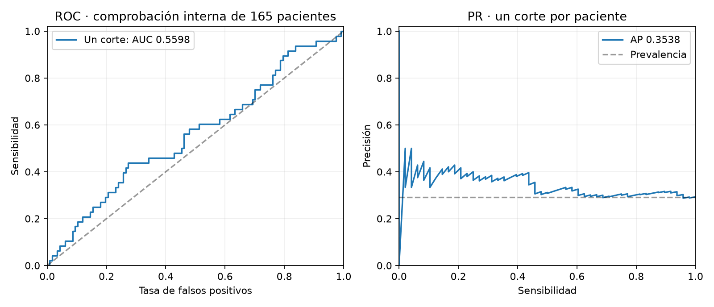
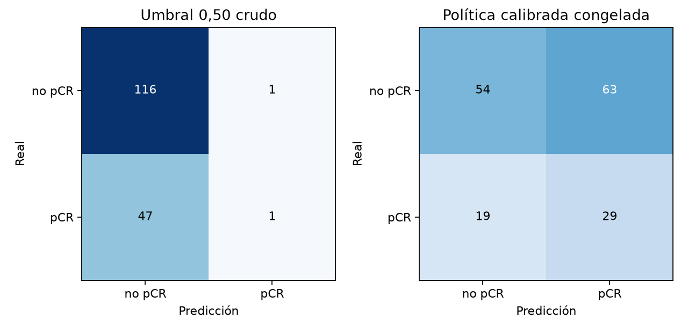
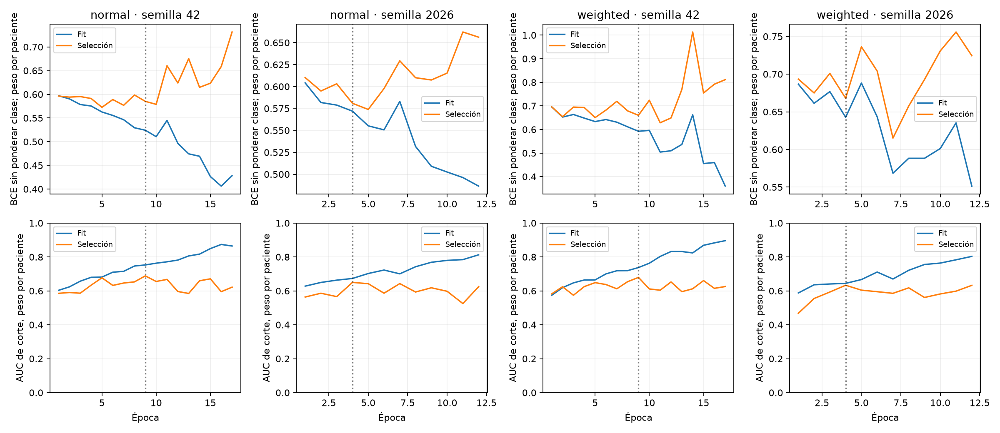
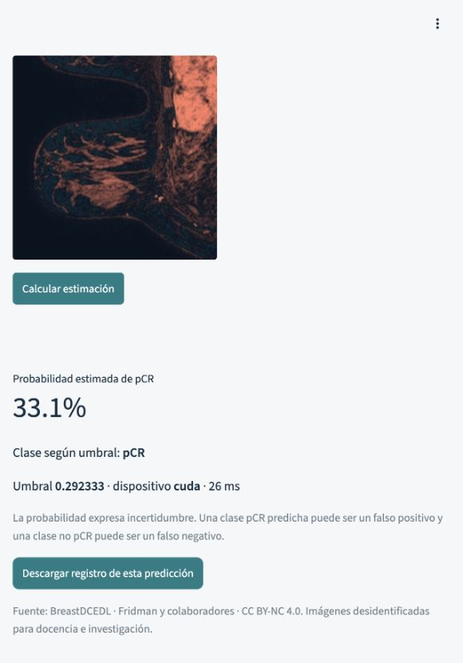

# Cierre de la CNN cinética para una tripleta de un solo corte

25/10/2026. Los cuatro pasos autorizados se ejecutan con un protocolo único y
cuatro entrenamientos. **Resultado interno insuficiente para acreditar AUC 0,60.**
El candidato se conserva como V008 experimental; V007 original permanece intacto.

## 1. Auditoría del formato de uso

La demostración recibe una tripleta PRE/EARLY/LATE de un solo corte, 3×256×256,
uint8/255. No recibe clínica ni promedia otros cortes que el profesor no entrega.
El AUC 0,6084 anterior de V007 usó todos los cortes de 176 pacientes de test:
**no es el rendimiento demostrado de esta aplicación ni de V008**.

Se auditaron las parejas históricas V007 que excluían a cada paciente en 767
pacientes de las nuevas particiones fit+selection. No se abrieron para esta
auditoría las imágenes de calibration/check ni test/validation. AUC agrupada
cruda con un corte: 0.5195; con media de todos los
cortes: 0.5215. Cada fold puede tener otra
escala de salida por la pérdida elegida: las medias de AUC por fold están en
`auditoria_v007_por_fold.json`. Son componentes históricos de desarrollo, no el
ensemble completo ni una evaluación independiente.

Las diez redes antiguas, en conjunto, usaron todas las pacientes de train. No
había un grupo de train excluido de todas ellas para recalibrar directamente
el ensemble final de diez redes. Por ello se hizo la tanda limitada siguiente.

## 2. Tanda limitada y separación de responsabilidades

Misma clase CNNMultiescalaCinetica, **593.521 parámetros**, mismos filtros,
recortes, mapas y dropout que V007; inicialización desde cero. LR 0,0003,
weight decay 0,01: opción modal de las elecciones internas históricas, sin usar
test para escogerla. AdamW, AMP, lote 32, coseno, máximo 40 épocas, mínimo 8,
paciencia 8. BCEWithLogitsLoss normal/ponderada y semillas 42/2026.

| Rol disjunto | Pacientes | Uso |
|---|---:|---|
| Fit | 657 | Gradientes; todos sus cortes, peso total uno por paciente |
| Selection | 110 | Checkpoint y elección normal/ponderada |
| Calibration | 165 | Platt y umbral del ensemble seleccionado |
| Check | 165 | Una comprobación después de congelar pesos y política |

Se estratifica por cohorte y clase. Las semillas y el corte pseudouniforme por
paciente se fijan en `protocolo.json`, sin seleccionar cortes por etiqueta o
predicción. La selección usa AUC de cortes con peso total uno por paciente:
evalúa el contrato de un corte, no la media de diez cortes. El lote en GPU
conserva los mismos uint8 y la escala /255; la caché no ajusta estadísticas.

| Pérdida | AUC del ensemble en selection |
|---|---:|
| Normal, elegida | 0.6884 |
| Ponderada | 0.6630 |

Se completaron 58 épocas y
11,890 pasos AdamW, sin pasos
omitidos. Los checkpoints elegidos son las épocas 9 y 4 de BCE normal. Los
pesos seleccionados se guardaron antes de abrir calibration y las imágenes de
check se cargaron después de congelar `politica_congelada.json`.

## 3. Calibración, umbral y resultado de comprobación

La calibración usa exactamente la media de las dos semillas que ejecutará la
aplicación sobre una tripleta. Platt con C=1 y pendiente no negativa, solo con
las 165 pacientes de calibration; todos sus cortes pesan en total uno por
paciente. El umbral maximiza balanced accuracy en calibration. Es un criterio
docente declarado, no una regla clínica ni una obligación de especificidad 90 %.

**Umbral congelado: 0.292333096.** Pendiente Platt
0.238232, intercepto
-0.583215.

La comprobación primaria usa una tripleta prefijada por cada una de las 165
pacientes (48 pCR). IC95 % mediante 2.000 bootstrap por paciente, estratificados
por cohorte y clase, condicionales a los pesos y al corte elegido.

| Métrica | Crudo, umbral 0,50 | Calibrado, umbral congelado |
|---|---:|---:|
| AUC | 0.5598 | **0.5598**, IC95 % [0.4596; 0.6519] |
| Sensibilidad pCR | 2.08% | **60.42%** |
| Especificidad | 99.15% | **46.15%** |
| TN / FP / FN / TP | 116 / 1 / 47 / 1 | **54 / 63 / 19 / 29** |
| Balanced accuracy | 0.5061 | 0.5329 |
| Brier | 0.2109 | 0.2044 |
| Logloss | 0.6239 | 0.5986 |




La política detecta más pCR, a costa de muchos FP. La transformación monótona
y el umbral **no aumentan la AUC**. No se ajusta otra vez después de ver check.
Como análisis secundario, AUC de todos los cortes con peso por paciente:
0.5407. La media de cortes por paciente
da 0.5422, pero cambia la entrada y
no se elige esa métrica como principal tras observar el resultado.

## Sobreajuste y límites

Brecha mediana fit−selection en los cuatro checkpoints elegidos: 0.0406;
en las últimas épocas: 0.2155. La selección interna del
ensemble fue 0,6884 y la comprobación de un corte queda en 0,5598. Las métricas
de selección usan distribución de cortes ponderada y la primaria de check un
corte por paciente; incluso comparando la secundaria de check, 0,5407, el
resultado interno no se sostiene. No se declara eliminado el sobreajuste.



Las 1.097 pacientes de train tienen antecedentes de búsqueda adaptativa en el
proyecto. Aunque los cuatro roles estén separados para este procedimiento,
check sigue siendo desarrollo interno. El test de 176 pacientes y la validación
privada permanecen cerrados en esta tanda. V007 y V008 no se comparan como si
tuvieran los mismos pesos, pacientes o número de cortes de entrada.

## 4. Paquete y aplicación

Se conserva el candidato elegido en selection como
`v008_cnn_cinetica_un_corte_20261025`, dos pesos de inferencia, calibración,
umbral, fuentes, configuración y hashes. No incluye optimizer, RNG ni dataset.
Es experimental e insuficiente: no sustituye V007 ni demuestra AUC 0,60.

La aplicación `app_imagen.py` recibe exclusivamente la tripleta de un corte,
valida formato, tamaño, fase y coincidencia de identificador, muestra el realce,
probabilidad, clase, umbral, versión/checksum, dispositivo y latencia. No ofrece
un deslizador para cambiar el umbral con las muestras del profesor. La evaluación
privada solo corresponde al profesor y no se ejecuta aquí.

```bash
.venv/bin/python -m streamlit run app_imagen.py
```

El despliegue público y la evaluación docente posterior son pasos separados;
esta entrega prepara y verifica la aplicación local, sin publicar automáticamente.

## Evidencia y decisión

- `protocolo.json` y SHA: configuración y particiones fijadas antes de entrenar.
- `particiones.csv`: cuatro roles por paciente; solo train.
- `seleccion_congelada.json`, `politica_congelada.json` y SHA: orden de congelación.
- `resultado.json`, `comprobacion_cortes.csv` y `calibracion_cortes.csv`.
- `diagnostico_checkpoints.csv`, `entorno.json` y registro de entrenamiento.
- Las historias y configuraciones seleccionadas se incluyen en la versión.

**Decisión:** conservar resultados y candidato, preparar la demostración de un
corte y detener los ajustes. El resultado no justifica otra búsqueda contra
estas mismas 165 pacientes ni modificar la política mirando el test antiguo.

## Verificación final

Pasaron 93 pruebas unitarias. Se verificaron carga e integridad de las ocho
versiones y la invariancia de v001–v007. V008 ejecuta inferencia desde una copia
aislada sin dataset: diferencia CPU respecto a la comprobación 6,6e-9 y error
de la aplicación GPU inferior a 1e-6 en la muestra auditada.

La prueba de integración de Streamlit verifica entrada incompleta, predicción
de un ejemplo de train y borrado del resultado al cambiar la imagen. La revisión
visual comprueba las fases, el realce, la probabilidad, clase, umbral y aviso.
El AUC principal se comprobó también por comparación directa de todos los pares
positivo/negativo. Fuentes, pesos y política permanecen intactos.

La aplicación histórica V002 no se modifica. La nueva demostración está en
`app_imagen.py`; el despliegue público y la evaluación privada no se han realizado.

Vista de la aplicación con un ejemplo de train, únicamente para comprobar el flujo;
la probabilidad mostrada no es una estimación independiente de rendimiento.


