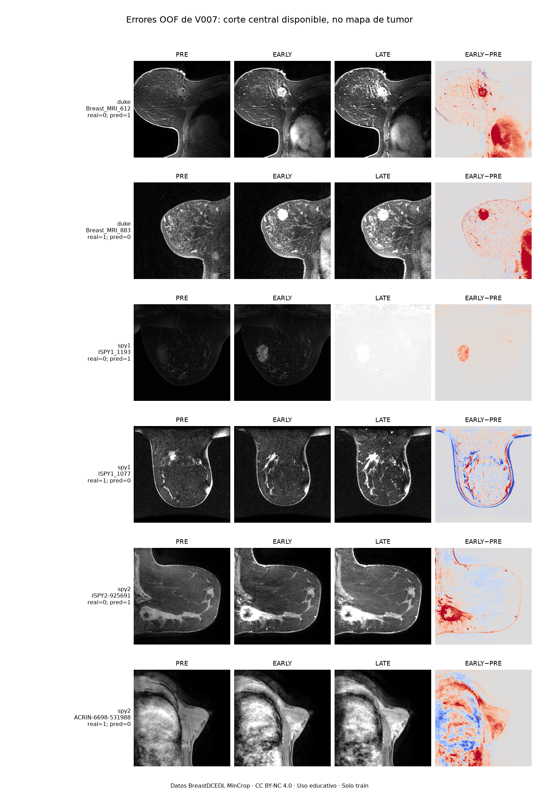
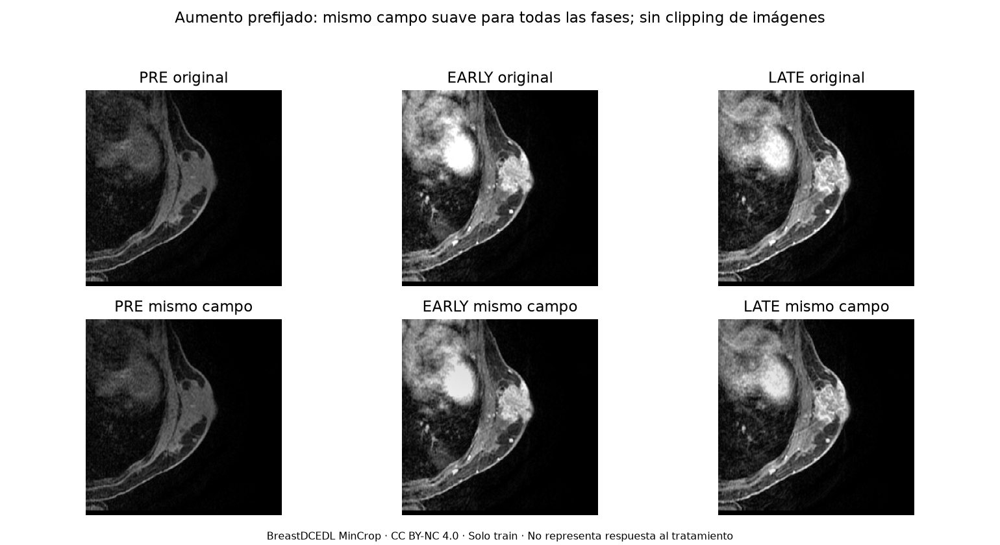
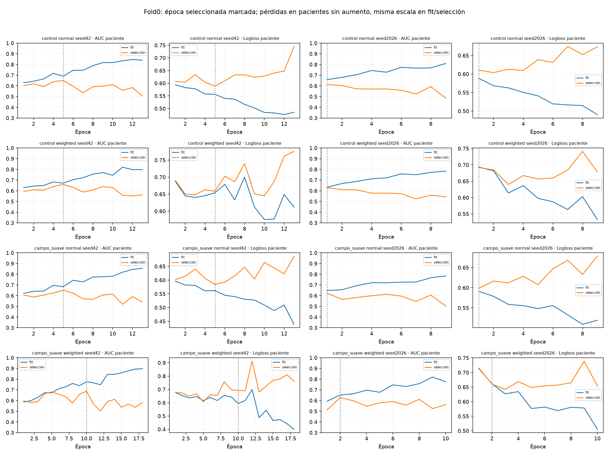
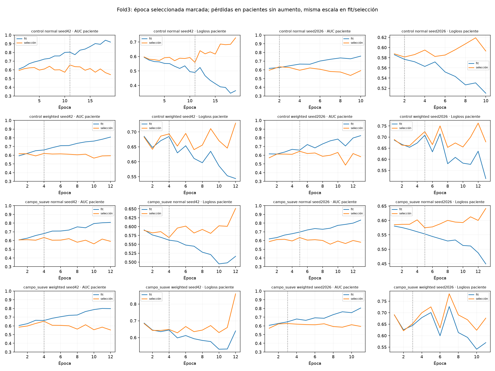
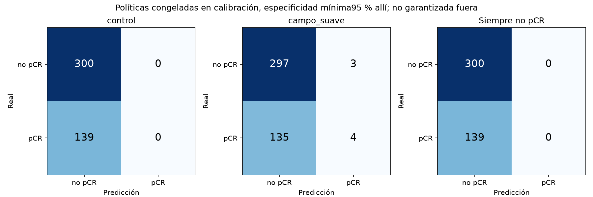
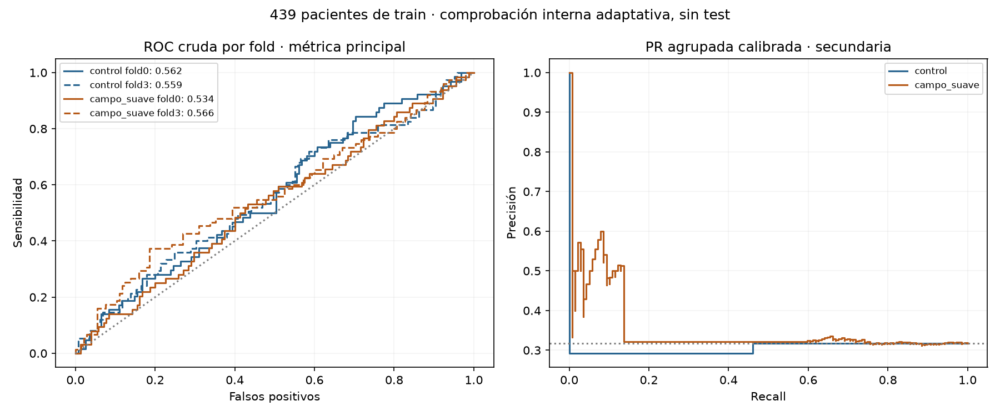
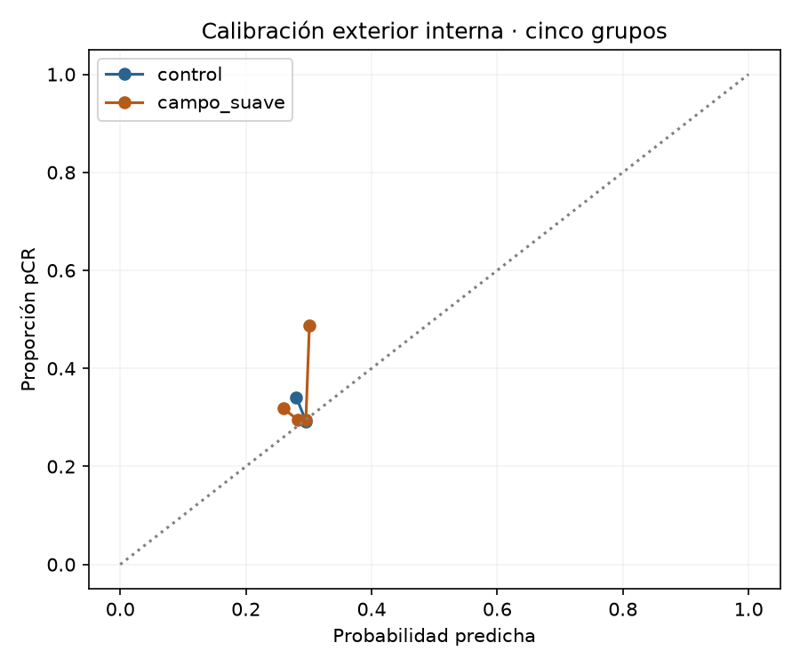

# Robustez de adquisición: piloto de la CNN cinética por paciente

2026-10-25T18:40:56.864718+01:00. Solo train. CNN propia 2D V007, **593.521 parámetros**, desde cero y sin clínica. Dieciséis entrenamientos completados; no se ha abierto test ni validation privada.

## Resultado principal

| Brazo | AUC fold0 | AUC fold3 | Media ± DE entre dos folds | AUC agrupada cruda | AUC agrupada calibrada | Macro-F1 política |
|---|---:|---:|---:|---:|---:|---:|
| control | 0.5617 | 0.5590 | **0.5603 ± 0.0019** | 0.5076 | 0.4719 | 0.4060 |
| campo_suave | 0.5338 | 0.5664 | **0.5501 ± 0.0231** | 0.5064 | 0.5291 | 0.4331 |

La unidad es la paciente: media de todos sus cortes, y ensemble de dos semillas. Pérdida elegida únicamente en selección interna. Son **439 pacientes, 139 pCR**. La AUC agrupada cruda mezcla escalas de folds y queda como secundaria.

Δ media campo−control = **-0.0102**, IC95 % pareado **[-0.0492; +0.0283]**. Intervalos condicionales a modelos fijos, 4.000 bootstrap por fold/cohorte/clase; no corrigen todo el historial de búsqueda. No se comparan estas AUC directamente con el 0,6084 del test histórico.

**Filtro prefijado para ampliar: NO APROBADO; no ampliar esta hipótesis.**

- mean_auc_at_least_060: False
- delta_at_least_002: False
- both_folds_improve: False
- gap_increase_at_most_001: False
- paired_ci95_lower_positive: False

No se declara logrado un AUC independiente de0,60/0,70 por este piloto. Una cifra de selección o de un fold no constituye ese resultado. No se activa ningún candidato ni se reajusta después de comprobar.

## Datos entendidos antes de entrenar

Se auditaron los índices de1.097 pacientes de train y se inspeccionó un corte central disponible por paciente, sin convertirlo en unidad de evaluación. El realce medio EARLY−PRE fue positivo en **99.82%**; LATE disminuyó respecto a EARLY en **20.51%** de esos cortes. La máscara de foreground es solo una selección de píxeles no negros: no delimita el tumor.

Las prevalencias fueron Duke21,05 %, I-SPY1 25 % e I-SPY2 32,14 %. La AUC OOF histórica agrupada de V007 fue0,5264 y la de un diagnóstico basado únicamente en tasas de cohorte de otros folds fue0.5226. La similitud no demuestra causalmente que la CNN use atajos. La media de folds histórica fue0,5766; no confundirla con la agrupada.

Se ven diferencias de adquisición, algunos desplazamientos entre fases y casos con LATE especialmente brillante. Son observaciones exploratorias; no se excluyen pacientes ni se renormalizan fases por separado. No hay contornos radiológicos para afirmar si la red atiende correctamente al tumor.

## Único cambio experimental

Control frente a campo suave de intensidad compartido. Una rejilla aleatoria4×4 por paciente/época se interpola bicúbicamente; el campo se mantiene en[0,85;1] y se aplica con probabilidad0,5 a las tres fases y todos sus cortes. Después se aplica la geometría habitual. No cambia la arquitectura, ni LR, WD, agregación, etiquetas o datos. La atenuación evita añadir saturación; preserva EARLY′−PRE′=B·(EARLY−PRE). Se midió un error máximo numérico de1.2e-07 en esa identidad.

Es una adaptación aleatoria inspirada en [Chen et al., MICCAI2020](https://arxiv.org/abs/2006.13322), que estudian segmentación de RM cardíaca y campos adversariales. No es una reproducción de ese método ni evidencia previa de mejorar pCR.

## Protocolo, entrenamiento y separación

Folds originales0/3 como comprobación de cada modelo. En fold0:614 fit,132 selección,132 calibración,219 comprobación. En fold3:613/132/132/220. Roles disjuntos por paciente, estratificados por cohorte/clase. Entre folds una paciente puede entrenar el modelo de otro fold, como en validación cruzada; nunca el que genera su predicción de comprobación.

LR0,0003, WD0,01, AdamW, lote32, máximo40 épocas, mínimo8, paciencia8 y margen0,001. Semillas42/2026 y mismas inicializaciones y aumentos geométricos en brazos emparejados. BCEWithLogitsLoss normal y ponderada con N0/N1 de pacientes de fit; BCE por corte con contribución total igual por paciente y normalizador fijo. La selección de época usa AUC por paciente sin aumento, no AUC por corte.

Se congelaron las dieciséis épocas seleccionadas y las cuatro elecciones de pérdida antes de calibración. Calibración PlattC1 con pendiente no negativa en pacientes separados. Se congelaron las ocho políticas antes de comprobar. Los hashes se verifican al terminar. El script de informe solo lee resultados; no ejecuta inferencia ni decide otro umbral.

Pasos AdamW reales: **37632**; pasos omitidos AMP: **0**. Pesos/pérdidas finitos: **True**. Tiempo acumulado de épocas: **9.2 minutos**. GPU, memoria, versión de entorno y fuentes están en entorno.json/protocolo.json. Las99 pruebas pasaron antes de entrenar. Se corrigió previamente una incompatibilidad de pandas3 en el script de auditoría; no se modificó una ejecución en marcha.

## Sobreajuste

- control: brecha fit−selección mediana en épocas elegidas **+0.0080**; al final **+0.2378**.
- campo_suave: brecha fit−selección mediana en épocas elegidas **+0.0547**; al final **+0.2357**.

Las pérdidas de las figuras son logloss de probabilidades medias por paciente, evaluadas sin aumento y con la misma definición en fit/selección. La BCE ponderada de optimización se conserva aparte en history.csv y no se presenta como directamente comparable con una BCE normal. La línea vertical marca la época elegida; una brecha pequeña no basta para afirmar buen aprendizaje.

## Normal frente a ponderada

| Brazo | BCE | AUC media folds | Sensibilidad media con política congelada | Especificidad media |
|---|---|---:|---:|---:|
| control | normal | 0.5651 | 0.00% | 100.00% |
| control | weighted | 0.5713 | 0.00% | 100.00% |
| campo_suave | normal | 0.5629 | 2.67% | 98.97% |
| campo_suave | weighted | 0.5466 | 3.33% | 98.62% |

La política de cada receta se ajusta por separado solo en sus132 pacientes de calibración. Estas filas no se usan para escoger otro ganador después de ver la comprobación. No asumir que pos_weight mejora sensibilidad al mantener otro umbral: entrenamiento y decisión son pasos diferentes.

## Umbral, F1 y utilidad académica

La regla principal maximiza sensibilidad entre umbrales con especificidad≥95 % en calibración. Busca reducir falsos optimismos pCR en un uso hipotético, sin autorizar decisiones clínicas. Esa especificidad no está garantizada en pacientes nuevos. La regla secundaria de máximo macro-F1 también quedó fijada en calibración y se conserva por transparencia; no sustituye a la principal según el resultado exterior.

| Política | TN | FP | FN | TP | Sensibilidad | Especificidad | Precisión pCR | F1 pCR | F1 no pCR | Macro-F1 |
|---|---:|---:|---:|---:|---:|---:|---:|---:|---:|---:|
| control | 300 | 0 | 139 | 0 | 0.00% | 100.00% | 0.00% | 0.0000 | 0.8119 | 0.4060 |
| campo_suave | 297 | 3 | 135 | 4 | 2.88% | 99.00% | 57.14% | 0.0548 | 0.8115 | 0.4331 |
| Siempre no pCR | 300 | 0 | 139 | 0 | 0.00% | 100.00% | 0.00% | 0.0000 | 0.8119 | 0.4060 |

## Discriminación y calibración

| Brazo | AP cruda / calibrada | Brier crudo / calibrado | Logloss crudo / calibrado |
|---|---:|---:|---:|
| control | 0.3305 / 0.3054 | 0.2412 / 0.2176 | 0.6788 / 0.6273 |
| campo_suave | 0.3260 / 0.3519 | 0.2361 / 0.2171 | 0.6667 / 0.6260 |

Por cohorte, la siguiente tabla es exploratoria, con muestras pequeñas y escalas de dos folds; no sirve para excluir una cohorte ni crear modelos específicos tras verla.

| Brazo | Cohorte | N | pCR | AUC cruda / calibrada |
|---|---|---:|---:|---:|
| control | duke | 84 | 20 | 0.5477 / 0.5328 |
| control | spy1 | 42 | 7 | 0.6082 / 0.5429 |
| control | spy2 | 313 | 112 | 0.4778 / 0.4526 |
| campo_suave | duke | 84 | 20 | 0.5547 / 0.5184 |
| campo_suave | spy1 | 42 | 7 | 0.5469 / 0.5143 |
| campo_suave | spy2 | 313 | 112 | 0.4809 / 0.5218 |

## Límites y entrega

Esta comprobación interna reutiliza train con amplio historial de desarrollo. Dos folds no completan la validación cruzada de cinco folds exigida para una entrega final y no prueban generalización independiente. El test histórico no se ha vuelto a cargar ni ha elegido ningún parámetro, umbral, exclusión o siguiente entrenamiento.

V007 y V008, versiones anteriores y aplicación quedan intactos. Los pesos de trabajo y checkpoints permanecen locales, fuera de Git; el código, configuración, hashes, curvas e informe permiten revisar el ensayo. No se han publicado ramas ni resultados remotos. El resultado insuficiente se conserva como tal; no se fuerza un0,60 ajustando sobre la comprobación.

## Cierre del ensayo

El aumento no demuestra mejora: AUC media0,5501 frente a0,5603 del control, Δ−0,0102, IC95 %[-0,0492;+0,0283]. No pasa ninguna de las cinco condiciones de ampliación; se cierra y no se entrena cinco folds de esta receta. La política primaria del campo detecta4/139 pCR, con3 falsos positivos: sensibilidad2,88 %, F1 pCR0,0548. No es una clasificación útil de pCR. La selección interna no había garantizado estos resultados.

Las anomalías visuales se comprobaron en todos los cortes de tres pacientes de train: ISPY1_1193 tiene LATE extremadamente brillante; ISPY1_1069/1077 muestran realce medio negativo en sus diez cortes. Ver auditoria/casos_adquisicion.json. No se eliminan, corrigen ni reetiquetan casos sin evidencia del origen. No se afirma que expliquen el bajo AUC global.

El código exacto del ensayo y generador de informe se conserva en el commit local **2c48ab2f533550e62853758dd43ef90af7a673cb**, antecesor de main. Se retiran el entrenador experimental, sus pruebas específicas y scripts asociados del código activo según CONTRIBUTING.md. No se crean ramas ni copias de archivo duplicadas. Las configuraciones e historias completas están en ejecuciones.json e historias.csv; los dieciséis pesos de inferencia y checkpoints de trabajo siguen locales en runs/, excluidos de Git. Las101 pruebas pasaron con el código del piloto; se comprueba después que la suite vigente continúa pasando al retirarlo.

La siguiente prioridad es esclarecer la calidad de entrada y los fallos por paciente, no repetir este aumento con más intensidad. V007 permanece como referencia histórica; este piloto no revalida su test ni demuestra que un nuevo umbral lo haga útil.
