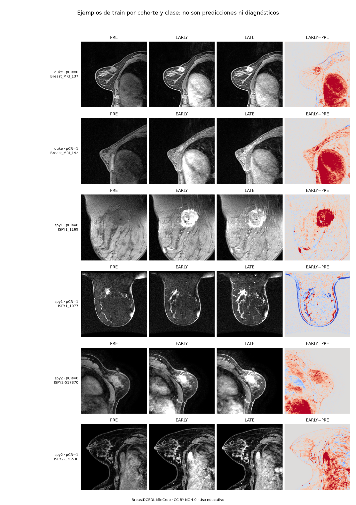
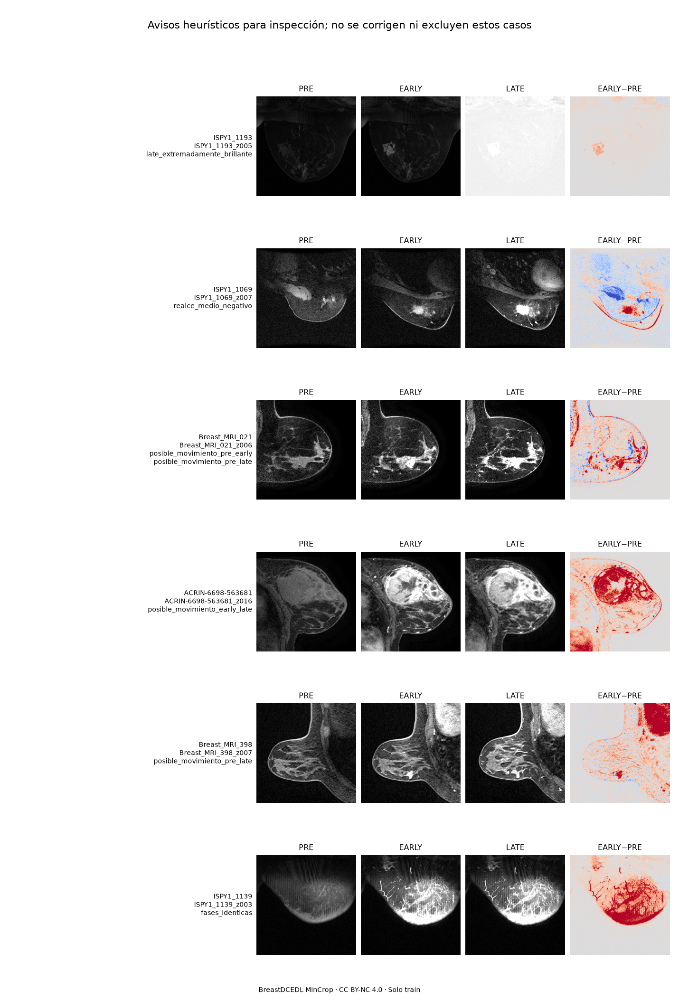
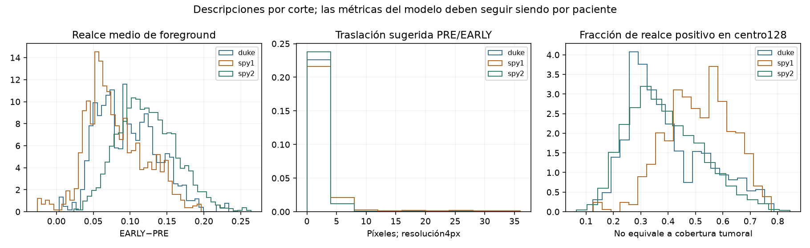
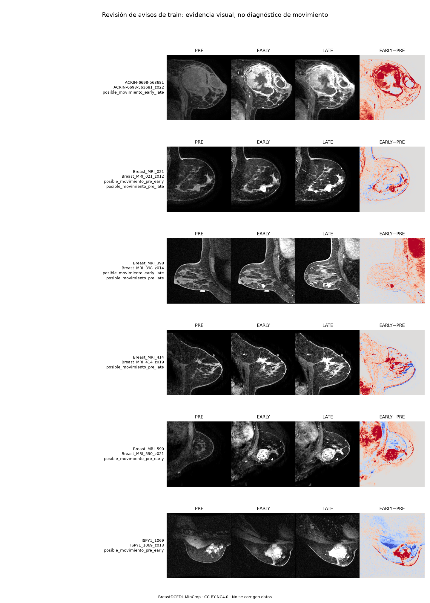
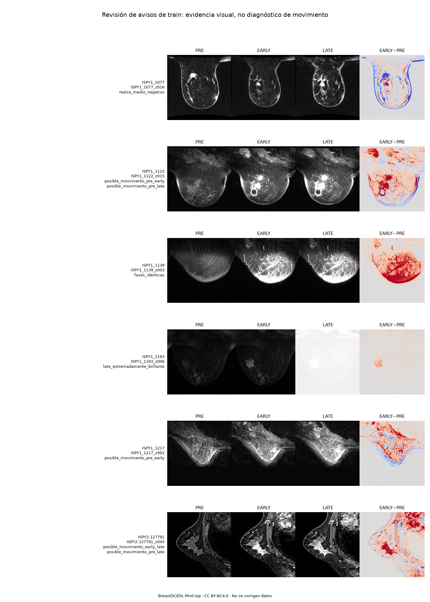
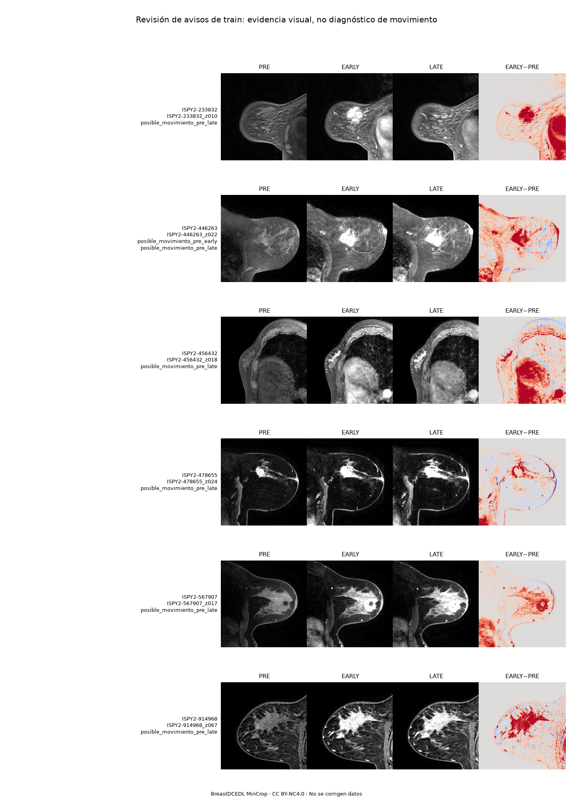

# Auditoría completa de train y protocolo con mayor aprovechamiento de pacientes

2026-10-25T22:20:15.381181+01:00. Alcance autorizado: auditar y preparar; **no entrenar, corregir datos ni activar modelos**.

## Resultado de la auditoría

Se abrieron y validaron los **32,835 PNG** de **10,945 cortes y 1,097 pacientes de train**. Se verificaron formato PNG, escala de grises L, uint8, tamaño 256×256, rango, nombres de fases, correspondencia paciente/corte/z, integridad de lectura y coherencia de los CSV. Los promedios de intensidad se acumulan en float64.

- Archivos ausentes/corruptos o de formato incorrecto: **0**.
- PNG no indexados en train: **0**.
- Discrepancias de etiqueta/cohorte entre índices: **0**.
- Pacientes cruzados entre los splits públicos disponibles en metadata: **0**. No se han abierto imágenes ni usado etiquetas de test/validation para el análisis.
- Imágenes exactamente iguales entre pacientes de train: **0**; tripletas repetidas entre pacientes o cortes de una misma paciente: **0**.
- Avisos heurísticos: **101 cortes de 18 pacientes**, 1.64% de las pacientes. Se inspeccionó una muestra representativa de cada una de esas18, además de ejemplos por cohorte/clase. Un aviso no equivale a un dato erróneo.

El inventario por PNG y todas las métricas por corte permanecen locales; los resúmenes, incidencias, hashes y figuras son revisables. No se ha comparado el contenido de train contra píxeles de test/validation: por tanto no se afirma ausencia absoluta de duplicados entre esos conjuntos.

## Incidencia confirmada: EARLY y LATE repetidas

**ISPY1_1139**, paciente de train: EARLY y LATE son **idénticas píxel a píxel en sus diez cortes**. El CSV indica `n_times=3`, `pre=0`, `post_early=2`, `post_late=2`. Los nombres cumplen el esquema, pero no representan tres adquisiciones diferentes.

La evidencia está en fases_repetidas_confirmadas.json, con los diez hashes y muestras. No se ha reasignado otra adquisición, duplicado una fase distinta ni excluido la paciente. Con estos PNG no puede recuperarse la adquisición intermedia correcta. La política sobre este caso debe aclararse con el responsable del dataset; se entrega un borrador de consulta, sin enviarlo. Una paciente no explica por sí sola el bajo AUC global.

## Avisos que requieren interpretación

- **ISPY1_1193**: LATE extremadamente brillante en los diez cortes; el origen de la diferencia de escala no se determina con los PNG. No se normaliza cada fase por separado.
- **ISPY1_1069 / ISPY1_1077**: realce medio de foreground negativo al promediar sus cortes. Se marcaron16 cortes con media EARLY−PRE<−0,01. Esto no prueba inversión de fases: la media de foreground no mide exclusivamente tumor y es sensible a desplazamientos y adquisición.
- **15 pacientes** presentan alguna sugerencia de traslación. PRE/EARLY:16 cortes; EARLY/LATE:23; PRE/LATE:51. Son conteos por comparación, con solapamientos. No se suman como pacientes diferentes.

Se usó correlación normalizada de magnitudes de gradiente, suavizado y resolución 4px, con búsqueda±24px. Los avisos exigen desplazamiento≥8px, ganancia de correlación≥0,10 y correlación≥0,50, sin máximo en el borde. Los tests recuperan traslaciones sintéticas conocidas y no detectan movimiento al aplicar solo un cambio afín de intensidad.

Un máximo de esa métrica puede deberse al realce; no valida una corrección anatómica. Los máximos en el límite se conservan como ambiguos, no como alineados. Tampoco se detectan necesariamente rotaciones o deformaciones. En algunos ejemplos se aprecian diferencias de contorno PRE/post, pero la revisión es técnica y no sustituye evaluación radiológica.

## Distribución y posición del realce

| Cohorte | Pacientes | pCR | Prevalencia | Mediana de energía de realce positivo en centro128 |
|---|---:|---:|---:|---:|
| duke | 209 | 44 | 21.05% | 35.68% |
| spy1 | 104 | 26 | 25.00% | 51.45% |
| spy2 | 784 | 252 | 32.14% | 36.96% |

La media EARLY supera PRE en **99.82%** de las pacientes. Esto describe el conjunto; no certifica el instante fisiológico real de cada PNG.

La fracción de energía en centro128 **no es la fracción de tumor incluida**: vasos, corazón y parénquima también realzan. Los límites tumorales del CSV están en coordenadas del volumen fuente y no hay una transformación documentada al PNG que permita usarlos como máscaras locales. Por ello **no se concluye que el tumor quede fuera del recorte ni se cambia la arquitectura por esa cifra**. V007 ya conserva una vista global256 además de sus centros128/64.

## Protocolo preparado: cinco folds sin un bloque adicional de calibración

Se conservan los folds originales y la selección interna estratificada por cohorte/clase. Los roles concretos y sus hashes ya están guardados, sin entrenar.

| Fold exterior | Fit | Selección de época/pérdida/política | Comprobación exterior | N0/N1 en fit |
|---|---:|---:|---:|---:|
| 0 | 746 | 132 | 219 | 2.4064 |
| 1 | 746 | 132 | 219 | 2.3756 |
| 2 | 745 | 132 | 220 | 2.3259 |
| 3 | 745 | 132 | 220 | 2.5476 |
| 4 | 746 | 132 | 219 | 2.3756 |

Cada paciente recibe exactamente una predicción exterior por receta, producida por la pareja que no la utilizó para fit ni selección. **Nunca se aplica el ensemble de los cinco folds a sus propias pacientes de train para llamarlo OOF**.

Respecto al último piloto, fit pasa de 614 a746 en fold0 y de 613 a745 en fold3: **132 pacientes adicionales por red**, aproximadamente21,5 %. Ya no existe un bloque de 132 pacientes dedicado solo a calibración. Las1.097 participan en el desarrollo por validación cruzada; eso no significa que todas entrenen cada red.

El compromiso es explícito: **selección comparte época, pérdida, calibración y umbral**. Sus resultados son optimistas y se identifican como selección, no como una comprobación independiente. El fold exterior queda fuera de esas decisiones y evalúa el procedimiento completo. Se conserva un exterior precisamente para estimar ese efecto. Esto aprovecha más datos, pero no elimina todo el sesgo ni garantiza mejor AUC. Véase [Collins et al., BMJ2024](https://www.bmj.com/content/384/bmj-2023-074819) sobre la pérdida de información por fragmentar muestras pequeñas; no implica que ese artículo avale una receta concreta de CNN.

### Decisiones ya explicitadas

- Referencia: CNNMultiescalaCinetica, **593.521 parámetros**, desde cero, mismos recortes, filtros y dropout de V007. Sin variables clínicas como entrada.
- Ambas BCE, semillas 42/2026, cinco folds: **20 ejecuciones de referencia si se autoriza después**. No hay otra matriz en ejecución.
- LR0,0003, WD0,01, lote 32, máximo 40, mínimo 8, paciencia8 y min_delta0,001; receta modal de decisiones internas históricas, no elegida mirando test.
- Contribución igual por paciente con BCE por corte y peso1/n_cortes; pos_weight por pacientes de fit.
- Época elegida solo en selección. La pérdida se elige con AUC del ensemble de semillas de selección; empate a favor de normal.
- Agregación fija: media de probabilidades de todos los cortes y de ambas semillas. AUC principal: media±DE de los cinco folds; agrupadas cruda/calibrada como secundarias.
- Platt C=1 con pendiente no negativa, ajustado en selección sobre la misma pareja. Umbral primario: máxima sensibilidad con especificidad≥95 % en selección; secundario macro-F1, sin escoger después entre políticas mirando exterior.
- Las cinco elecciones y políticas se congelarán antes de evaluar exterior. Se informarán curvas, brechas en la época elegida, AP, calibración, sensibilidad/especificidad, F1 por clase y comparación con siempre no pCR.

## Futuro modelo final: diseño, no entrenamiento

La partición final ya prefijada contiene **932 pacientes para fit y165 para selección/política**, estratificadas por cohorte/clase. Si se llega a autorizar una receta cerrada, serían cuatro entrenamientos: normal/ponderada por dos semillas, con elección y política solo en esas165.

El paquete resultante sería **una pareja fija de dos semillas**. Su calibración y umbral se ajustarían con las predicciones de esa misma pareja y media de cortes. Se evita trasladar una calibración aprendida con puntuaciones de dos modelos a una media de diez. No se sustituyen ahora V007/V008 ni la app.

La CV evalúa el procedimiento con fit745–746, no garantiza el rendimiento de los futuros pesos con 932. La selección final no es una evaluación independiente. El test histórico permanece sin volver a consultar; una confirmación nueva corresponde al profesor con su validación privada y el procedimiento congelado. No se promete alcanzar0,60.

## Condiciones antes de cualquier entrenamiento

1. Aclarar la fase repetida de ISPY1_1139 y la política autorizada sobre la incidencia; revisar la escala extrema de ISPY1_1193.
2. Mantener trazabilidad de cualquier corrección que llegase a autorizarse; sin cambios individuales según etiqueta, error del modelo o test.
3. Registrar una hipótesis de un solo cambio, comparador y criterio de ampliación antes de entrenar. Este protocolo prepara la evaluación, no elige una arquitectura nueva.
4. Nueva autorización de entrenamiento: **en este trabajo no se ha iniciado ninguno**.

## Evidencia e integridad

- Código de auditoría/protocolo: commit local96a98cf3056062c07572060c96728340548c1320.
- 99 pruebas pasaron: caminos cerrados a train, formatos, etiquetas coherentes, recuperación de traslación, invariancia a intensidad afín, cinco folds disjuntos y ausencia de entrenamiento.
- Árbol de datos train, SHA-256 agregado: `0021b690cf50660f5575295d34c937957bf16631b9b7f73460a7cc03bdd4802e`.
- Metadatos, PNG y versiones históricas se conservaron; modelos y aplicación no se modificaron. No se hicieron push ni ramas nuevas.
- El inventario de 32.835 archivos y las métricas exhaustivas por corte permanecen locales; los hashes, resúmenes e incidencias permiten localizar la evidencia.

## Revisión visual de las 18 pacientes señaladas

