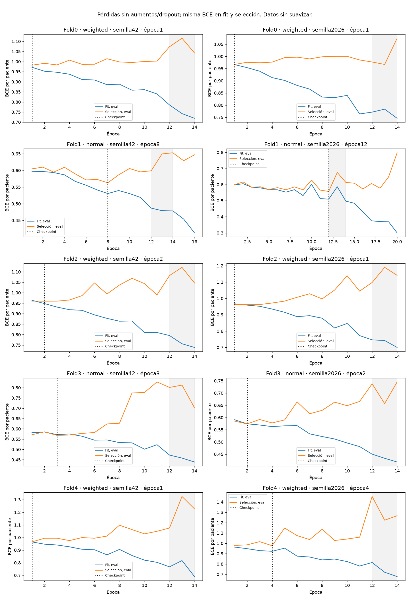
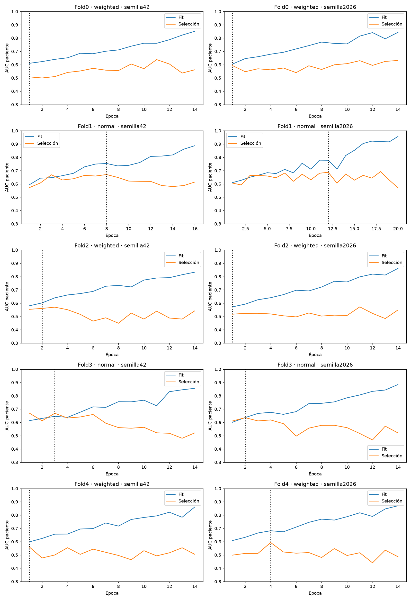
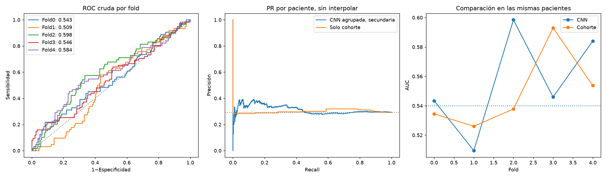

# Criterio del profesor: ensayo insuficiente

**Cerrado sin adoptar.** AUC media0,5563 frente a cohorte0,5490; diferencia+0,0073 con IC95%[-0,0326;+0,0475]. No demuestra mejora sobre cohorte ni aprendizaje conjunto sostenido hasta14. AUC OOF agrupada cruda0,5127. No se considera cumplida la petición del profesor ni se sustituye un modelo.

Misma CNN propia de593.521 parámetros, desde cero, PRE/EARLY/LATE y diferencias;20 entrenamientos, cinco folds, dos semillas, BCE normal/ponderada. Datos originales conservados, incluidas incidencias auditadas. Test y validación privada cerrados; desarrollo con antecedentes adaptativos.

La referencia de solo cohorte aprende prevalencias exclusivamente en fit: mediaAUC **0.549012**. El valor0,54 es orientativo; aquí se compara contra la referencia realmente calculada.

La CNN con checkpoint por BCE interna tiene mediaAUC **0.556270 ± 0.035413**; IC95% condicionado [0.5174103151312222, 0.5940122733874982]. Diferencia respecto a cohorte **+0.007258**, IC95% pareado [-0.03263971656502769, 0.04754197888773753]. Criterio puntual superado: **True**; evidencia condicionada de mejora sobre cohorte: **False**. AUC agrupada cruda secundaria 0.512731; no sustituye la media por fold.

## Curvas y sobreajuste

Ambas pérdidas se calculan en eval, sin aumentos ni dropout, después de la media de todos los cortes por paciente, usando idéntico pos_weight dentro de cada run. La BCE de optimización por corte se conserva separada; no se compara directamente con la pérdida por paciente. Las pérdidas ponderadas y normales no se comparan por magnitud para elegir el brazo.

Se observaron al menos14 épocas; se puede seleccionar una época anterior. **0/10** modelos elegidos muestran pendiente negativa en ambas pérdidas en1–14 y media12–14 inferior a1–3. Brecha AUC fit−selección mediana en los checkpoints **0.048353**. Curvas próximas pueden indicar infraajuste y no demuestran discriminación. Las gráficas conservan cada punto observado; no se exige una bajada monótona ni se altera LR para alcanzar una época estética.

## Métricas y comparación

La regla de checkpoint por AUC en las mismas trayectorias obtiene media **0.552695**. Es un diagnóstico prefijado, con la misma parada por pérdida: no una comparación causal de dos recetas completas ni una autorización para elegirla después de mirar exterior.

BCE normal fija: 0.555445; ponderada fija: 0.570209. La pérdida principal de cada fold se eligió en selección, no exterior. Todas las cinco parejas y políticas se congelaron antes de inferir exterior. Selection se reutiliza para checkpoint, pérdida, calibración y umbral: sus métricas son optimistas. La CV evalúa el procedimiento completo con745–746 pacientes fit y132 de selección por fold.

Política principal, especificidad objetivo95% en selección: TN739, FP36, FN300, TP22; sensibilidad6.83%, especificidad95.35%, F1pCR0.1158, macroF10.4653. Decir siempre no pCR: macroF10.4140. Esto no constituye una recomendación clínica ni selección de otra política con exterior.

Comparación completa por cohorte, AP, Brier/logloss calibrados, umbral0,5 crudo y política congelada en comparacion.json y oof_loss.csv. La política secundaria macroF1 y sus predicciones también se conservaron sin escogerla mirando exterior. Umbrales de validación no garantizan especificidad95% exterior.

## Límites y decisión

No es una nueva evaluación ciega: train y el test histórico ya se han examinado en el proyecto. Bootstrap2000 por fold/clase, pareado por paciente, condicionado a estos modelos; no incorpora toda variabilidad de selección/entrenamiento. Una estimación superior a0,54 no demuestra por sí sola señal tumoral; se informa el comparador de cohorte y AUC dentro de cada cohorte. No se promete0,60. No se activa ni publica un modelo, no se entrena refit y no se inicia otra búsqueda automática.

La preferencia de curvas conjuntamente descendentes se incorpora como diagnóstico comprobable, no como prueba suficiente de generalización. [Cawley y Talbot](https://www.jmlr.org/papers/v11/cawley10a.html) documentan el sesgo por optimizar repetidamente la selección; repetir CV sobre este train no borra su historial.

## Cierre y conservación

20/20 entrenamientos;289 épocas;67.337 pasos AdamW sin omisiones. Duración total17min20s, incluyendo carga/evaluación/informe. Las106 pruebas previas pasaron; las métricas y la matriz se recalcularon por una vía independiente y los diez pesos elegidos se cargaron en procesos sin optimizador para inferencia CPU sintética. Cero de20 trayectorias cumple el diagnóstico conjunto1–14; solo una de las diez redes elegidas tiene su óptimo de pérdida en la época12.

BCE ponderada fija tiene media0,5702, un resultado secundario que no reemplaza la regla principal después de observar exterior. La selección por AUC en las mismas trayectorias obtiene0,5527. Ninguno demuestra haber eliminado el sobreajuste. No se inicia otra tanda.

El código y sus pruebas se retiran del árbol activo al cerrar el ensayo, según CONTRIBUTING.md, y se conservan en main en el commit db845626bfca69276217074256fc131c0bffbc01. No ejecutar sus comandos con el árbol actual; consultar ese commit para reproducirlo en un entorno separado. Los pesos y checkpoints de trabajo siguen locales e ignorados en runs/. Informes, historias ligeras, configuraciones, resúmenes, predicciones y hashes se conservan. No se crea una versión productiva, no se cambia la app y no se hace push.

La primera invocación falló antes de importar el paquete por resolver el enlace del Python del entorno virtual. Se corrigió únicamente el lanzador; cero pasos de entrenamiento en ese intento, sin cambio de protocolo. Evidencia en intento_lanzamiento_fallido.json.
