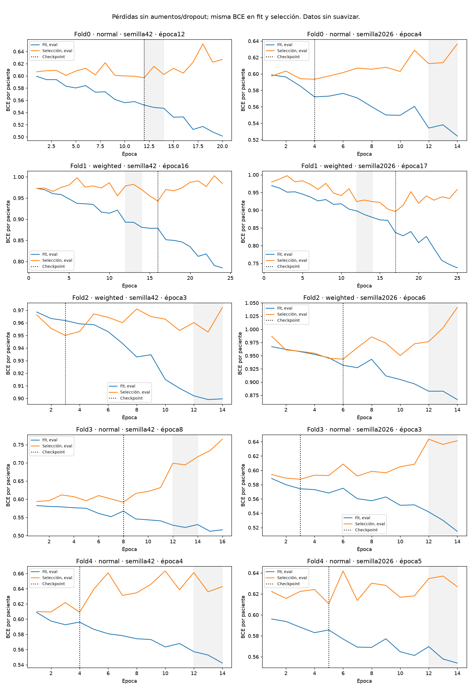
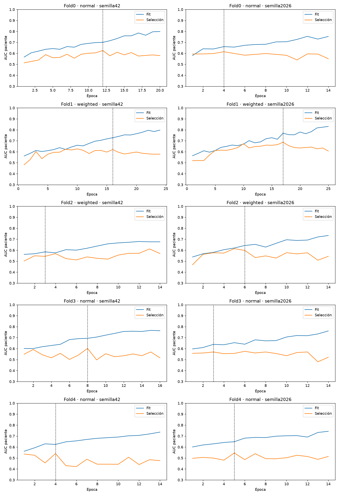
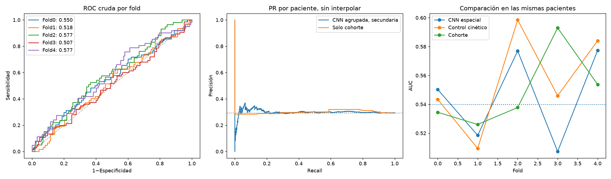

# CNN espacial compacta por corte: comparación prefijada

**Cerrado sin adoptar.** MediaAUC0,546094±0,032469 frente a control0,556270 y cohorte0,549012. La diferencia frente a cohorte es−0,002918, IC95%[-0,042034;+0,037720]; frente al control−0,010176, IC95% secundario[-0,041030;+0,021731]. No demuestra mejora ni un empeoramiento concluyente. AUC OOF agrupada cruda0,510214. Las curvas más largas de algunos runs no se trasladan a discriminación exterior. No se sustituye ningún modelo ni se inicia otra tanda.

Nueva CNN propia de **105,569 parámetros**, desde cero, PRE/EARLY/LATE y diferencias firmadas. Tres bloques16/32/64, vista global128, cuadrícula4×4, cabeza32 y un logit por corte. Media de probabilidades de todos los cortes fuera de la red. Sin atención/max entre cortes, clínica, EMA, mixup ni label smoothing.20 entrenamientos, cinco folds, dos semillas, BCE normal/ponderada. Datos originales conservados, incluidas incidencias auditadas. Test y validación privada cerrados; desarrollo con antecedentes adaptativos.

Se cambia únicamente la arquitectura, definida completamente en protocolo.json. Roles, semillas, batch32, LR0.0003, WD0.01, dropout.35/.1, BN/ReLU, aumentos geométricos, máximo40/mínimo14/paciencia8, contribución1/n_cortes y normalizador fijo, selección por pérdida, elección de BCE por AUC interna y políticas coinciden con el control cerrado. No se atribuye el cambio a un único componente de la nueva arquitectura. El piloto espacial histórico con atención/EMA tenía otro contrato y sus cifras internas0.595/0.611 no son resultados de este modelo.

La referencia de solo cohorte aprende prevalencias exclusivamente en fit: mediaAUC **0.549012**. El valor0,54 es orientativo; aquí se compara contra la referencia realmente calculada.

La CNN con checkpoint por BCE interna tiene mediaAUC **0.546094 ± 0.032469**; IC95% condicionado [0.507617326863203, 0.5840638925542048]. Diferencia respecto a cohorte **-0.002918**, IC95% pareado [-0.04203350018478336, 0.037719821249243404]. Criterio puntual superado: **False**; evidencia condicionada de mejora sobre cohorte: **False**. AUC agrupada cruda secundaria 0.510214; no sustituye la media por fold.

Control cinético cerrado: media **0.556270**. Delta espacial−control **-0.010176**, IC95% pareado secundario [-0.041029825186294305, 0.02173148591098398]. Se compara sobre las mismas pacientes, sin reentrenar ni escoger otra receta del control. La comparación contra cohorte es principal; no se interpretan dos intervalos secundarios como prueba conjunta corregida.

## Curvas y sobreajuste

Ambas pérdidas se calculan en eval, sin aumentos ni dropout, después de la media de todos los cortes por paciente, usando idéntico pos_weight dentro de cada run. La BCE de optimización por corte se conserva separada; no se compara directamente con la pérdida por paciente. Las pérdidas ponderadas y normales no se comparan por magnitud para elegir el brazo.

Se observaron al menos14 épocas; se puede seleccionar una época anterior. **2/10** modelos elegidos muestran pendiente negativa en ambas pérdidas en1–14 y media12–14 inferior a1–3. Brecha AUC fit−selección mediana en los checkpoints **0.078215**. Curvas próximas pueden indicar infraajuste y no demuestran discriminación. Las gráficas conservan cada punto observado; no se exige una bajada monótona ni se altera LR para alcanzar una época estética.

En las20 trayectorias, **4/20** muestran esa mejora conjunta. Mediana de época elegida en las diez redes principales **5.5**. Se completaron **346 épocas** y **80618 pasos AdamW**, sin pasos omitidos. Una mejora conjunta1–14 puede corresponder solo al ajuste de prevalencia: se exige analizar además AUC y su comparación exterior con cohorte.

## Métricas y comparación

La regla de checkpoint por AUC en las mismas trayectorias obtiene media **0.556638**. Es un diagnóstico prefijado, con la misma parada por pérdida: no una comparación causal de dos recetas completas ni una autorización para elegirla después de mirar exterior.

BCE normal fija: 0.538726; ponderada fija: 0.540940. La pérdida principal de cada fold se eligió en selección, no exterior. Todas las cinco parejas y políticas se congelaron antes de inferir exterior. Selection se reutiliza para checkpoint, pérdida, calibración y umbral: sus métricas son optimistas. La CV evalúa el procedimiento completo con745–746 pacientes fit y132 de selección por fold.

Política principal, especificidad objetivo95% en selección: TN750, FP25, FN308, TP14; sensibilidad4.35%, especificidad96.77%, F1pCR0.0776, macroF10.4479. Decir siempre no pCR: macroF10.4140. Esto no constituye una recomendación clínica ni selección de otra política con exterior.

Comparación completa por cohorte, AP, Brier/logloss calibrados, umbral0,5 crudo y política congelada en comparacion.json y oof_loss.csv. La política secundaria macroF1 y sus predicciones también se conservaron sin escogerla mirando exterior. Umbrales de validación no garantizan especificidad95% exterior.

AUC por cohorte y fold en auc_por_cohorte_y_fold.csv; los grupos SPY1 tienen pocos positivos. Las AUC agrupadas por cohorte combinan puntuaciones de modelos distintos y son secundarias, no sustituyen las medidas dentro de cada fold.

## Límites y decisión

No es una nueva evaluación ciega: train y el test histórico ya se han examinado en el proyecto. Bootstrap2000 por fold/clase, pareado por paciente, condicionado a estos modelos; no incorpora toda variabilidad de selección/entrenamiento. Una estimación superior a0,54 no demuestra por sí sola señal tumoral; se informa el comparador de cohorte y AUC dentro de cada cohorte. No se promete0,60. No se activa ni publica un modelo, no se entrena refit y no se inicia otra búsqueda automática.

La preferencia de curvas conjuntamente descendentes se incorpora como diagnóstico comprobable, no como prueba suficiente de generalización. [Cawley y Talbot](https://www.jmlr.org/papers/v11/cawley10a.html) documentan el sesgo por optimizar repetidamente la selección; repetir CV sobre este train no borra su historial.

## Cierre verificado

20/20 ejecuciones;346 épocas;80.618 pasos AdamW sin omisiones. Duración del runner8min57s, incluyendo carga y evaluación.109 pruebas previas. Las AUC se recalcularon mediante rangos de Mann–Whitney, la matriz se verificó con conteos independientes y los diez pesos elegidos se cargaron con weights_only sin optimizador para inferencia CPU sintética. Tamaño/mtime de los32.835 PNG originales y hashes de modelos/control conservados.

En los diez modelos elegidos, descenso conjunto1–14:2/10, frente a0/10 en control; mediana de época elegida5.5, frente a2.0; brecha AUC fit−selección mediana0.078215, frente a0.048353. No hay eliminación general del sobreajuste. El análisis de4/20 trayectorias con descenso es diagnóstico descriptivo, no una prueba estadística de beneficio de arquitectura.

El mejor checkpoint por AUC de las mismas trayectorias obtiene media0,556638 y su ponderada fija0,564831. Son secundarios prefijados: no se adopta retrospectivamente la cifra más favorable.

Código y pruebas del candidato se retiran del árbol activo conforme a CONTRIBUTING.md y se conservan en el commit ea01a35ba68f396870973225733fd927ea89ab40 de main. Sus comandos son históricos; no ejecutarlos contra el árbol actual. Los pesos y checkpoints de trabajo siguen locales e ignorados en runs/. Se conservan historias, configuraciones, resúmenes, predicciones y hashes. No se crea una versión productiva, no se modifica la app y no se hace push.
