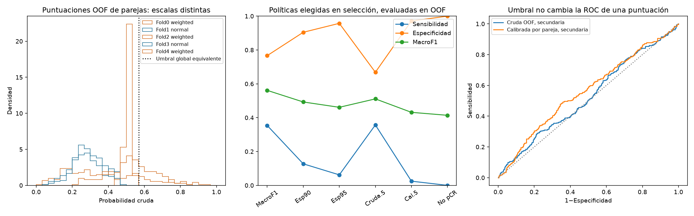
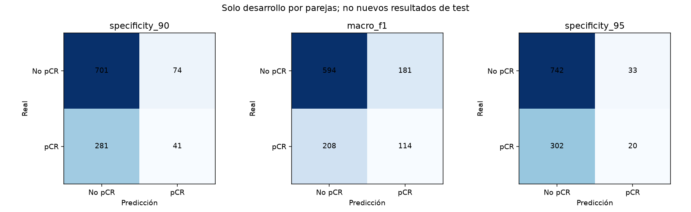
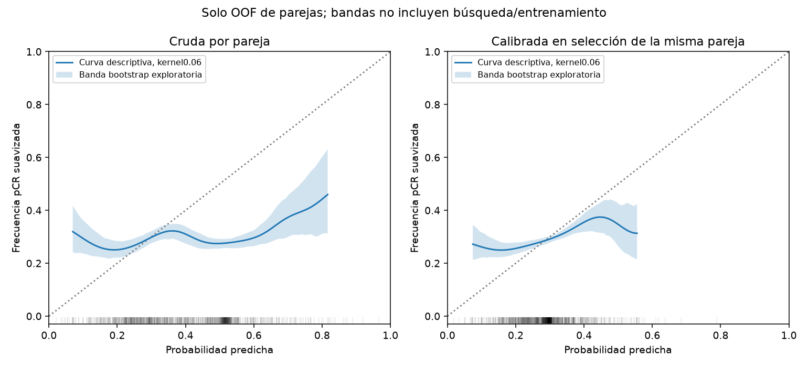

# Auditoría de calibración y política de V007

**Resultado: mejora de clasificación en CV por parejas, sin cambio de AUC.** Sensibilidad12,73%→35,40%; F1pCR0,1876→0,3695; macroF10,4928→0,5614. FP74→181 y FN281→208. Delta macroF1+0,0686, IC95% pareado[+0,0409;+0,0966]. La política está marcada no desplegable para el ensemble10: no se ha probado un umbral nuevo en test ni cambiado ningún peso.

26/10/2026. Sin reentrenamiento de la CNN ni inferencia de pacientes; solo metadatos de train, selección y OOF históricas. No se abren test ni validación privada. Los diez pesos y todas las versiones permanecen intactos. La inferencia se comprueba aparte con PNG sintéticos.

## Qué está confirmado

V007 despliega la media de diez redes, pero ajustó calibración/umbral global sobre OOF de parejas de dos redes. Además, las parejas seleccionadas mezclan BCE normal/ponderada y configuraciones distintas. Las puntuaciones crudas cambian de escala entre folds. La implementación de PNG/255, media de todos los cortes/modelos y calibración coincide con el manifiesto en una prueba sintética; no se ha detectado un error aritmético de inferencia.

La calibración archivada se reproduce desde sus OOF: pendiente0.098274, intercepto-0.833029; umbral calibrado0.308794, equivalente crudo0.568922. Estrategias que reproducen ese umbral en desarrollo:['specificity_90']. La etiqueta del manifiesto test_evaluated_once=False es una instantánea archivada previa a la evaluación histórica ya documentada; no autoriza repetir test y no se modifica esa versión.

Esto confirma una diferencia entre cómo se obtuvieron las puntuaciones de calibración y las puntuaciones de despliegue, no demuestra que cause por sí sola la sensibilidad nula observada históricamente. Tampoco elimina la débil discriminación ni el sobreajuste de la red.

## Comparación con las mismas parejas y pacientes

Cinco calibraciones y umbrales se fijaron con selección interna de cada pareja antes de evaluar sus OOF archivadas. La política principal nueva maximiza macroF1 en selección; la referencia reproduce exactamente la política original por pareja con especificidad objetivo90%. La política95% y los umbrales0,5 son secundarios prefijados, no se escoge la política más favorable después de ver exterior. Selection ya eligió checkpoints/configuraciones: tiene optimismo; las OOF tienen historia adaptativa y no son una nueva confirmación independiente.

| Política | Sensibilidad | Especificidad | F1pCR | MacroF1 | FP | FN |
|---|---:|---:|---:|---:|---:|---:|
|macro_f1|35.40%|76.65%|0.3695|0.5614|181|208|
|specificity_90|12.73%|90.45%|0.1876|0.4928|74|281|
|specificity_95|6.21%|95.74%|0.1067|0.4612|33|302|
|raw_050|35.71%|66.84%|0.3314|0.5110|257|207|
|calibrated_050|2.48%|97.16%|0.0455|0.4315|22|314|
|always_no_pcr|0.00%|100.00%|0.0000|0.4140|0|322|

Delta macro-policy−spec90, IC95% pareado: macroF1[0.04093012934226463, 0.09662306613462325]; sensibilidad[0.18633540372670807, 0.2701863354037267]; especificidad[-0.16387096774193544, -0.11483870967741938]. Bootstrap2000 por fold/clase, condicionado a estos modelos. Ganar sensibilidad puede incrementar falsos positivos; macroF1 es un criterio académico, no una preferencia clínica validada.

AUC cruda por paciente **sin cambio**: media de folds0.576593 ±0.030063, agrupada0.526404. La calibración creciente conserva AUC dentro de cada fold; agrupada calibrada0.561803 es un análisis secundario de puntuaciones diferentes, no mejora de discriminación dentro de cada modelo.

Calidad probabilística: {'raw_pair_oof': {'brier': 0.23827773448676606, 'logloss': 0.6768293588555861, 'mean_prediction': 0.3972439238294358, 'prevalence': 0.2935278030993619}, 'calibrated_pair_oof': {'brier': 0.20941803846618418, 'logloss': 0.6137874330870201, 'mean_prediction': 0.2859033483823437, 'prevalence': 0.2935278030993619}, 'global_fit_apparent_only': {'brier': 0.20710747623598197, 'logloss': 0.6046772141020255, 'mean_prediction': 0.29350667072001196, 'prevalence': 0.2935278030993619}}. Brier/logloss mezclan calibración y discriminación, no prueban por sí solos buena calibración. Curvas de evaluación con kernel gaussiano de ancho0,06 prefijado y dominio percentiles1–99; bandas exploratorias200 bootstrap por fold/clase, condicionadas a estas puntuaciones y sujetas al sesgo del suavizado. No se utilizan para recalibrar ningún modelo ni para estimar la calibración del ensemble10.

## Qué se puede utilizar

politicas_congeladas.json pertenece únicamente al procedimiento de cinco parejas y está marcado deployable=False. No sustituye la calibración/umbral del ensemble completo ni se conecta a la app. No se calculan nuevas métricas de test con ningún umbral.

Intersección de pacientes nunca usadas para fit por ninguna red:1; nunca usadas para fit ni selección:0. No hay una reserva suficiente para validar con estos pesos una recalibración del ensemble completo. No se predice con las diez redes sobre train para presentar resultados contaminados como validación.

Para un paquete futuro coherente habría que fijar una pareja y reservar pacientes para su propia política antes de entrenar, o disponer de nuevas pacientes etiquetadas permitidas y no usadas para desarrollo. El diseño932fit/165selección-pólítica ya está preparado, pero no se ejecuta: no hemos iniciado otro entrenamiento ni prometido conservar el AUC histórico de V007. La confirmación final corresponde al profesor con evaluación independiente permitida. No se modifican versiones ni aplicaciones ni se hace push.

[Umbrales, ROC y validación](https://scikit-learn.org/stable/modules/classification_threshold.html). [Calibración y ensembles](https://scikit-learn.org/stable/modules/calibration.html). Los indicadores Brier/logloss no aíslan por sí solos la calibración. Las decisiones y AUC se reportan por separado.

## Verificación y cierre

104 pruebas pasaron. Las seis matrices y los F1 se comprobaron mediante sklearn, independientemente de las fórmulas por conteos del auditor. El AUC crudo0,526403526 se verificó comparando todos los pares positivo/negativo. Los cinco calibradores y umbrales originales por pareja se reconstruyen exactamente. La inferencia real de V007 coincide con el cálculo manual en una paciente sintética de tres cortes; no se detecta un error de normalización/medias.

Diagnóstico probabilístico descriptivo añadido al cierre, sin seleccionar otra política: la prevalencia de pacientes de fit de cada fold tiene Brier0,207726 y logloss0,606147; las puntuaciones calibradas por pareja tienen Brier0,209418 y logloss0,613787. La calibración reduce el error frente a las puntuaciones crudas, pero no supera este baseline de prevalencia en estas OOF. No se equipara mejora de F1 con buena calibración ni discriminación clínica suficiente.

Se conservan V007 y sus pesos tal cual; no se crea una versión productiva ni se activa la política. Esta auditoría deja preparado el diagnóstico y las políticas de CV; el paso pendiente para un paquete coherente es fijar una pareja con su propia reserva y confirmar posteriormente con pacientes permitidas no usadas para desarrollo. No se inicia ese entrenamiento aquí. Todo queda en main local, sin push.
