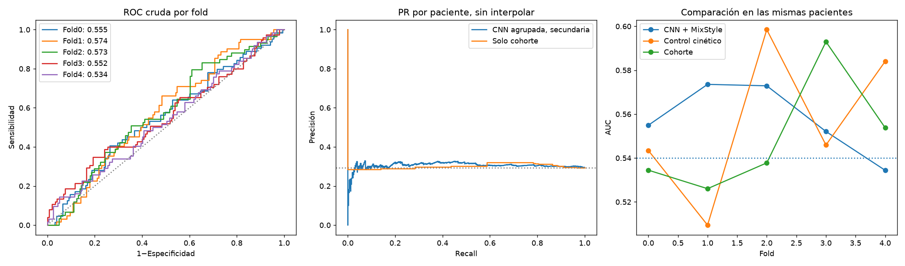
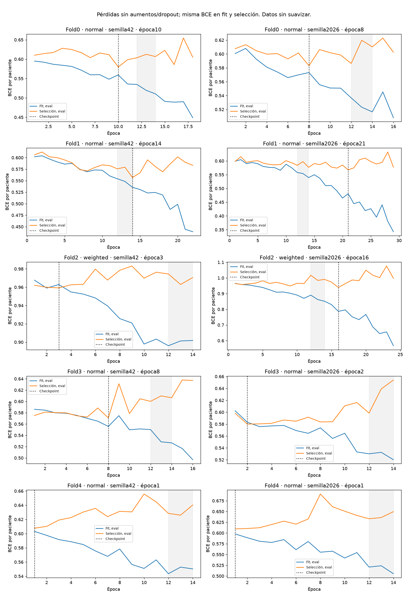
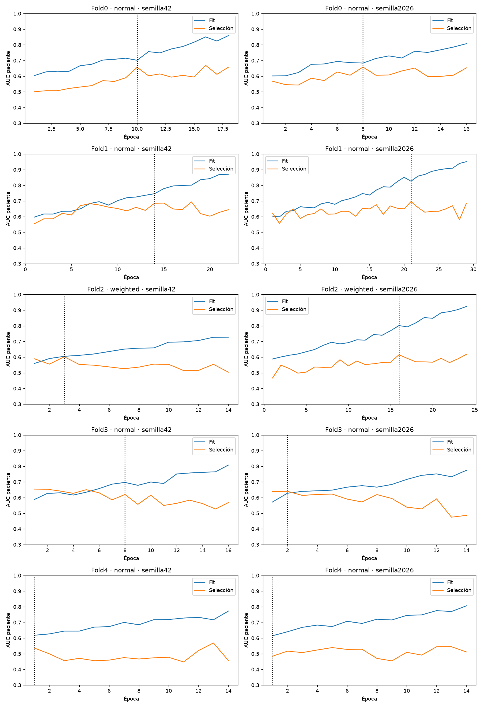
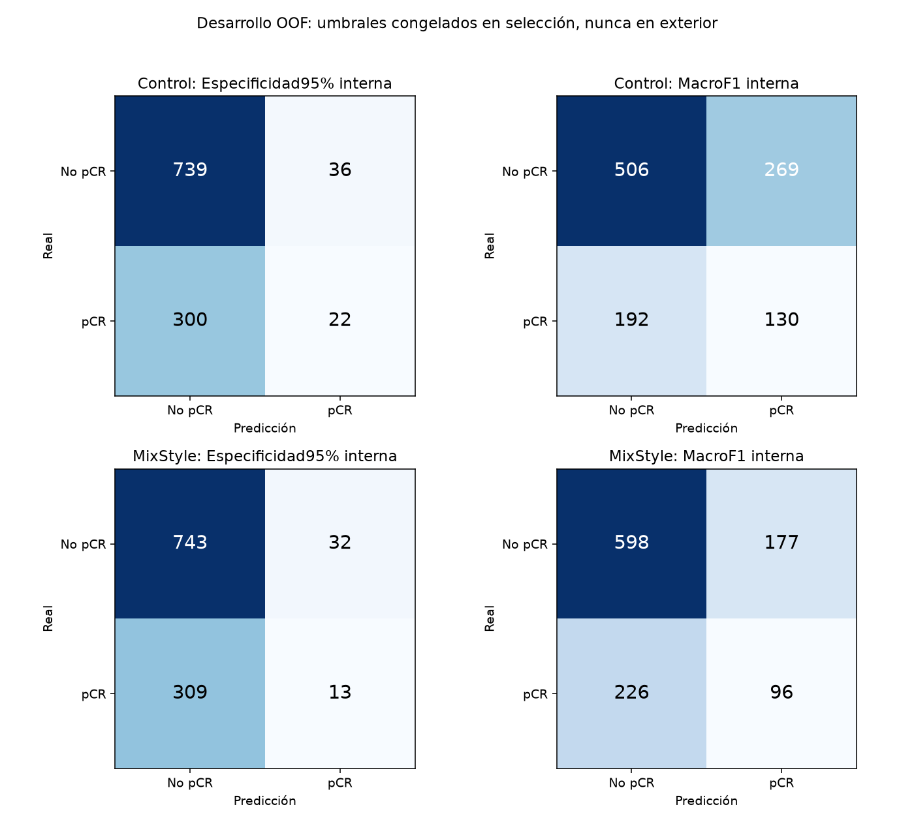

# MixStyle en la CNN cinética: resultado insuficiente

26/10/2026. **No se demuestra una mejora y no se alcanza AUC 0,60.** Se completaron
20 entrenamientos en 20,6 minutos,
sin fallos numéricos. Esta configuración no se promociona y no se inicia otra tanda.

## Qué se investigó y qué se probó

[Zhou et al., ICLR 2021](https://arxiv.org/html/2104.02008v1) proponen MixStyle:
mezclar estadísticas de características tempranas durante entrenamiento para
variar la apariencia que ve la red. Sus experimentos son de clasificación
natural, reidentificación y aprendizaje por refuerzo; no prueban mejora de pCR.
La extensión [CSU de 2024](https://pubmed.ncbi.nlm.nih.gov/38978834/) incluye
clasificación médica, pero usa otro método y otro tipo de imágenes. No se
implementa CSU ni se trasladan sus cifras a estas RM.

Se implementó una adaptación propia de MixStyle a la CNN multiescala V007:
misma arquitectura y **593.521 parámetros**, pesos aleatorios, sin preentrenados
ni clínica. PRE/EARLY/LATE PNG/255 y diferencias firmadas, con un logit por corte
y media de probabilidades de todos los cortes de cada paciente.

El único cambio fue MixStyle tras los bloques 0 y 1: probabilidad 0,5,
Beta(0,1; 0,1), epsilon 1e-6 y estadísticas FP32 con gradiente detenido. Las tres
vistas de un corte comparten pareja y coeficiente; cada vista se empareja con
su misma escala. La permutación aleatoria solo usa cortes del lote de fit,
sin etiquetas ni cohorte; puede emparejar cortes de la misma paciente o mantener
alguno. No mezcla etiquetas, fases ni píxeles. En inferencia es identidad.
Las estadísticas pueden contener señal biológica: no se presupone que sean
exclusivamente información del escáner.

Ya se habían revisado los descartes de LR/WD, capacidad/dropout, GroupNorm,
SAM, FiLM, mixup, campos de brillo y la CNN espacial. No se repiten esos cambios.

## Protocolo y comparación equitativa

Cinco folds auditados, dos semillas (42/2026) y BCE normal/ponderada: 20 ejecuciones.
Por fold: 745–746 pacientes fit, 132 de selección y 219–220 exteriores. Mismos
roles, semillas, arquitectura, batch 32, LR 0,0003, WD 0,01, dropout 0,35/0,1,
aumentos geométricos compartidos, coseno de 40 épocas, mínimo observado 14 y
paciencia 8 que el control cerrado del ensayo 27. Se permite elegir una época
anterior a 14; no se alargan curvas para mejorar su apariencia.

La BCEWithLogitsLoss por corte usa contribución 1/n_cortes por paciente y un
normalizador fijo; el peso positivo se calcula con pacientes de fit. Checkpoint
principal por mínima BCE interna por paciente; elección de pérdida por AUC de la
pareja en selección, empate normal. Las cinco elecciones, calibraciones y
políticas se congelaron antes de inferir exterior. Selection se reutiliza para
checkpoint, pérdida, calibración y umbral: sus cifras son optimistas.

Se reutiliza el control cerrado, sin reentrenarlo ni cambiar su receta.
La revisión del AST confirma el mismo procedimiento salvo la fábrica del modelo.
Las inicializaciones coinciden; dos semillas no cubren toda la variabilidad.

## Rendimiento de desarrollo por paciente

1.097 pacientes: 322 pCR y 775 no pCR. El contraste principal es la diferencia
pareada de **media de AUC cruda entre folds**, candidato menos control.

| Métrica | Control equiparado | MixStyle |
|---|---:|---:|
| Media AUC por fold | 0,556270 | **0,557581** |
| Desviación entre folds | 0,035413 | 0,016307 |
| AUC agrupada cruda, secundaria | 0,512731 | 0,528888 |
| AP agrupada cruda, secundaria | 0,313200 | 0,305978 |
| Brier con calibración interna por pareja | 0,211798 | 0,209674 |
| Log-loss con calibración interna por pareja | 0,623222 | 0,611396 |

**Delta medio: +0,001311; IC95% pareado
[-0,031876; +0,033474].**
Mejora puntual en 3/5 folds. El intervalo incluye cero:
no se demuestra superioridad ni equivalencia exacta. IC95% de la media del
candidato: [0,519237; 0,594208].

La referencia de prevalencia por cohorte, aprendida solo en fit, tiene media
AUC 0,549012. Delta candidato−cohorte: +0,008570,
IC95% [-0,036522; +0,049585]. Estar
por encima de 0,54 puntualmente no prueba aportar señal superior a la cohorte.

La calibración por pareja produce AUC agrupada 0,555476;
esta escala difiere de la cruda. Aunque mejoran Brier y log-loss frente al control,
no superan la probabilidad constante de prevalencia de fit por fold: Brier
0,207726, log-loss 0,606147. Este comparador añadido al cierre es descriptivo,
no se usó para elegir modelos. No hay evidencia aquí de probabilidades de alta calidad.

La V007 histórica tenía media AUC 0,576593 y AUC agrupada cruda 0,526404, con otra
selección y partición interna: comparación descriptiva. Su test histórico
0,608376 no se ha reabierto y no es un resultado de esta tanda.



## Sobreajuste

342 épocas y 79.686 pasos AdamW, ninguno omitido. La mediana de época elegida
es **8**; elecciones: 10, 8, 14, 21, 3, 16, 8, 2, 1, 1. La brecha mediana
AUC fit−selección es **0,0690** en los checkpoints elegidos
y **0,2530** al final. Persiste sobreajuste claro.

4/10 modelos elegidos y 8/20 ejecuciones
cumplen el diagnóstico de tendencia conjunta descendente entre épocas 1–14:
pendiente negativa en ambas pérdidas y media 12–14 menor que 1–3. No exige
monotonía ni demuestra generalización. Las mejoras parciales de curvas no han
producido una mejora convincente de AUC.

Las dos pérdidas de cada gráfica se calculan en eval, sin aumentos ni dropout,
después de agregar todos los cortes, con idéntico pos_weight. La pérdida de
optimización por corte se conserva aparte. No se comparan magnitudes de BCE
normal y ponderada para elegir pérdida. Cada punto observado se conserva.




## Umbrales y errores

Políticas congeladas en selección de la misma pareja: máxima sensibilidad con
especificidad objetivo 95% y, secundariamente, máximo macroF1. Platt no negativo,
C=1. No se ajustó ninguna política con exterior ni se escoge una por esta tabla.

| Brazo y política interna | Sensibilidad | Especificidad | F1 pCR | MacroF1 | FP | FN |
|---|---:|---:|---:|---:|---:|---:|
| Control · Especificidad 95% | 6,83% | 95,35% | 0,1158 | 0,4653 | 36 | 300 |
| Control · MacroF1 | 40,37% | 65,29% | 0,3606 | 0,5238 | 269 | 192 |
| MixStyle · Especificidad 95% | 4,04% | 95,87% | 0,0708 | 0,4421 | 32 | 309 |
| MixStyle · MacroF1 | 29,81% | 77,16% | 0,3227 | 0,5353 | 177 | 226 |

Decir siempre «no pCR» da macroF1 0,413996 y exactitud 70,65% por el desbalance.
Positivo significa respuesta patológica completa, no presencia de cáncer. Los
FP predicen respuesta completa donde no la hubo; los FN omiten una respuesta
completa real. MacroF1 no define por sí sola utilidad clínica. El objetivo de
especificidad interna no garantiza esa especificidad en pacientes exteriores.
Estas son políticas de cinco parejas de CV, no una calibración validada de un
ensemble final de diez redes.



## Verificación y límites

Pasan **115 tests antes de entrenar y 104 después de retirar el candidato**.
Prueba sintética CUDA/AMP de cuatro pasos: pesos actualizados, valores finitos
y error cero frente a la CNN original en eval. La revisión posterior verifica
pasos AdamW reales, checkpoints, alineación por paciente y AUC mediante todas
las parejas positivo−negativo. Los diez pesos elegidos cargan y predicen en un
proceso aislado sin importar el módulo experimental, usando datos sintéticos.

Fuentes, metadatos, control y 620 archivos de versiones históricas conservan sus
hashes. Los 32.835 PNG de train conservan tamaño y mtime auditados. Se conservan
roles, configuraciones, historias, elecciones, políticas, OOF y verificaciones;
no se incluyen imágenes ni checkpoints con optimizador/RNG en Git.

Bootstrap de 2.000 remuestreos pareados de pacientes, estratificados por fold y
clase. Condiciona a estos modelos y no incorpora toda la variabilidad de
entrenamiento, la búsqueda adaptativa ni la dependencia entre modelos de CV.
Train ya tiene historial de desarrollo. La CV mezcla cohortes en fit y exterior:
no prueba un dominio completamente nuevo. No se presentan estas cifras como
nueva validación externa. Test y privada no se han consultado en esta tanda.

La regla secundaria de checkpoint por AUC obtiene media 0,557536.
Con BCE fija: normal 0,567435, ponderada
0,562438; son análisis secundarios prefijados,
no otros ganadores elegidos después de ver exterior. Ninguno alcanza 0,60.

## Decisión y reproducibilidad

**Configuración no promocionada.** No cumple el gate prefijado de réplica:
media ≥0,60, delta ≥0,01, límite inferior del IC del delta >0 y mejora en 3/5 folds.
No se fuerza otra prueba contra esta misma validación. El resultado no demuestra
que toda regularización de estilo falle ni identifica el escáner como causa.

Código y pruebas preservados en el commit local
**7f9b3f2f96c58e3261f344d25d52f77a6804c199**, retirados del árbol activo conforme
a CONTRIBUTING.md. Los pesos de trabajo siguen locales en runs/, ignorados por
Git; no se crea versión productiva. V001–V008 y las aplicaciones quedan intactas.
Solo main, sin push ni activación de modelos.

```bash
git show 7f9b3f2f96c58e3261f344d25d52f77a6804c199:src/cancer_mama/regularizacion_estilo.py
```

Protocolo: protocolo.json. Métricas completas: comparacion.json y
politicas_clasificacion.json. Diagnóstico: resumen_entrega.json y
resumenes/. Verificaciones: verificacion_independiente.json y verificacion_final.json.
Esta última corresponde a la entrega editorial cerrada; verificacion_ejecucion.json
conserva la instantánea anterior a la edición del informe.
