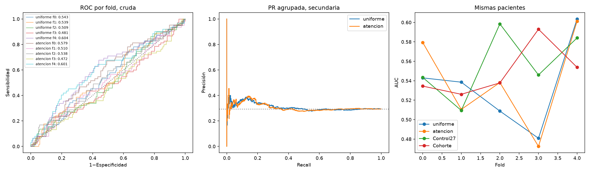
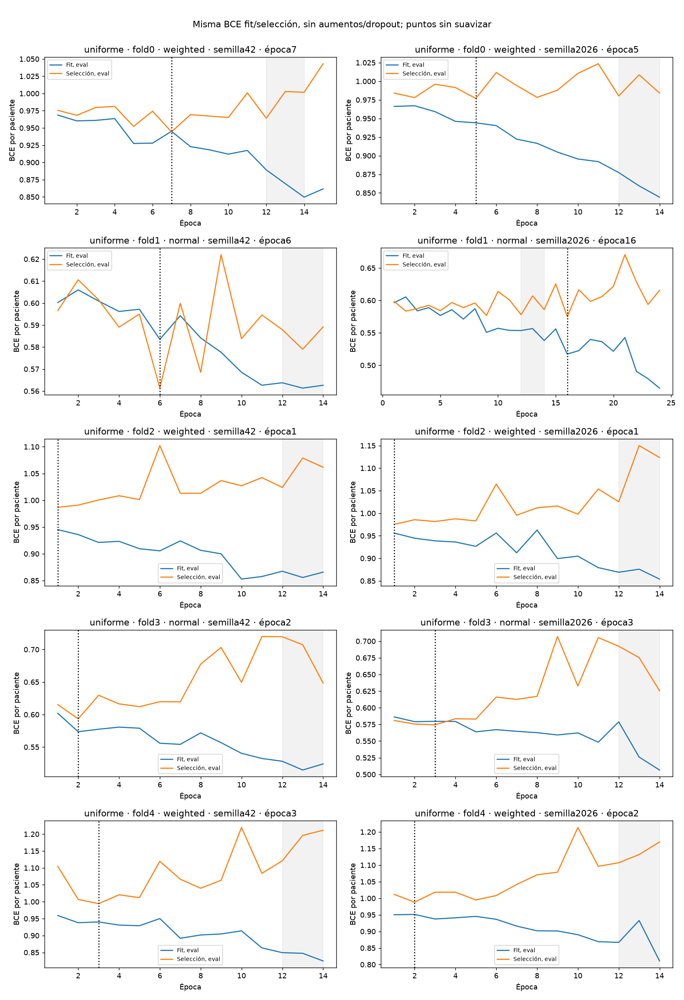
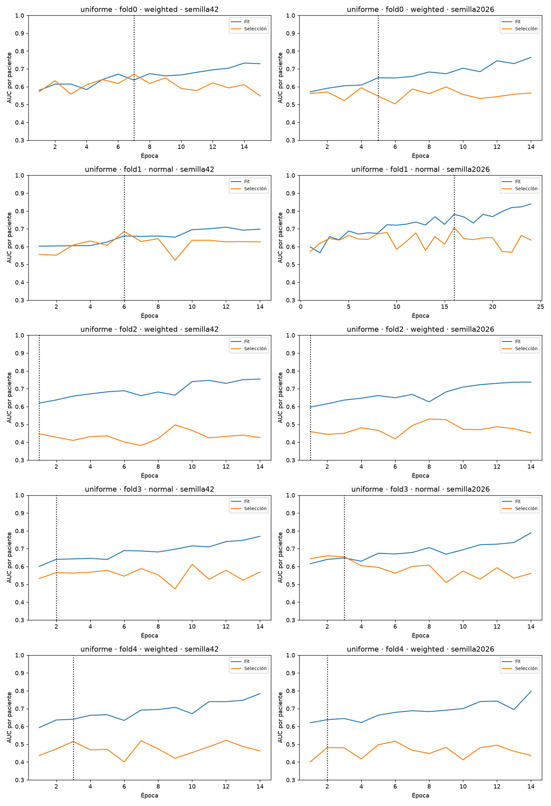
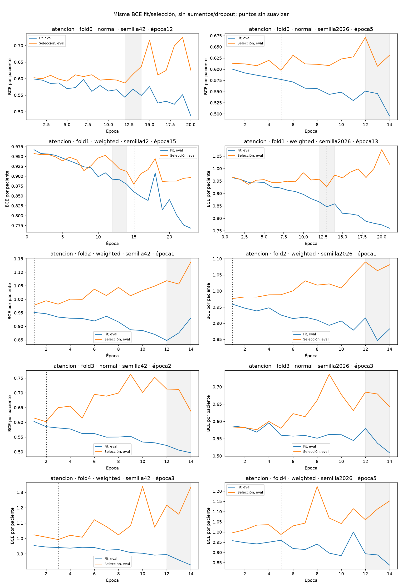
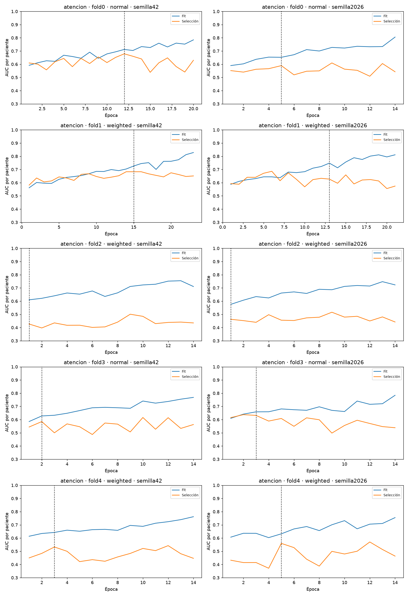
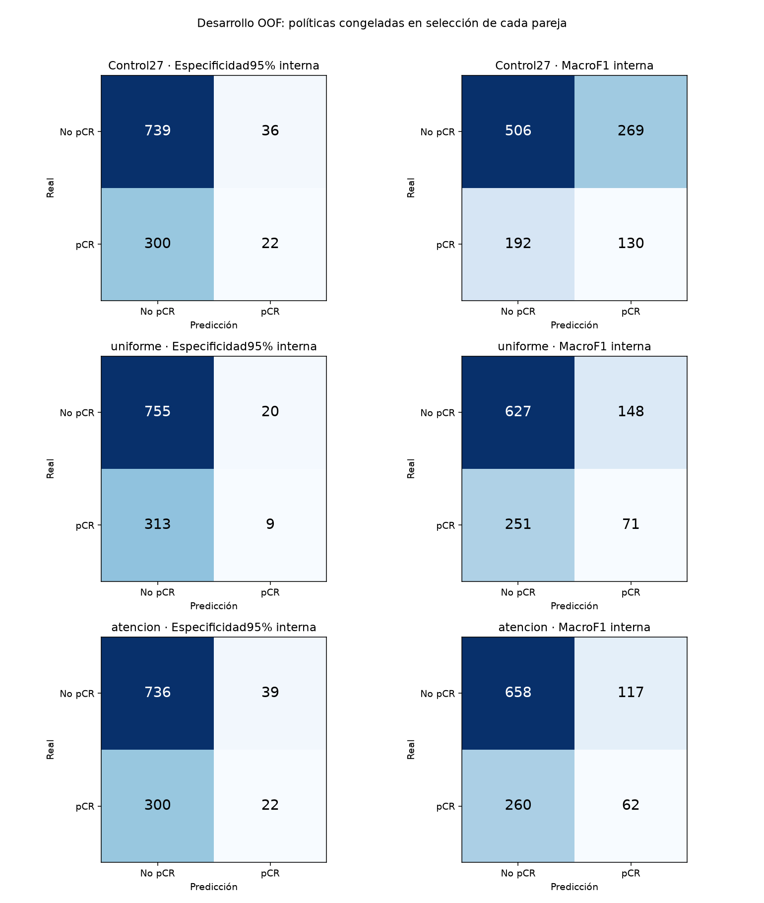

# CNN nativa con preservación espacial: familia insuficiente

26/10/2026. **Las dos recetas no mejoran el control y no alcanzan AUC 0,60.**
Se cierra esta familia sin réplica, activación de modelos ni otra búsqueda contra
el mismo exterior. Las diferencias puntuales son desfavorables; sus intervalos
incluyen cero, por lo que tampoco demuestran inferioridad poblacional.

**40/40 entrenamientos**, 615 épocas y 143,295 pasos
AdamW sin omisiones. Entrenamiento y evaluación: **91,9 minutos**.
Todo se conserva en main local, sin push.

## Investigación y arquitectura

[Zhang, ICML 2019](https://proceedings.mlr.press/v97/zhang19a.html) motiva filtrar
antes de submuestrear. [Woo et al., ECCV 2018](https://www.ecva.net/papers/eccv_2018/papers_ECCV/html/Sanghyun_Woo_Convolutional_Block_Attention_ECCV_2018_paper.php)
motiva ponderar características espacialmente. El [estudio empírico de pooling
en imagen médica](https://pmc.ncbi.nlm.nih.gov/articles/PMC8804673/) muestra efectos
dependientes de tarea. Estos trabajos no prueban beneficio en pCR. No se importan
sus redes o pesos, ni se implementa CBAM.

Se compararon dos CNN propias 2D desde cero. Entrada PRE/EARLY/LATE PNG gris
256×256 uint8 dividida entre 255, con diferencias firmadas derivadas dentro de
la red. Sin clínica, máscaras, preentrenados ni nuevas modalidades. Las fases no
son RGB y la geometría se transforma conjuntamente.

La vista completa de 256 píxeles pasa por cuatro bloques de dos convoluciones
3×3, BN y ReLU, con canales 16/32/64/96. Cada reducción usa máximo denso,
filtro binomial fijo y submuestreo; las cuadrículas son 128→64→32→16. La cabeza
es 96→32→1, con dropout 0,35 y dropout espacial 0,1. No se aprende la agregación
entre cortes: cada paciente conserva la media de probabilidades de todos ellos.

- **Media uniforme:** puerta espacial congelada en cero; 214.497 parámetros
  entrenables.
- **Atención espacial:** aprende esa puerta 1×1 desde cero; 214.593 parámetros
  entrenables. Mezcla mitad media uniforme con mitad softmax de temperatura 2.
  La ponderación está normalizada y acotada dentro del corte.

Ambas recetas comparten inicialización. La atención no es una segmentación
ni una explicación clínica validada. Frente a V007 cambian varios componentes:
resolución, capacidad y reducciones; no se puede atribuir todo a un factor.
Atención frente a uniforme ofrece una ablación secundaria más específica.

## Comparación equitativa y selección

Cinco folds por paciente, semillas 42/2026 y BCE normal/ponderada por receta:
40 ejecuciones. Mismos roles y entrenamiento que el control cerrado del ensayo 27:
745–746 pacientes fit, 132 de selección y 219–220 exteriores por fold.

AdamW, LR 0,0003, WD 0,01, batch 32, coseno de 40 épocas, mínimo observado 14,
paciencia 8 y mejora mínima de BCE 0,001. La BCEWithLogitsLoss por corte usa
contribución 1/n_cortes por paciente, normalizador fijo y pos_weight de pacientes
fit. El checkpoint principal minimiza la BCE interna por paciente; la pérdida
se elige por AUC de la pareja de dos semillas en selección, empate normal.

**Las diez elecciones de ambas recetas se congelaron antes de la primera
inferencia exterior de esta familia.** Se conserva un checkpoint anterior a la
época 14 cuando corresponde. La selección se reutiliza para checkpoint, pérdida,
calibración y umbral: sus métricas internas son optimistas.

## AUC por paciente en desarrollo

1.097 pacientes, 322 pCR y 775 no pCR. Contrastes principales: diferencia de
media de AUC cruda entre folds de cada receta frente al control equiparado.

| Modelo | Media AUC ± DE | AUC agrupada cruda | AUC agrupada calibrada por parejas |
|---|---:|---:|---:|
| Control equiparado 27 | 0,556270 ± 0,035413 | 0,512731 | — |
| Media uniforme | **0,534928 ± 0,045817** | 0,503827 | 0,501695 |
| Atención espacial | **0,540346 ± 0,051806** | 0,500649 | 0,523084 |

| Receta | Δ medio frente al control | IC97,5% del Δ | Folds con mejora puntual |
|---|---:|---|---:|
| Media uniforme | -0,021342 | [-0,067249; +0,024754] | 2/5 |
| Atención espacial | -0,015924 | [-0,059929; +0,030920] | 3/5 |

Bootstrap de 4.000 remuestreos pareados de pacientes, estratificados por fold y
clase. Los IC97,5% aplican Bonferroni para dos contrastes principales. Todos
incluyen cero. Atención−uniforme, secundario: delta **+0,005417**,
IC95% [-0,015719; +0,026738]. No demuestra beneficio adicional.

La referencia de prevalencias de cohorte, aprendidas solo en fit, tiene media
AUC 0,549012: ambas recetas quedan por debajo puntualmente. La V007 histórica
tenía media 0,576593 y test histórico 0,608376 con otro protocolo. Son referencias
descriptivas; **ese test no se ha reabierto**.



## Sobreajuste

| Receta | Época elegida mediana | Brecha AUC elegida | Brecha AUC final | Tendencia conjunta 1–14 |
|---|---:|---:|---:|---:|
| Media uniforme | 3,0 | 0,0890 | 0,2153 | 1/10 |
| Atención espacial | 4,0 | 0,0677 | 0,2542 | 1/10 |

Persiste sobreajuste. La mayoría de los mejores checkpoints llegan temprano;
conservar 14 épocas observadas no fuerza a elegirlas. Las curvas muestran la
BCE por paciente después de promediar todos los cortes, en eval, sin aumentos
ni dropout, con la misma ponderación en fit y selección. La BCE de optimización
por corte se conserva aparte. No se comparan magnitudes de BCE normal y ponderada
para elegir pérdida ni se suavizan los puntos observados.

El diagnóstico de tendencia conjunta usa pendiente negativa y media de épocas
12–14 menor que 1–3 en ambas pérdidas. No exige monotonía ni prueba generalización.






## Políticas y errores

Platt no negativo C=1 y umbrales de máxima sensibilidad con especificidad interna
objetivo 95%, y máximo macroF1 secundario. Se congelan en selección de la misma
pareja. No se elige una política según sus resultados exteriores ni se ajustan
umbrales con exterior.

| Receta y política interna | Sensibilidad | Especificidad | F1 pCR | MacroF1 | FP | FN |
|---|---:|---:|---:|---:|---:|---:|
| Control · Esp. 95% | 6,83% | 95,35% | 0,1158 | 0,4653 | 36 | 300 |
| Control · MacroF1 | 40,37% | 65,29% | 0,3606 | 0,5238 | 269 | 192 |
| Media uniforme · Esp. 95% | 2,80% | 97,42% | 0,0513 | 0,4353 | 20 | 313 |
| Media uniforme · MacroF1 | 22,05% | 80,90% | 0,2625 | 0,5105 | 148 | 251 |
| Atención espacial · Esp. 95% | 6,83% | 94,97% | 0,1149 | 0,4638 | 39 | 300 |
| Atención espacial · MacroF1 | 19,25% | 84,90% | 0,2475 | 0,5124 | 117 | 260 |

Positivo significa respuesta patológica completa. Un FP predice respuesta
completa donde no la hubo; un FN omite una respuesta completa real. MacroF1 no
fija por sí sola utilidad clínica. El objetivo interno de especificidad no se
garantiza en exterior. Decir siempre «no pCR» da macroF1 0,413996 y exactitud
70,65% por el desbalance. Precisión, recall y F1 de ambas clases quedan en
politicas_clasificacion.json.



## Calidad de probabilidades y análisis secundarios

| Receta | AP agrupada cruda | Brier calibrado por pareja | Log-loss calibrada por pareja |
|---|---:|---:|---:|
| Media uniforme | 0,308754 | 0,210670 | 0,620862 |
| Atención espacial | 0,306692 | 0,212174 | 0,637519 |

La probabilidad constante de prevalencia fit por fold obtiene Brier
**0,207726** y log-loss **0,606147**: ambas recetas
son peores. Este comparador descriptivo se añadió al cierre y no se utilizó
para seleccionar modelos. La calibración de parejas no valida una política
para un ensemble final de diez redes.

Las reglas secundarias por mejor AUC y BCE fija tampoco alcanzan media 0,60.
Métricas completas y AUC por cohorte/fold están en comparacion.json y
auc_por_cohorte_y_fold.csv de cada receta. Las AUC agrupadas por cohorte mezclan
puntuaciones de distintos modelos y son secundarias. No se elige después el
mejor de estos análisis para sustituir el resultado principal.

## Verificación, límites y cierre

Pasan **117 tests antes de entrenar y 104 tras retirar el candidato**. La prueba
sintética del coordinador confirmó las 40 llamadas y la congelación de diez
elecciones antes de evaluar exterior; no contó como entrenamiento real.

Se verificaron checkpoints, pasos AdamW reales, finitud, etiquetas/roles y AUC
mediante todas las parejas positivo−negativo. Los **20 pesos seleccionados**
cargan y predicen en un proceso aislado solo PyTorch: error máximo **0** frente
a la implementación del ensayo. La reproducción CPU/GPU de una paciente de
selección por peso tiene error máximo **2.1e-07**,
con tolerancia 1e-5. Es comprobación técnica, no validación clínica.

Fuentes, roles, metadatos, control y 620 archivos históricos se verificaron por
hash. Los 32.835 PNG de train conservan tamaño/mtime auditados. Las versiones
V001–V008 y las aplicaciones quedan intactas.

Todo es desarrollo adaptativo: el train ya tiene antecedentes y los folds
comparten datos de aprendizaje. Los intervalos no incluyen toda la variabilidad
de entrenamiento ni la búsqueda histórica. La CV mezcla cohortes y no prueba
un dominio completamente nuevo. **Test y privada han permanecido cerrados.**

Ninguna receta supera el gate prefijado de réplica: media AUC≥0,60, agrupada
calibrada por parejas≥0,60, delta≥0,01, límite inferior IC97,5%>0 y mejora en
3/5 folds. No se inicia réplica ni otra variante contra este mismo exterior.
No se concluye que toda atención o reducción suavizada falle.

Código y pruebas retirados del árbol activo conforme a CONTRIBUTING.md,
conservados en el commit local **f30a6dbaa71ceec3bb76ad337de0ecd9560a9963** de main.
Los pesos de trabajo permanecen locales en runs/ de cada receta, ignorados por
Git. No se crea una versión productiva, no se activan modelos ni se hace push.

```bash
git show f30a6dbaa71ceec3bb76ad337de0ecd9560a9963:src/cancer_mama/preservacion_espacial.py
```

El protocolo documental añade el cierre después del ensayo; la fuente congelada
se comprueba con ese commit. verificacion_final.json corresponde a la entrega
editorial actual; verificacion_ejecucion.json conserva el inventario previo al
cierre. Los estados iniciales de cada receta se preservan en estado_preparacion.json;
el estado de progreso usado durante la ejecución es el de la familia.
